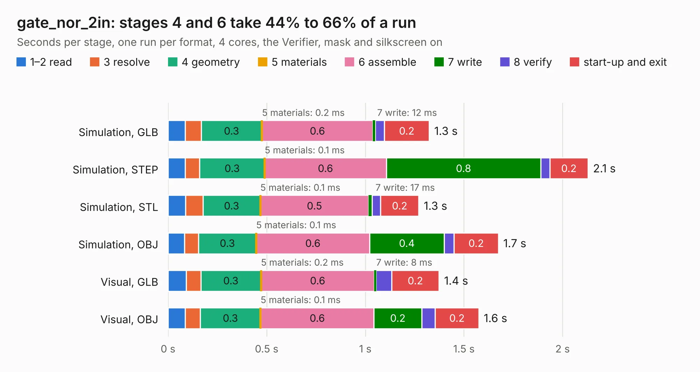

# 2850. gate_nor_2in

Board 2,850 of the 3,129 of [Corpus Testing](../Corpus-Testing.md), on [Corpus Page 27](../CorpusTestingPages/Corpus-Testing-27.md#2850-gate_nor_2in).

| Mode and format | 1–2 read | 3 resolve | 4 geometry | 5 materials | 6 assemble | 7 write | 8 verify | start-up and exit | Total |
|---|---:|---:|---:|---:|---:|---:|---:|---:|---:|
| Simulation, GLB | 87&nbsp;ms | 81&nbsp;ms | 0.3 | 0.2&nbsp;ms | 0.6 | 12&nbsp;ms | 46&nbsp;ms | 0.2 | 1.3 |
| Simulation, STEP | 86&nbsp;ms | 74&nbsp;ms | 0.3 | 0.1&nbsp;ms | 0.6 | 0.8 | 45&nbsp;ms | 0.2 | 2.1 |
| Simulation, STL | 88&nbsp;ms | 88&nbsp;ms | 0.3 | 0.1&nbsp;ms | 0.5 | 17&nbsp;ms | 43&nbsp;ms | 0.2 | 1.3 |
| Simulation, OBJ | 83&nbsp;ms | 72&nbsp;ms | 0.3 | 0.1&nbsp;ms | 0.6 | 0.4 | 50&nbsp;ms | 0.2 | 1.7 |
| Visual, GLB | 92&nbsp;ms | 75&nbsp;ms | 0.3 | 0.2&nbsp;ms | 0.6 | 8&nbsp;ms | 80&nbsp;ms | 0.2 | 1.4 |
| Visual, OBJ | 87&nbsp;ms | 76&nbsp;ms | 0.3 | 0.1&nbsp;ms | 0.6 | 0.2 | 69&nbsp;ms | 0.2 | 1.6 |

<table align="center"><tr><td valign="top">

| Board | Repo: [tmarhguy/alu](https://github.com/tmarhguy/alu) Board: `gate_nor_2in.kicad_pcb` |
|---|---|
| Folder | schematics / kicad / modules / gates / gate_nor / gate_nor_2in_1bit |
| Complexity | 104&nbsp;/&nbsp;1000 (size&nbsp;89, features&nbsp;15) |
| KESE&nbsp;features | through vias |
| Tested | 9th November 2026 |
| Copper&nbsp;layers | 2 |
| File&nbsp;format | KiCad 9 (20241229) |
| Parts,&nbsp;tracks,&nbsp;vias | 4, 24, 1 |
| Triangles,&nbsp;simulation | 66,598 in 16 parts |
| Verifier | PASS in all six runs |

</td><td valign="top">

<table>
<tr><th>File type</th><th>File size</th><th>Peak memory used</th></tr>
<tr><th colspan="3" align="left">Simulation</th></tr>
<tr><td>GLB</td><td align="right">2.2&nbsp;MB</td><td align="right">71&nbsp;MB</td></tr>
<tr><td>STEP</td><td align="right">8.7&nbsp;MB</td><td align="right">180&nbsp;MB</td></tr>
<tr><td>STL</td><td align="right">3.3&nbsp;MB</td><td align="right">72&nbsp;MB</td></tr>
<tr><td>OBJ</td><td align="right">6.3&nbsp;MB</td><td align="right">97&nbsp;MB</td></tr>
<tr><th colspan="3" align="left">Visual</th></tr>
<tr><td>GLB</td><td align="right">1.4&nbsp;MB</td><td align="right">102&nbsp;MB</td></tr>
<tr><td>OBJ</td><td align="right">3.9&nbsp;MB</td><td align="right">116&nbsp;MB</td></tr>
</table>

</td></tr></table>

| Previous | Next |
|:---|---:|
| [2849. gate_nand_2in](b2849b_alu_gate-nand-2in.md) | [2851. gate_or_2in](b2851b_alu_gate-or-2in.md) |
