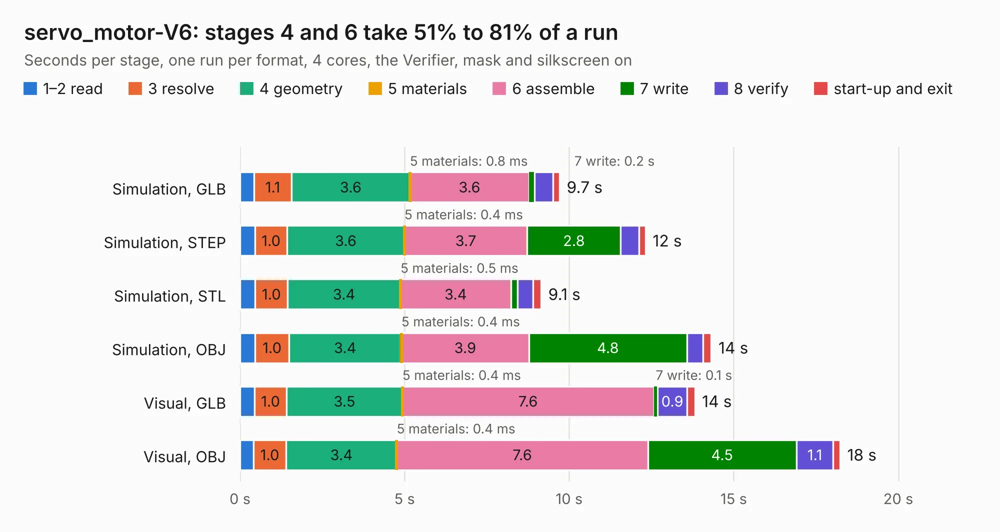

# 2850. servo_motor-V6

Board 2,850 of the 3,108 of [Corpus Testing](../Corpus-Testing.md), on [Corpus Page 27](../CorpusTestingPages/Corpus-Testing-27.md#2850-servo_motor-v6).

| Mode and format | 1–2 read | 3 resolve | 4 geometry | 5 materials | 6 assemble | 7 write | 8 verify | start-up and exit | Total |
|---|---:|---:|---:|---:|---:|---:|---:|---:|---:|
| Simulation, GLB | 0.4 | 1.1 | 3.6 | 0.8&nbsp;ms | 3.6 | 0.2 | 0.6 | 0.2 | 9.7 |
| Simulation, STEP | 0.5 | 1.0 | 3.6 | 0.4&nbsp;ms | 3.7 | 2.8 | 0.5 | 0.2 | 12.3 |
| Simulation, STL | 0.5 | 1.0 | 3.4 | 0.5&nbsp;ms | 3.4 | 0.2 | 0.5 | 0.2 | 9.1 |
| Simulation, OBJ | 0.5 | 1.0 | 3.4 | 0.4&nbsp;ms | 3.9 | 4.8 | 0.5 | 0.2 | 14.3 |
| Visual, GLB | 0.4 | 1.0 | 3.5 | 0.4&nbsp;ms | 7.6 | 0.1 | 0.9 | 0.2 | 13.8 |
| Visual, OBJ | 0.4 | 1.0 | 3.4 | 0.4&nbsp;ms | 7.6 | 4.5 | 1.1 | 0.2 | 18.2 |

<table align="center"><tr><td valign="top">

| Board | Repo: [tomrodinger/servomotor](https://github.com/tomrodinger/servomotor) Board: `servo_motor-V6.kicad_pcb` |
|---|---|
| Folder | PCB / Servomotor2 / V6 |
| Complexity | 286&nbsp;/&nbsp;1000 (size&nbsp;186, features&nbsp;100) |
| KESE&nbsp;features | through vias, custom pads, rounded, trapezoid or chamfered pads, filled zones, copper drawings, stack-up, dielectric εr and tanδ |
| Tested | 9th November 2026 |
| Copper&nbsp;layers | 2 |
| File&nbsp;format | KiCad 7 (20221018) |
| Parts,&nbsp;tracks,&nbsp;vias | 92, 843, 214 |
| Triangles,&nbsp;simulation | 894,130 in 89 parts |
| Verifier | PASS in all six runs |

</td><td valign="top">

<table>
<tr><th>File type</th><th>File size</th><th>Peak memory used</th></tr>
<tr><th colspan="3" align="left">Simulation</th></tr>
<tr><td>GLB</td><td align="right">31&nbsp;MB</td><td align="right">436&nbsp;MB</td></tr>
<tr><td>STEP</td><td align="right">161&nbsp;MB</td><td align="right">522&nbsp;MB</td></tr>
<tr><td>STL</td><td align="right">45&nbsp;MB</td><td align="right">417&nbsp;MB</td></tr>
<tr><td>OBJ</td><td align="right">92&nbsp;MB</td><td align="right">637&nbsp;MB</td></tr>
<tr><th colspan="3" align="left">Visual</th></tr>
<tr><td>GLB</td><td align="right">29&nbsp;MB</td><td align="right">626&nbsp;MB</td></tr>
<tr><td>OBJ</td><td align="right">86&nbsp;MB</td><td align="right">633&nbsp;MB</td></tr>
</table>

</td></tr></table>

| Previous | Next |
|:---|---:|
| [2849. servo_motor](b2849b_servomotor_PCB-Servomotor2-V5_servo-motor.md) | [2851. 1.0](b2851b_servomotor_1-0.md) |
