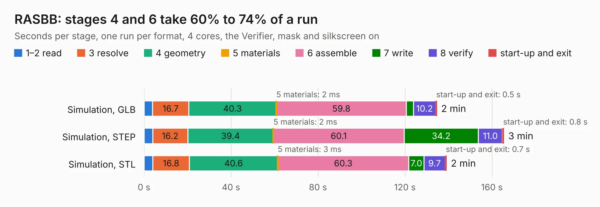

# 2853. RASBB

Board 2,853 of the 3,126 of [Corpus Testing](../Corpus-Testing.md), on [Corpus Page 27](../CorpusTestingPages/Corpus-Testing-27.md#2853-rasbb).

| Mode and format | 1–2 read | 3 resolve | 4 geometry | 5 materials | 6 assemble | 7 write | 8 verify | start-up and exit | Total |
|---|---:|---:|---:|---:|---:|---:|---:|---:|---:|
| Simulation, GLB | 3.9 | 16.7 | 40.3 | 2&nbsp;ms | 59.8 | 3.3 | 10.2 | 0.5 | 134.7 |
| Simulation, STEP | 3.9 | 16.2 | 39.4 | 2&nbsp;ms | 60.1 | 34.2 | 11.0 | 0.8 | 165.6 |
| Simulation, STL | 4.0 | 16.8 | 40.6 | 3&nbsp;ms | 60.3 | 7.0 | 9.7 | 0.7 | 139.2 |
| Simulation, OBJ | 3.6 | 15.6 | 35.9 | 2&nbsp;ms | 56.6 | 97.5 | 9.2 | 0.5 | 219.0 |
| Visual, GLB | 3.8 | 15.7 | 34.6 | 3&nbsp;ms | 128.7 | 1.5 | 14.6 | 0.4 | 199.4 |
| Visual, OBJ | 3.6 | 15.2 | 34.8 | 3&nbsp;ms | 129.3 | 41.0 | 13.8 | 0.4 | 238.2 |

<table align="center"><tr><td valign="top">

| Board | Repo: [tobias-dg3yev/ra-sentinel](https://github.com/tobias-dg3yev/ra-sentinel) Board: `RASBB.kicad_pcb` |
|---|---|
| Folder | RASBB / Hardware / Rev.B / Design |
| Complexity | 482&nbsp;/&nbsp;1000 (size&nbsp;347, features&nbsp;135) |
| KESE&nbsp;features | through vias, slotted holes, custom pads, rounded, trapezoid or chamfered pads, arc tracks, filled zones, copper drawings, copper text, stack-up, dielectric εr and tanδ |
| Tested | 9th November 2026 |
| Copper&nbsp;layers | 8 |
| File&nbsp;format | KiCad 10 (20260206) |
| Parts,&nbsp;tracks,&nbsp;vias | 616, 12,047, 1,915 |
| Triangles,&nbsp;simulation | 16,458,470 in 765 parts |
| Verifier | PASS in all six runs |

</td><td valign="top">

<table>
<tr><th>File type</th><th>File size</th><th>Peak memory used</th></tr>
<tr><th colspan="3" align="left">Simulation</th></tr>
<tr><td>GLB</td><td align="right">547&nbsp;MB</td><td align="right">3.6&nbsp;GB</td></tr>
<tr><td>STEP</td><td align="right">1.7&nbsp;GB</td><td align="right">4.9&nbsp;GB</td></tr>
<tr><td>STL</td><td align="right">823&nbsp;MB</td><td align="right">3.7&nbsp;GB</td></tr>
<tr><td>OBJ</td><td align="right">1.8&nbsp;GB</td><td align="right">10&nbsp;GB</td></tr>
<tr><th colspan="3" align="left">Visual</th></tr>
<tr><td>GLB</td><td align="right">260&nbsp;MB</td><td align="right">4.4&nbsp;GB</td></tr>
<tr><td>OBJ</td><td align="right">875&nbsp;MB</td><td align="right">5.7&nbsp;GB</td></tr>
</table>

</td></tr></table>

| Previous | Next |
|:---|---:|
| [2852. RASBB](b2852b_ra-sentinel_RASBB-Hardware-Rev-A-Design_RASBB.md) | [2854. RASBB](b2854b_ra-sentinel_RASBB-Hardware-Rev-C-Design_RASBB.md) |
