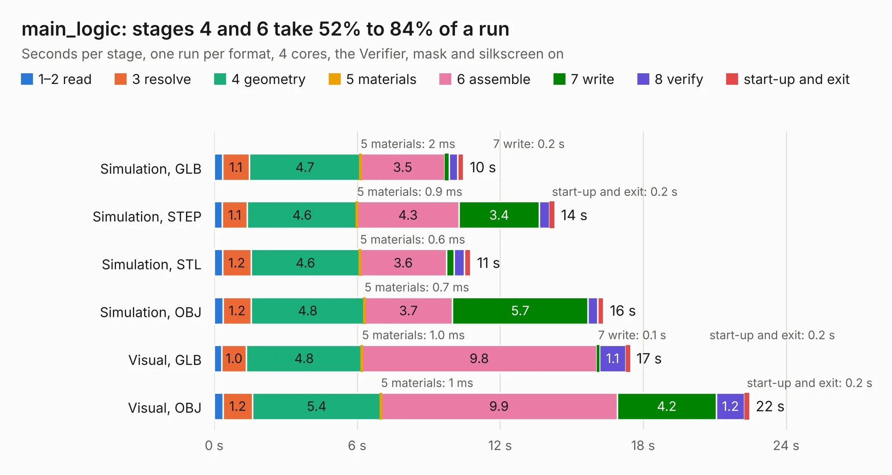

# 2854 main_logic

Board 2,854 of the 3,138 of [Corpus Testing](../Corpus-Testing.md), on [Corpus Page 27](../CorpusTestingPages/Corpus-Testing-27.md#2854-main_logic).

| Mode and format | 1–2 read | 3 resolve | 4 geometry | 5 materials | 6 assemble | 7 write | 8 verify | start-up and exit | Total |
|---|---:|---:|---:|---:|---:|---:|---:|---:|---:|
| Simulation, GLB | 0.3 | 1.1 | 4.7 | 2&nbsp;ms | 3.5 | 0.2 | 0.4 | 0.2 | 10.5 |
| Simulation, STEP | 0.3 | 1.1 | 4.6 | 0.9&nbsp;ms | 4.3 | 3.4 | 0.4 | 0.2 | 14.3 |
| Simulation, STL | 0.4 | 1.2 | 4.6 | 0.6&nbsp;ms | 3.6 | 0.3 | 0.4 | 0.3 | 10.8 |
| Simulation, OBJ | 0.4 | 1.2 | 4.8 | 0.7&nbsp;ms | 3.7 | 5.7 | 0.4 | 0.3 | 16.3 |
| Visual, GLB | 0.3 | 1.0 | 4.8 | 1.0&nbsp;ms | 9.8 | 0.1 | 1.1 | 0.2 | 17.5 |
| Visual, OBJ | 0.4 | 1.2 | 5.4 | 1&nbsp;ms | 9.9 | 4.2 | 1.2 | 0.2 | 22.5 |

<table align="center"><tr><td valign="top">

| Board | Repo: [tmarhguy/alu](https://github.com/tmarhguy/alu) Board: `main_logic.kicad_pcb` |
|---|---|
| Folder | schematics / kicad / boards / main_logic |
| Complexity | 79&nbsp;/&nbsp;1000 (size&nbsp;69, features&nbsp;10) |
| KESE&nbsp;features | rounded, trapezoid or chamfered pads |
| Tested | 9th November 2026 |
| Copper&nbsp;layers | 2 |
| File&nbsp;format | KiCad 9 (20241229) |
| Parts,&nbsp;tracks,&nbsp;vias | 122, 0, 0 |
| Triangles,&nbsp;simulation | 1,212,090 in 206 parts |
| Note | mostly unrouted |
| Verifier | PASS in all six runs |

</td><td valign="top">

<table>
<tr><th>File type</th><th>File size</th><th>Peak memory used</th></tr>
<tr><th colspan="3" align="left">Simulation</th></tr>
<tr><td>GLB</td><td align="right">41&nbsp;MB</td><td align="right">503&nbsp;MB</td></tr>
<tr><td>STEP</td><td align="right">194&nbsp;MB</td><td align="right">639&nbsp;MB</td></tr>
<tr><td>STL</td><td align="right">61&nbsp;MB</td><td align="right">533&nbsp;MB</td></tr>
<tr><td>OBJ</td><td align="right">127&nbsp;MB</td><td align="right">843&nbsp;MB</td></tr>
<tr><th colspan="3" align="left">Visual</th></tr>
<tr><td>GLB</td><td align="right">32&nbsp;MB</td><td align="right">633&nbsp;MB</td></tr>
<tr><td>OBJ</td><td align="right">97&nbsp;MB</td><td align="right">744&nbsp;MB</td></tr>
</table>

</td></tr></table>

| Previous | Next |
|:---|---:|
| [2853 main_control](b2853b_alu_main-control.md) | [2855 gate_and_2in](b2855b_alu_gate-and-2in.md) |
