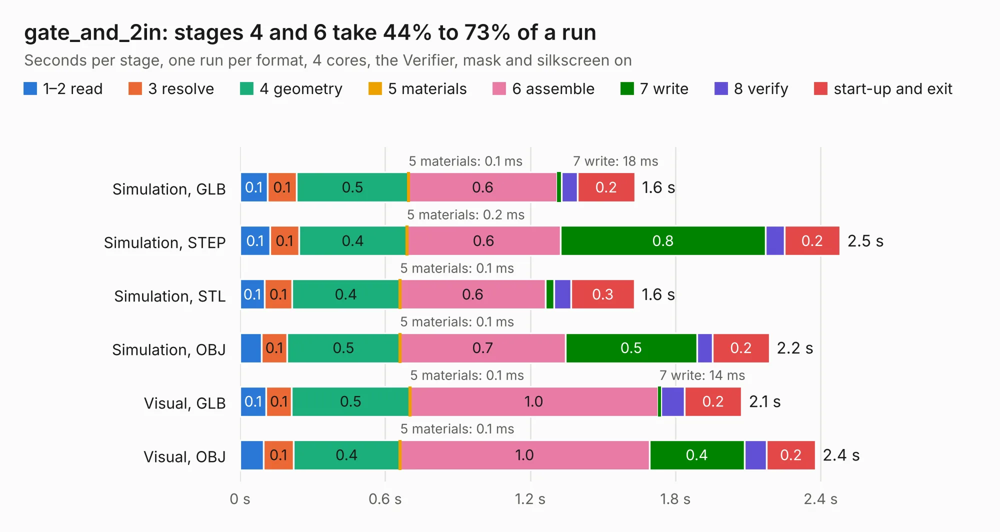

# 2855 gate_and_2in

Board 2,855 of the 3,138 of [Corpus Testing](../Corpus-Testing.md), on [Corpus Page 27](../CorpusTestingPages/Corpus-Testing-27.md#2855-gate_and_2in).

| Mode and format | 1–2 read | 3 resolve | 4 geometry | 5 materials | 6 assemble | 7 write | 8 verify | start-up and exit | Total |
|---|---:|---:|---:|---:|---:|---:|---:|---:|---:|
| Simulation, GLB | 0.1 | 0.1 | 0.5 | 0.1&nbsp;ms | 0.6 | 18&nbsp;ms | 67&nbsp;ms | 0.2 | 1.6 |
| Simulation, STEP | 0.1 | 0.1 | 0.4 | 0.2&nbsp;ms | 0.6 | 0.8 | 78&nbsp;ms | 0.2 | 2.5 |
| Simulation, STL | 0.1 | 0.1 | 0.4 | 0.1&nbsp;ms | 0.6 | 36&nbsp;ms | 70&nbsp;ms | 0.3 | 1.6 |
| Simulation, OBJ | 88&nbsp;ms | 0.1 | 0.5 | 0.1&nbsp;ms | 0.7 | 0.5 | 65&nbsp;ms | 0.2 | 2.2 |
| Visual, GLB | 0.1 | 0.1 | 0.5 | 0.1&nbsp;ms | 1.0 | 14&nbsp;ms | 97&nbsp;ms | 0.2 | 2.1 |
| Visual, OBJ | 96&nbsp;ms | 0.1 | 0.4 | 0.1&nbsp;ms | 1.0 | 0.4 | 91&nbsp;ms | 0.2 | 2.4 |

<table align="center"><tr><td valign="top">

| Board | Repo: [tmarhguy/alu](https://github.com/tmarhguy/alu) Board: `gate_and_2in.kicad_pcb` |
|---|---|
| Folder | schematics / kicad / modules / gates / gate_and / gate_and_2in |
| Complexity | 119&nbsp;/&nbsp;1000 (size&nbsp;104, features&nbsp;15) |
| KESE&nbsp;features | through vias |
| Tested | 9th November 2026 |
| Copper&nbsp;layers | 2 |
| File&nbsp;format | KiCad 9 (20241229) |
| Parts,&nbsp;tracks,&nbsp;vias | 6, 42, 5 |
| Triangles,&nbsp;simulation | 103,594 in 17 parts |
| Verifier | PASS in all six runs |

</td><td valign="top">

<table>
<tr><th>File type</th><th>File size</th><th>Peak memory used</th></tr>
<tr><th colspan="3" align="left">Simulation</th></tr>
<tr><td>GLB</td><td align="right">3.4&nbsp;MB</td><td align="right">174&nbsp;MB</td></tr>
<tr><td>STEP</td><td align="right">13&nbsp;MB</td><td align="right">187&nbsp;MB</td></tr>
<tr><td>STL</td><td align="right">5.2&nbsp;MB</td><td align="right">180&nbsp;MB</td></tr>
<tr><td>OBJ</td><td align="right">9.8&nbsp;MB</td><td align="right">175&nbsp;MB</td></tr>
<tr><th colspan="3" align="left">Visual</th></tr>
<tr><td>GLB</td><td align="right">2.2&nbsp;MB</td><td align="right">151&nbsp;MB</td></tr>
<tr><td>OBJ</td><td align="right">6.2&nbsp;MB</td><td align="right">150&nbsp;MB</td></tr>
</table>

</td></tr></table>

| Previous | Next |
|:---|---:|
| [2854 main_logic](b2854b_alu_main-logic.md) | [2856 gate_and_4in](b2856b_alu_gate-and-4in.md) |
