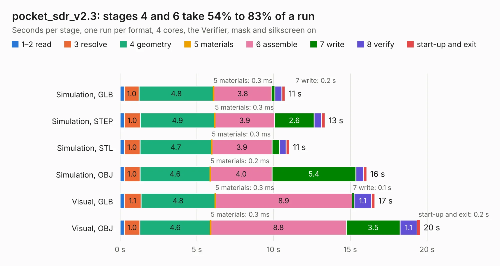

# 2857. pocket_sdr_v2.3

Board 2,857 of the 3,126 of [Corpus Testing](../Corpus-Testing.md), on [Corpus Page 27](../CorpusTestingPages/Corpus-Testing-27.md#2857-pocket_sdr_v23).

| Mode and format | 1–2 read | 3 resolve | 4 geometry | 5 materials | 6 assemble | 7 write | 8 verify | start-up and exit | Total |
|---|---:|---:|---:|---:|---:|---:|---:|---:|---:|
| Simulation, GLB | 0.3 | 1.0 | 4.8 | 0.3&nbsp;ms | 3.8 | 0.2 | 0.5 | 0.2 | 10.8 |
| Simulation, STEP | 0.3 | 1.0 | 4.9 | 0.3&nbsp;ms | 3.9 | 2.6 | 0.5 | 0.2 | 13.3 |
| Simulation, STL | 0.3 | 1.0 | 4.7 | 0.3&nbsp;ms | 3.9 | 0.5 | 0.4 | 0.2 | 11.0 |
| Simulation, OBJ | 0.3 | 1.0 | 4.6 | 0.2&nbsp;ms | 4.0 | 5.4 | 0.5 | 0.2 | 16.1 |
| Visual, GLB | 0.3 | 1.1 | 4.8 | 0.3&nbsp;ms | 8.9 | 0.1 | 1.1 | 0.2 | 16.6 |
| Visual, OBJ | 0.3 | 1.0 | 4.6 | 0.3&nbsp;ms | 8.8 | 3.5 | 1.1 | 0.2 | 19.5 |

<table align="center"><tr><td valign="top">

| Board | Repo: [tomojitakasu/PocketSDR](https://github.com/tomojitakasu/PocketSDR) Board: `pocket_sdr_v2.3.kicad_pcb` |
|---|---|
| Folder | FE_2CH / HW / v2.3 |
| Complexity | 351&nbsp;/&nbsp;1000 (size&nbsp;251, features&nbsp;100) |
| KESE&nbsp;features | through vias, slotted holes, rounded, trapezoid or chamfered pads, arc tracks, filled zones, stack-up, dielectric εr and tanδ |
| Tested | 9th November 2026 |
| Copper&nbsp;layers | 4 |
| File&nbsp;format | KiCad 7 (20221018) |
| Parts,&nbsp;tracks,&nbsp;vias | 76, 792, 240 |
| Triangles,&nbsp;simulation | 1,335,824 in 94 parts |
| Verifier | PASS in all six runs |

</td><td valign="top">

<table>
<tr><th>File type</th><th>File size</th><th>Peak memory used</th></tr>
<tr><th colspan="3" align="left">Simulation</th></tr>
<tr><td>GLB</td><td align="right">46&nbsp;MB</td><td align="right">583&nbsp;MB</td></tr>
<tr><td>STEP</td><td align="right">187&nbsp;MB</td><td align="right">686&nbsp;MB</td></tr>
<tr><td>STL</td><td align="right">67&nbsp;MB</td><td align="right">523&nbsp;MB</td></tr>
<tr><td>OBJ</td><td align="right">138&nbsp;MB</td><td align="right">910&nbsp;MB</td></tr>
<tr><th colspan="3" align="left">Visual</th></tr>
<tr><td>GLB</td><td align="right">30&nbsp;MB</td><td align="right">670&nbsp;MB</td></tr>
<tr><td>OBJ</td><td align="right">90&nbsp;MB</td><td align="right">688&nbsp;MB</td></tr>
</table>

</td></tr></table>

| Previous | Next |
|:---|---:|
| [2856. RASRF2400WBMC](b2856b_ra-sentinel_RASRF2400WBMC.md) | [2858. v3.0](b2858b_PocketSDR_v3-0.md) |
