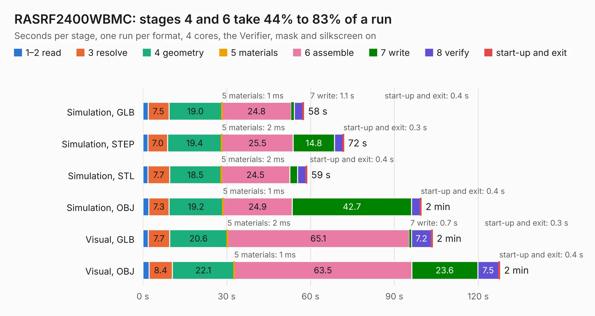

# 2857. RASRF2400WBMC

Board 2,857 of the 3,127 of [Corpus Testing](../Corpus-Testing.md), on [Corpus Page 27](../CorpusTestingPages/Corpus-Testing-27.md#2857-rasrf2400wbmc).

| Mode and format | 1–2 read | 3 resolve | 4 geometry | 5 materials | 6 assemble | 7 write | 8 verify | start-up and exit | Total |
|---|---:|---:|---:|---:|---:|---:|---:|---:|---:|
| Simulation, GLB | 1.9 | 7.5 | 19.0 | 1&nbsp;ms | 24.8 | 1.1 | 3.0 | 0.4 | 57.6 |
| Simulation, STEP | 1.8 | 7.0 | 19.4 | 2&nbsp;ms | 25.5 | 14.8 | 3.0 | 0.3 | 72.0 |
| Simulation, STL | 1.8 | 7.7 | 18.5 | 2&nbsp;ms | 24.5 | 2.8 | 3.0 | 0.4 | 58.7 |
| Simulation, OBJ | 2.1 | 7.3 | 19.2 | 1&nbsp;ms | 24.9 | 42.7 | 3.1 | 0.4 | 99.7 |
| Visual, GLB | 2.0 | 7.7 | 20.6 | 2&nbsp;ms | 65.1 | 0.7 | 7.2 | 0.3 | 103.6 |
| Visual, OBJ | 2.2 | 8.4 | 22.1 | 1&nbsp;ms | 63.5 | 23.6 | 7.5 | 0.4 | 127.8 |

<table align="center"><tr><td valign="top">

| Board | Repo: [tobias-dg3yev/ra-sentinel](https://github.com/tobias-dg3yev/ra-sentinel) Board: `RASRF2400WBMC.kicad_pcb` |
|---|---|
| Folder | RASRF2400WBMC / Hardware / KiCad |
| Complexity | 394&nbsp;/&nbsp;1000 (size&nbsp;304, features&nbsp;90) |
| KESE&nbsp;features | through vias, rounded, trapezoid or chamfered pads, arc tracks, filled zones, stack-up, dielectric εr and tanδ |
| Tested | 10th November 2026 |
| Copper&nbsp;layers | 6 |
| File&nbsp;format | KiCad 10 (20260206) |
| Parts,&nbsp;tracks,&nbsp;vias | 388, 4,374, 921 |
| Triangles,&nbsp;simulation | 6,665,854 in 375 parts |
| Verifier | PASS in all six runs |

</td><td valign="top">

<table>
<tr><th>File type</th><th>File size</th><th>Peak memory used</th></tr>
<tr><th colspan="3" align="left">Simulation</th></tr>
<tr><td>GLB</td><td align="right">223&nbsp;MB</td><td align="right">2.2&nbsp;GB</td></tr>
<tr><td>STEP</td><td align="right">737&nbsp;MB</td><td align="right">2.5&nbsp;GB</td></tr>
<tr><td>STL</td><td align="right">333&nbsp;MB</td><td align="right">2.1&nbsp;GB</td></tr>
<tr><td>OBJ</td><td align="right">723&nbsp;MB</td><td align="right">4.2&nbsp;GB</td></tr>
<tr><th colspan="3" align="left">Visual</th></tr>
<tr><td>GLB</td><td align="right">124&nbsp;MB</td><td align="right">2.1&nbsp;GB</td></tr>
<tr><td>OBJ</td><td align="right">407&nbsp;MB</td><td align="right">2.7&nbsp;GB</td></tr>
</table>

</td></tr></table>

| Previous | Next |
|:---|---:|
| [2856. RASRF](b2856b_ra-sentinel_RASRF.md) | [2858. pocket_sdr_v2.3](b2858b_PocketSDR_pocket-sdr-v2-3.md) |
