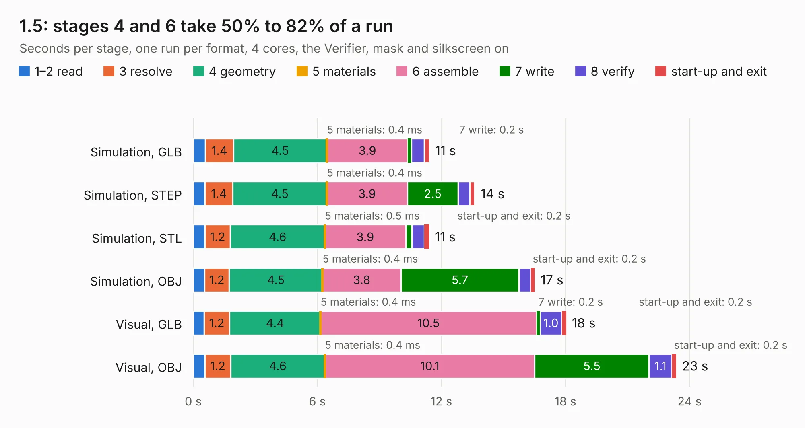

# 2858. 1.5

Board 2,858 of the 3,112 of [Corpus Testing](../Corpus-Testing.md), on [Corpus Page 27](../CorpusTestingPages/Corpus-Testing-27.md#2858-15).

| Mode and format | 1–2 read | 3 resolve | 4 geometry | 5 materials | 6 assemble | 7 write | 8 verify | start-up and exit | Total |
|---|---:|---:|---:|---:|---:|---:|---:|---:|---:|
| Simulation, GLB | 0.6 | 1.4 | 4.5 | 0.4&nbsp;ms | 3.9 | 0.2 | 0.6 | 0.2 | 11.4 |
| Simulation, STEP | 0.6 | 1.4 | 4.5 | 0.4&nbsp;ms | 3.9 | 2.5 | 0.6 | 0.2 | 13.6 |
| Simulation, STL | 0.6 | 1.2 | 4.6 | 0.5&nbsp;ms | 3.9 | 0.3 | 0.6 | 0.2 | 11.4 |
| Simulation, OBJ | 0.5 | 1.2 | 4.5 | 0.4&nbsp;ms | 3.8 | 5.7 | 0.6 | 0.2 | 16.5 |
| Visual, GLB | 0.5 | 1.2 | 4.4 | 0.4&nbsp;ms | 10.5 | 0.2 | 1.0 | 0.2 | 18.0 |
| Visual, OBJ | 0.6 | 1.2 | 4.6 | 0.4&nbsp;ms | 10.1 | 5.5 | 1.1 | 0.2 | 23.4 |

<table align="center"><tr><td valign="top">

| Board | Repo: [tomrodinger/servomotor](https://github.com/tomrodinger/servomotor) Board: `1.5.kicad_pcb` |
|---|---|
| Folder | PCB / Servomotor3 / 1.5 |
| Complexity | 349&nbsp;/&nbsp;1000 (size&nbsp;224, features&nbsp;125) |
| KESE&nbsp;features | through vias, custom pads, rounded, trapezoid or chamfered pads, filled zones, copper drawings, curved board outline, stack-up, dielectric εr and tanδ, copper finish |
| Tested | 9th November 2026 |
| Copper&nbsp;layers | 2 |
| File&nbsp;format | KiCad 9 (20241229) |
| Parts,&nbsp;tracks,&nbsp;vias | 75, 550, 330 |
| Triangles,&nbsp;simulation | 1,145,496 in 65 parts |
| Verifier | PASS in all six runs |

</td><td valign="top">

<table>
<tr><th>File type</th><th>File size</th><th>Peak memory used</th></tr>
<tr><th colspan="3" align="left">Simulation</th></tr>
<tr><td>GLB</td><td align="right">40&nbsp;MB</td><td align="right">630&nbsp;MB</td></tr>
<tr><td>STEP</td><td align="right">142&nbsp;MB</td><td align="right">656&nbsp;MB</td></tr>
<tr><td>STL</td><td align="right">57&nbsp;MB</td><td align="right">662&nbsp;MB</td></tr>
<tr><td>OBJ</td><td align="right">117&nbsp;MB</td><td align="right">824&nbsp;MB</td></tr>
<tr><th colspan="3" align="left">Visual</th></tr>
<tr><td>GLB</td><td align="right">34&nbsp;MB</td><td align="right">704&nbsp;MB</td></tr>
<tr><td>OBJ</td><td align="right">103&nbsp;MB</td><td align="right">749&nbsp;MB</td></tr>
</table>

</td></tr></table>

| Previous | Next |
|:---|---:|
| [2857. 1.3](b2857b_servomotor_1-3.md) | [2859. V10](b2859b_servomotor_V10.md) |
