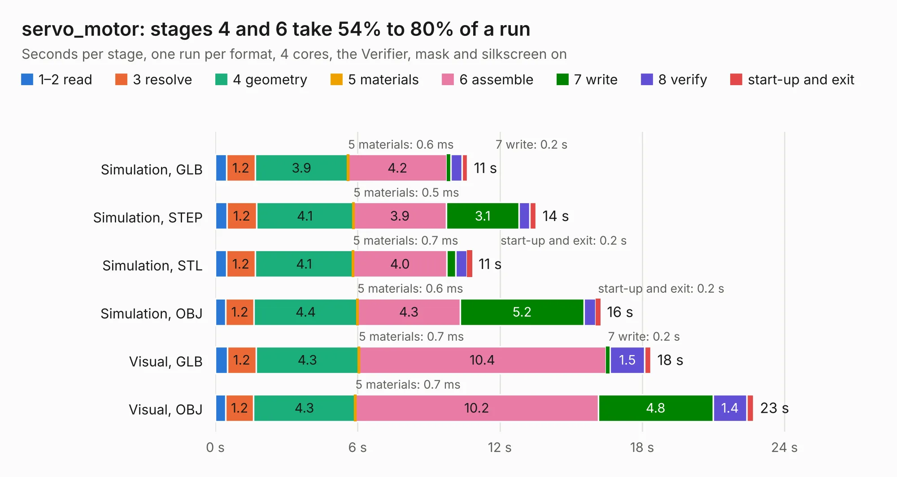

# 2862. servo_motor

Board 2,862 of the 3,122 of [Corpus Testing](../Corpus-Testing.md), on [Corpus Page 27](../CorpusTestingPages/Corpus-Testing-27.md#2862-servo_motor).

| Mode and format | 1–2 read | 3 resolve | 4 geometry | 5 materials | 6 assemble | 7 write | 8 verify | start-up and exit | Total |
|---|---:|---:|---:|---:|---:|---:|---:|---:|---:|
| Simulation, GLB | 0.5 | 1.2 | 3.9 | 0.6&nbsp;ms | 4.2 | 0.2 | 0.5 | 0.2 | 10.6 |
| Simulation, STEP | 0.5 | 1.2 | 4.1 | 0.5&nbsp;ms | 3.9 | 3.1 | 0.4 | 0.3 | 13.5 |
| Simulation, STL | 0.5 | 1.2 | 4.1 | 0.7&nbsp;ms | 4.0 | 0.4 | 0.5 | 0.2 | 10.8 |
| Simulation, OBJ | 0.4 | 1.2 | 4.4 | 0.6&nbsp;ms | 4.3 | 5.2 | 0.5 | 0.2 | 16.2 |
| Visual, GLB | 0.5 | 1.2 | 4.3 | 0.7&nbsp;ms | 10.4 | 0.2 | 1.5 | 0.3 | 18.4 |
| Visual, OBJ | 0.4 | 1.2 | 4.3 | 0.7&nbsp;ms | 10.2 | 4.8 | 1.4 | 0.3 | 22.7 |

<table align="center"><tr><td valign="top">

| Board | Repo: [tomrodinger/servomotor](https://github.com/tomrodinger/servomotor) Board: `servo_motor.kicad_pcb` |
|---|---|
| Folder | PCB / Servomotor2 / V4 |
| Complexity | 306&nbsp;/&nbsp;1000 (size&nbsp;186, features&nbsp;120) |
| KESE&nbsp;features | through vias, slotted holes, custom pads, rounded, trapezoid or chamfered pads, filled zones, copper drawings, curved board outline, stack-up, dielectric εr and tanδ |
| Tested | 9th November 2026 |
| Copper&nbsp;layers | 2 |
| File&nbsp;format | KiCad 6 (20211014) |
| Parts,&nbsp;tracks,&nbsp;vias | 94, 834, 225 |
| Triangles,&nbsp;simulation | 1,065,306 in 97 parts |
| Verifier | PASS in all six runs |

</td><td valign="top">

<table>
<tr><th>File type</th><th>File size</th><th>Peak memory used</th></tr>
<tr><th colspan="3" align="left">Simulation</th></tr>
<tr><td>GLB</td><td align="right">38&nbsp;MB</td><td align="right">471&nbsp;MB</td></tr>
<tr><td>STEP</td><td align="right">203&nbsp;MB</td><td align="right">628&nbsp;MB</td></tr>
<tr><td>STL</td><td align="right">53&nbsp;MB</td><td align="right">503&nbsp;MB</td></tr>
<tr><td>OBJ</td><td align="right">110&nbsp;MB</td><td align="right">793&nbsp;MB</td></tr>
<tr><th colspan="3" align="left">Visual</th></tr>
<tr><td>GLB</td><td align="right">33&nbsp;MB</td><td align="right">709&nbsp;MB</td></tr>
<tr><td>OBJ</td><td align="right">99&nbsp;MB</td><td align="right">748&nbsp;MB</td></tr>
</table>

</td></tr></table>

| Previous | Next |
|:---|---:|
| [2861. servo_motor](b2861b_servomotor_PCB-Servomotor1-V27_servo-motor.md) | [2863. servo_motor](b2863b_servomotor_PCB-Servomotor2-V5_servo-motor.md) |
