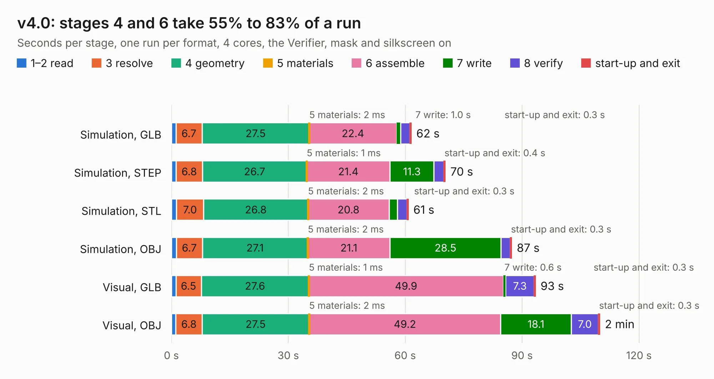

# 2863. v4.0

Board 2,863 of the 3,129 of [Corpus Testing](../Corpus-Testing.md), on [Corpus Page 27](../CorpusTestingPages/Corpus-Testing-27.md#2863-v40).

| Mode and format | 1–2 read | 3 resolve | 4 geometry | 5 materials | 6 assemble | 7 write | 8 verify | start-up and exit | Total |
|---|---:|---:|---:|---:|---:|---:|---:|---:|---:|
| Simulation, GLB | 1.1 | 6.7 | 27.5 | 2&nbsp;ms | 22.4 | 1.0 | 2.4 | 0.3 | 61.5 |
| Simulation, STEP | 1.2 | 6.8 | 26.7 | 1&nbsp;ms | 21.4 | 11.3 | 2.5 | 0.4 | 70.3 |
| Simulation, STL | 1.3 | 7.0 | 26.8 | 2&nbsp;ms | 20.8 | 2.1 | 2.5 | 0.3 | 60.8 |
| Simulation, OBJ | 1.3 | 6.7 | 27.1 | 2&nbsp;ms | 21.1 | 28.5 | 2.4 | 0.3 | 87.3 |
| Visual, GLB | 1.1 | 6.5 | 27.6 | 1&nbsp;ms | 49.9 | 0.6 | 7.3 | 0.3 | 93.4 |
| Visual, OBJ | 1.1 | 6.8 | 27.5 | 2&nbsp;ms | 49.2 | 18.1 | 7.0 | 0.3 | 109.9 |

<table align="center"><tr><td valign="top">

| Board | Repo: [tomojitakasu/PocketSDR](https://github.com/tomojitakasu/PocketSDR) Board: `v4.0.kicad_pcb` |
|---|---|
| Folder | FE_8CH / HW / v4.0 |
| Complexity | 402&nbsp;/&nbsp;1000 (size&nbsp;302, features&nbsp;100) |
| KESE&nbsp;features | through vias, slotted holes, arc tracks, filled zones, curved board outline, stack-up, dielectric εr and tanδ |
| Tested | 9th November 2026 |
| Copper&nbsp;layers | 4 |
| File&nbsp;format | KiCad 8 (20240108) |
| Parts,&nbsp;tracks,&nbsp;vias | 233, 3,065, 1,445 |
| Triangles,&nbsp;simulation | 5,577,956 in 260 parts |
| Verifier | PASS in all six runs |

</td><td valign="top">

<table>
<tr><th>File type</th><th>File size</th><th>Peak memory used</th></tr>
<tr><th colspan="3" align="left">Simulation</th></tr>
<tr><td>GLB</td><td align="right">191&nbsp;MB</td><td align="right">1.9&nbsp;GB</td></tr>
<tr><td>STEP</td><td align="right">669&nbsp;MB</td><td align="right">2.2&nbsp;GB</td></tr>
<tr><td>STL</td><td align="right">279&nbsp;MB</td><td align="right">2.0&nbsp;GB</td></tr>
<tr><td>OBJ</td><td align="right">602&nbsp;MB</td><td align="right">3.6&nbsp;GB</td></tr>
<tr><th colspan="3" align="left">Visual</th></tr>
<tr><td>GLB</td><td align="right">120&nbsp;MB</td><td align="right">2.0&nbsp;GB</td></tr>
<tr><td>OBJ</td><td align="right">389&nbsp;MB</td><td align="right">2.6&nbsp;GB</td></tr>
</table>

</td></tr></table>

| Previous | Next |
|:---|---:|
| [2862. div_4px2](b2862b_PocketSDR_div-4px2.md) | [2864. v4.1](b2864b_PocketSDR_v4-1.md) |
