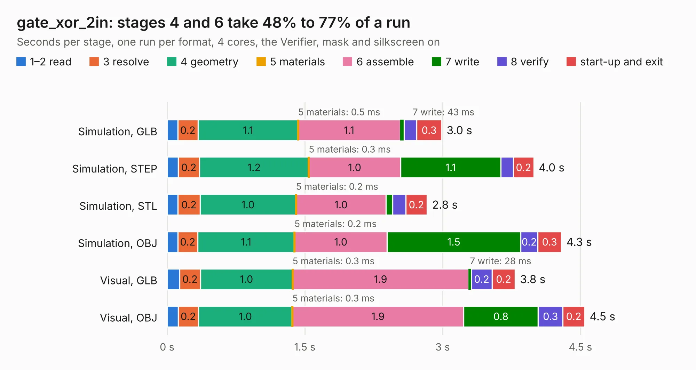

# 2863. gate_xor_2in

Board 2,863 of the 3,139 of [Corpus Testing](../Corpus-Testing.md), on [Corpus Page 27](../CorpusTestingPages/Corpus-Testing-27.md#2863-gate_xor_2in).

| Mode and format | 1–2 read | 3 resolve | 4 geometry | 5 materials | 6 assemble | 7 write | 8 verify | start-up and exit | Total |
|---|---:|---:|---:|---:|---:|---:|---:|---:|---:|
| Simulation, GLB | 0.1 | 0.2 | 1.1 | 0.5&nbsp;ms | 1.1 | 43&nbsp;ms | 0.1 | 0.3 | 3.0 |
| Simulation, STEP | 0.1 | 0.2 | 1.2 | 0.3&nbsp;ms | 1.0 | 1.1 | 0.1 | 0.2 | 4.0 |
| Simulation, STL | 0.1 | 0.2 | 1.0 | 0.2&nbsp;ms | 1.0 | 69&nbsp;ms | 0.1 | 0.2 | 2.8 |
| Simulation, OBJ | 0.1 | 0.2 | 1.1 | 0.2&nbsp;ms | 1.0 | 1.5 | 0.2 | 0.3 | 4.3 |
| Visual, GLB | 0.1 | 0.2 | 1.0 | 0.3&nbsp;ms | 1.9 | 28&nbsp;ms | 0.2 | 0.2 | 3.8 |
| Visual, OBJ | 0.1 | 0.2 | 1.0 | 0.3&nbsp;ms | 1.9 | 0.8 | 0.3 | 0.2 | 4.5 |

<table align="center"><tr><td valign="top">

| Board | Repo: [tmarhguy/alu](https://github.com/tmarhguy/alu) Board: `gate_xor_2in.kicad_pcb` |
|---|---|
| Folder | schematics / kicad / modules / gates / gate_xor / gate_xor_2in |
| Complexity | 146&nbsp;/&nbsp;1000 (size&nbsp;131, features&nbsp;15) |
| KESE&nbsp;features | through vias |
| Tested | 9th November 2026 |
| Copper&nbsp;layers | 2 |
| File&nbsp;format | KiCad 9 (20241229) |
| Parts,&nbsp;tracks,&nbsp;vias | 16, 120, 16 |
| Triangles,&nbsp;simulation | 269,400 in 22 parts |
| Verifier | PASS in all six runs |

</td><td valign="top">

<table>
<tr><th>File type</th><th>File size</th><th>Peak memory used</th></tr>
<tr><th colspan="3" align="left">Simulation</th></tr>
<tr><td>GLB</td><td align="right">8.9&nbsp;MB</td><td align="right">220&nbsp;MB</td></tr>
<tr><td>STEP</td><td align="right">35&nbsp;MB</td><td align="right">250&nbsp;MB</td></tr>
<tr><td>STL</td><td align="right">13&nbsp;MB</td><td align="right">232&nbsp;MB</td></tr>
<tr><td>OBJ</td><td align="right">26&nbsp;MB</td><td align="right">233&nbsp;MB</td></tr>
<tr><th colspan="3" align="left">Visual</th></tr>
<tr><td>GLB</td><td align="right">5.7&nbsp;MB</td><td align="right">215&nbsp;MB</td></tr>
<tr><td>OBJ</td><td align="right">16&nbsp;MB</td><td align="right">216&nbsp;MB</td></tr>
</table>

</td></tr></table>

| Previous | Next |
|:---|---:|
| [2862. gate_xnor_2in](b2862b_alu_gate-xnor-2in.md) | [2864. RASANT2400](b2864b_ra-sentinel_RASANT2400.md) |
