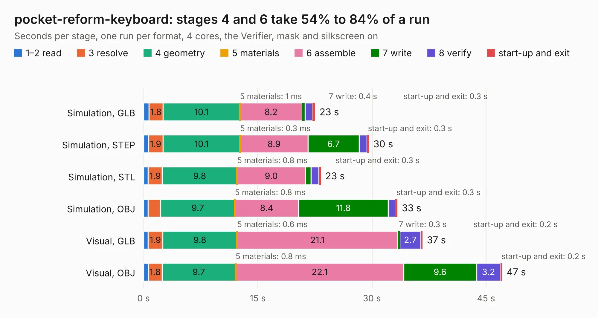

# 2863. pocket-reform-keyboard

Board 2,863 of the 3,105 of [Corpus Testing](../Corpus-Testing.md), on [Corpus Page 27](../CorpusTestingPages/Corpus-Testing-27.md#2863-pocket-reform-keyboard).

| Mode and format | 1–2 read | 3 resolve | 4 geometry | 5 materials | 6 assemble | 7 write | 8 verify | start-up and exit | Total |
|---|---:|---:|---:|---:|---:|---:|---:|---:|---:|
| Simulation, GLB | 0.7 | 1.8 | 10.1 | 1&nbsp;ms | 8.2 | 0.4 | 1.0 | 0.3 | 22.6 |
| Simulation, STEP | 0.6 | 1.9 | 10.1 | 0.3&nbsp;ms | 8.9 | 6.7 | 1.0 | 0.3 | 29.6 |
| Simulation, STL | 0.6 | 1.9 | 9.8 | 0.8&nbsp;ms | 9.0 | 0.8 | 1.0 | 0.3 | 23.3 |
| Simulation, OBJ | 0.6 | 1.7 | 9.7 | 0.8&nbsp;ms | 8.4 | 11.8 | 0.9 | 0.3 | 33.4 |
| Visual, GLB | 0.6 | 1.9 | 9.8 | 0.6&nbsp;ms | 21.1 | 0.3 | 2.7 | 0.2 | 36.7 |
| Visual, OBJ | 0.6 | 1.8 | 9.7 | 0.8&nbsp;ms | 22.1 | 9.6 | 3.2 | 0.2 | 47.1 |

<table align="center"><tr><td valign="top">

| Board | Repo: [torlye/pocket-reform](https://github.com/torlye/pocket-reform) Board: `pocket-reform-keyboard.kicad_pcb` |
|---|---|
| Folder | attic / pocket-reform-keyboard |
| Complexity | 270&nbsp;/&nbsp;1000 (size&nbsp;225, features&nbsp;45) |
| KESE&nbsp;features | through vias, rounded, trapezoid or chamfered pads, filled zones |
| Tested | 9th November 2026 |
| Copper&nbsp;layers | 2 |
| File&nbsp;format | KiCad 5 (20171130) |
| Parts,&nbsp;tracks,&nbsp;vias | 137, 802, 110 |
| Triangles,&nbsp;simulation | 2,474,030 in 109 parts |
| Verifier | PASS in all six runs |

</td><td valign="top">

<table>
<tr><th>File type</th><th>File size</th><th>Peak memory used</th></tr>
<tr><th colspan="3" align="left">Simulation</th></tr>
<tr><td>GLB</td><td align="right">83&nbsp;MB</td><td align="right">1.0&nbsp;GB</td></tr>
<tr><td>STEP</td><td align="right">345&nbsp;MB</td><td align="right">1.1&nbsp;GB</td></tr>
<tr><td>STL</td><td align="right">124&nbsp;MB</td><td align="right">921&nbsp;MB</td></tr>
<tr><td>OBJ</td><td align="right">256&nbsp;MB</td><td align="right">1.6&nbsp;GB</td></tr>
<tr><th colspan="3" align="left">Visual</th></tr>
<tr><td>GLB</td><td align="right">64&nbsp;MB</td><td align="right">1.1&nbsp;GB</td></tr>
<tr><td>OBJ</td><td align="right">197&nbsp;MB</td><td align="right">1.3&nbsp;GB</td></tr>
</table>

</td></tr></table>

| Previous | Next |
|:---|---:|
| [2862. V9](b2862b_servomotor_V9.md) | [2864. pref-display-back-d5-gold](b2864b_pocket-reform_pref-display-back-d5-gold.md) |
