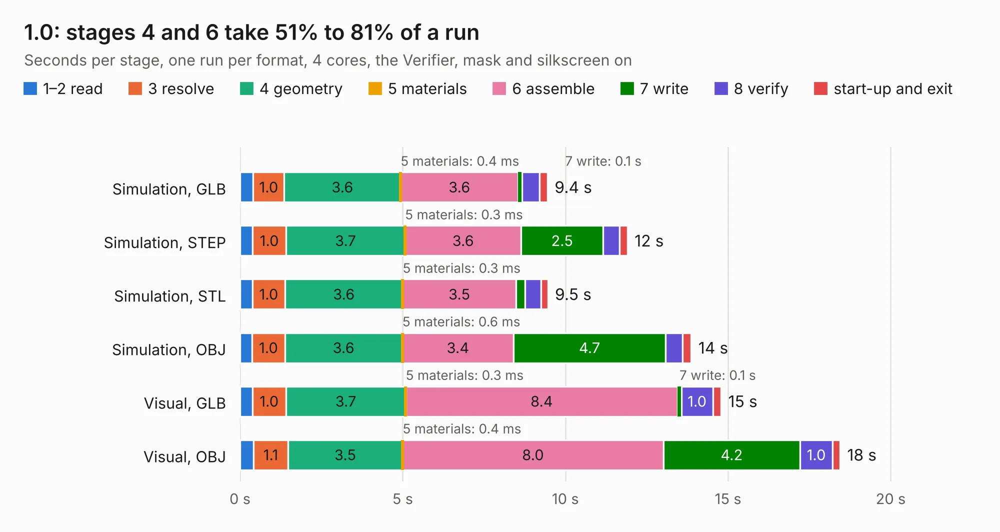

# 2864. 1.0

Board 2,864 of the 3,121 of [Corpus Testing](../Corpus-Testing.md), on [Corpus Page 27](../CorpusTestingPages/Corpus-Testing-27.md#2864-10).

| Mode and format | 1–2 read | 3 resolve | 4 geometry | 5 materials | 6 assemble | 7 write | 8 verify | start-up and exit | Total |
|---|---:|---:|---:|---:|---:|---:|---:|---:|---:|
| Simulation, GLB | 0.4 | 1.0 | 3.6 | 0.4&nbsp;ms | 3.6 | 0.1 | 0.5 | 0.2 | 9.4 |
| Simulation, STEP | 0.4 | 1.0 | 3.7 | 0.3&nbsp;ms | 3.6 | 2.5 | 0.5 | 0.2 | 11.9 |
| Simulation, STL | 0.4 | 1.0 | 3.6 | 0.3&nbsp;ms | 3.5 | 0.3 | 0.5 | 0.2 | 9.5 |
| Simulation, OBJ | 0.4 | 1.0 | 3.6 | 0.6&nbsp;ms | 3.4 | 4.7 | 0.5 | 0.3 | 13.9 |
| Visual, GLB | 0.4 | 1.0 | 3.7 | 0.3&nbsp;ms | 8.4 | 0.1 | 1.0 | 0.3 | 14.8 |
| Visual, OBJ | 0.4 | 1.1 | 3.5 | 0.4&nbsp;ms | 8.0 | 4.2 | 1.0 | 0.2 | 18.4 |

<table align="center"><tr><td valign="top">

| Board | Repo: [tomrodinger/servomotor](https://github.com/tomrodinger/servomotor) Board: `1.0.kicad_pcb` |
|---|---|
| Folder | PCB / Servomotor3 / 1.0 |
| Complexity | 346&nbsp;/&nbsp;1000 (size&nbsp;221, features&nbsp;125) |
| KESE&nbsp;features | through vias, custom pads, rounded, trapezoid or chamfered pads, filled zones, copper drawings, curved board outline, stack-up, dielectric εr and tanδ, copper finish |
| Tested | 9th November 2026 |
| Copper&nbsp;layers | 2 |
| File&nbsp;format | KiCad 9 (20241229) |
| Parts,&nbsp;tracks,&nbsp;vias | 66, 584, 261 |
| Triangles,&nbsp;simulation | 930,390 in 65 parts |
| Verifier | PASS in all six runs |

</td><td valign="top">

<table>
<tr><th>File type</th><th>File size</th><th>Peak memory used</th></tr>
<tr><th colspan="3" align="left">Simulation</th></tr>
<tr><td>GLB</td><td align="right">32&nbsp;MB</td><td align="right">416&nbsp;MB</td></tr>
<tr><td>STEP</td><td align="right">146&nbsp;MB</td><td align="right">518&nbsp;MB</td></tr>
<tr><td>STL</td><td align="right">47&nbsp;MB</td><td align="right">434&nbsp;MB</td></tr>
<tr><td>OBJ</td><td align="right">94&nbsp;MB</td><td align="right">656&nbsp;MB</td></tr>
<tr><th colspan="3" align="left">Visual</th></tr>
<tr><td>GLB</td><td align="right">27&nbsp;MB</td><td align="right">666&nbsp;MB</td></tr>
<tr><td>OBJ</td><td align="right">81&nbsp;MB</td><td align="right">618&nbsp;MB</td></tr>
</table>

</td></tr></table>

| Previous | Next |
|:---|---:|
| [2863. servo_motor-V6](b2863b_servomotor_servo-motor-V6.md) | [2865. 1.2](b2865b_servomotor_1-2.md) |
