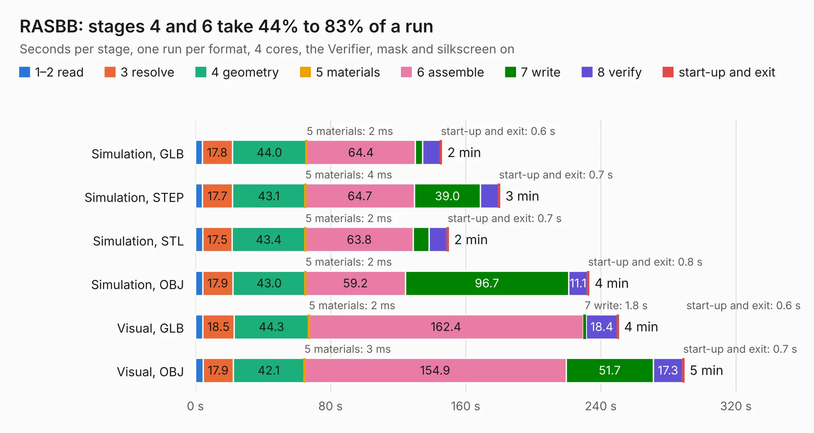

# 2866 RASBB

Board 2,866 of the 3,138 of [Corpus Testing](../Corpus-Testing.md), on [Corpus Page 27](../CorpusTestingPages/Corpus-Testing-27.md#2866-rasbb).

| Mode and format | 1–2 read | 3 resolve | 4 geometry | 5 materials | 6 assemble | 7 write | 8 verify | start-up and exit | Total |
|---|---:|---:|---:|---:|---:|---:|---:|---:|---:|
| Simulation, GLB | 4.0 | 17.8 | 44.0 | 2&nbsp;ms | 64.4 | 4.1 | 10.7 | 0.6 | 145.7 |
| Simulation, STEP | 4.2 | 17.7 | 43.1 | 4&nbsp;ms | 64.7 | 39.0 | 10.7 | 0.7 | 180.1 |
| Simulation, STL | 4.3 | 17.5 | 43.4 | 2&nbsp;ms | 63.8 | 9.3 | 10.7 | 0.7 | 149.7 |
| Simulation, OBJ | 4.3 | 17.9 | 43.0 | 2&nbsp;ms | 59.2 | 96.7 | 11.1 | 0.8 | 232.9 |
| Visual, GLB | 4.4 | 18.5 | 44.3 | 2&nbsp;ms | 162.4 | 1.8 | 18.4 | 0.6 | 250.4 |
| Visual, OBJ | 4.5 | 17.9 | 42.1 | 3&nbsp;ms | 154.9 | 51.7 | 17.3 | 0.7 | 289.1 |

<table align="center"><tr><td valign="top">

| Board | Repo: [tobias-dg3yev/ra-sentinel](https://github.com/tobias-dg3yev/ra-sentinel) Board: `RASBB.kicad_pcb` |
|---|---|
| Folder | RASBB / Hardware / Rev.C / Design |
| Complexity | 485&nbsp;/&nbsp;1000 (size&nbsp;350, features&nbsp;135) |
| KESE&nbsp;features | through vias, slotted holes, custom pads, rounded, trapezoid or chamfered pads, arc tracks, filled zones, copper drawings, copper text, stack-up, dielectric εr and tanδ |
| Tested | 9th November 2026 to 10th November 2026 |
| Copper&nbsp;layers | 8 |
| File&nbsp;format | KiCad 10 (20260206) |
| Parts,&nbsp;tracks,&nbsp;vias | 689, 14,138, 2,078 |
| Triangles,&nbsp;simulation | 17,831,050 in 809 parts |
| Verifier | PASS in all six runs |
| Run&nbsp;again | Simulation, OBJ: failed in the corpus run, run again with the memory cap raised from 11 GB to 14.5 GB, and passed |

</td><td valign="top">

<table>
<tr><th>File type</th><th>File size</th><th>Peak memory used</th></tr>
<tr><th colspan="3" align="left">Simulation</th></tr>
<tr><td>GLB</td><td align="right">594&nbsp;MB</td><td align="right">3.8&nbsp;GB</td></tr>
<tr><td>STEP</td><td align="right">1.9&nbsp;GB</td><td align="right">5.6&nbsp;GB</td></tr>
<tr><td>STL</td><td align="right">892&nbsp;MB</td><td align="right">3.9&nbsp;GB</td></tr>
<tr><td>OBJ</td><td align="right">2.0&nbsp;GB</td><td align="right">11&nbsp;GB</td></tr>
<tr><th colspan="3" align="left">Visual</th></tr>
<tr><td>GLB</td><td align="right">289&nbsp;MB</td><td align="right">4.8&nbsp;GB</td></tr>
<tr><td>OBJ</td><td align="right">968&nbsp;MB</td><td align="right">6.2&nbsp;GB</td></tr>
</table>

</td></tr></table>

| Previous | Next |
|:---|---:|
| [2865 RASBB](b2865b_ra-sentinel_RASBB-Hardware-Rev-B-Design_RASBB.md) | [2867 RASRF](b2867b_ra-sentinel_RASRF.md) |
