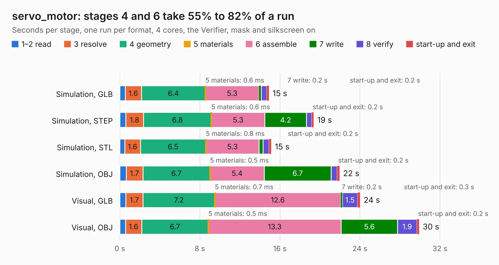

# 2867. servo_motor

Board 2,867 of the 3,129 of [Corpus Testing](../Corpus-Testing.md), on [Corpus Page 27](../CorpusTestingPages/Corpus-Testing-27.md#2867-servo_motor).

| Mode and format | 1–2 read | 3 resolve | 4 geometry | 5 materials | 6 assemble | 7 write | 8 verify | start-up and exit | Total |
|---|---:|---:|---:|---:|---:|---:|---:|---:|---:|
| Simulation, GLB | 0.5 | 1.6 | 6.4 | 0.6&nbsp;ms | 5.3 | 0.2 | 0.6 | 0.2 | 14.9 |
| Simulation, STEP | 0.6 | 1.8 | 6.8 | 0.6&nbsp;ms | 5.3 | 4.2 | 0.5 | 0.2 | 19.4 |
| Simulation, STL | 0.5 | 1.6 | 6.5 | 0.8&nbsp;ms | 5.3 | 0.4 | 0.6 | 0.2 | 15.1 |
| Simulation, OBJ | 0.6 | 1.7 | 6.7 | 0.5&nbsp;ms | 5.4 | 6.7 | 0.6 | 0.2 | 22.0 |
| Visual, GLB | 0.6 | 1.7 | 7.2 | 0.7&nbsp;ms | 12.6 | 0.2 | 1.5 | 0.3 | 24.0 |
| Visual, OBJ | 0.6 | 1.6 | 6.7 | 0.5&nbsp;ms | 13.3 | 5.6 | 1.9 | 0.2 | 29.9 |

<table align="center"><tr><td valign="top">

| Board | Repo: [tomrodinger/servomotor](https://github.com/tomrodinger/servomotor) Board: `servo_motor.kicad_pcb` |
|---|---|
| Folder | PCB / Servomotor1 / V26 |
| Complexity | 297&nbsp;/&nbsp;1000 (size&nbsp;187, features&nbsp;110) |
| KESE&nbsp;features | through vias, custom pads, rounded, trapezoid or chamfered pads, filled zones, copper drawings, curved board outline, stack-up, dielectric εr and tanδ |
| Tested | 9th November 2026 |
| Copper&nbsp;layers | 2 |
| File&nbsp;format | KiCad 6 (20211014) |
| Parts,&nbsp;tracks,&nbsp;vias | 99, 812, 233 |
| Triangles,&nbsp;simulation | 1,460,928 in 111 parts |
| Verifier | PASS in all six runs |

</td><td valign="top">

<table>
<tr><th>File type</th><th>File size</th><th>Peak memory used</th></tr>
<tr><th colspan="3" align="left">Simulation</th></tr>
<tr><td>GLB</td><td align="right">51&nbsp;MB</td><td align="right">585&nbsp;MB</td></tr>
<tr><td>STEP</td><td align="right">268&nbsp;MB</td><td align="right">734&nbsp;MB</td></tr>
<tr><td>STL</td><td align="right">73&nbsp;MB</td><td align="right">585&nbsp;MB</td></tr>
<tr><td>OBJ</td><td align="right">153&nbsp;MB</td><td align="right">1.0&nbsp;GB</td></tr>
<tr><th colspan="3" align="left">Visual</th></tr>
<tr><td>GLB</td><td align="right">43&nbsp;MB</td><td align="right">783&nbsp;MB</td></tr>
<tr><td>OBJ</td><td align="right">129&nbsp;MB</td><td align="right">934&nbsp;MB</td></tr>
</table>

</td></tr></table>

| Previous | Next |
|:---|---:|
| [2866. Coin_Cell_Tester](b2866b_servomotor_PCB-Coin-Cell-Tester-PCB-V2_Coin-Cell-Tester.md) | [2868. servo_motor](b2868b_servomotor_PCB-Servomotor1-V27_servo-motor.md) |
