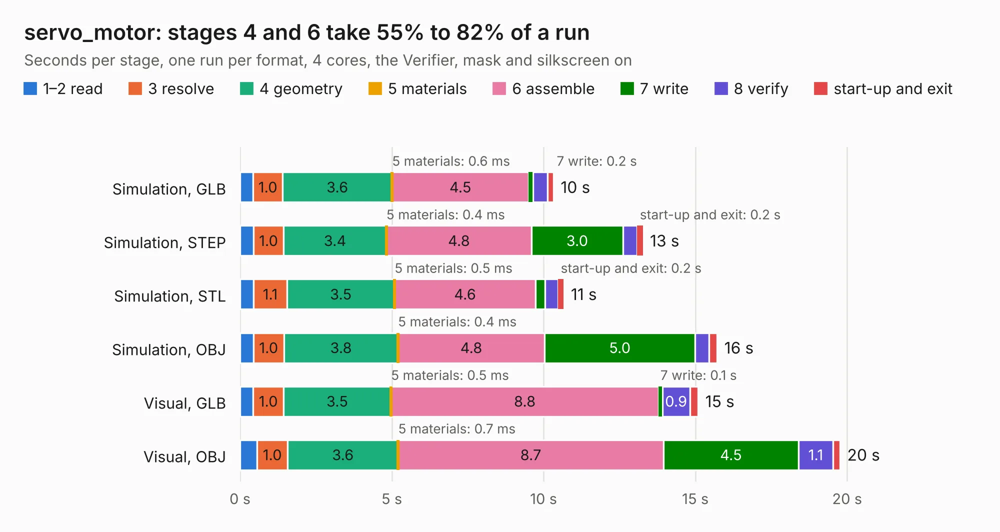

# 2868. servo_motor

Board 2,868 of the 3,127 of [Corpus Testing](../Corpus-Testing.md), on [Corpus Page 27](../CorpusTestingPages/Corpus-Testing-27.md#2868-servo_motor).

| Mode and format | 1–2 read | 3 resolve | 4 geometry | 5 materials | 6 assemble | 7 write | 8 verify | start-up and exit | Total |
|---|---:|---:|---:|---:|---:|---:|---:|---:|---:|
| Simulation, GLB | 0.4 | 1.0 | 3.6 | 0.6&nbsp;ms | 4.5 | 0.2 | 0.5 | 0.2 | 10.3 |
| Simulation, STEP | 0.4 | 1.0 | 3.4 | 0.4&nbsp;ms | 4.8 | 3.0 | 0.5 | 0.2 | 13.3 |
| Simulation, STL | 0.4 | 1.1 | 3.5 | 0.5&nbsp;ms | 4.6 | 0.3 | 0.4 | 0.2 | 10.7 |
| Simulation, OBJ | 0.4 | 1.0 | 3.8 | 0.4&nbsp;ms | 4.8 | 5.0 | 0.5 | 0.3 | 15.7 |
| Visual, GLB | 0.4 | 1.0 | 3.5 | 0.5&nbsp;ms | 8.8 | 0.1 | 0.9 | 0.3 | 15.1 |
| Visual, OBJ | 0.6 | 1.0 | 3.6 | 0.7&nbsp;ms | 8.7 | 4.5 | 1.1 | 0.2 | 19.8 |

<table align="center"><tr><td valign="top">

| Board | Repo: [tomrodinger/servomotor](https://github.com/tomrodinger/servomotor) Board: `servo_motor.kicad_pcb` |
|---|---|
| Folder | PCB / Servomotor2 / V5 |
| Complexity | 285&nbsp;/&nbsp;1000 (size&nbsp;185, features&nbsp;100) |
| KESE&nbsp;features | through vias, custom pads, rounded, trapezoid or chamfered pads, filled zones, copper drawings, stack-up, dielectric εr and tanδ |
| Tested | 9th November 2026 |
| Copper&nbsp;layers | 2 |
| File&nbsp;format | KiCad 7 (20221018) |
| Parts,&nbsp;tracks,&nbsp;vias | 92, 834, 215 |
| Triangles,&nbsp;simulation | 967,280 in 89 parts |
| Verifier | PASS in all six runs |

</td><td valign="top">

<table>
<tr><th>File type</th><th>File size</th><th>Peak memory used</th></tr>
<tr><th colspan="3" align="left">Simulation</th></tr>
<tr><td>GLB</td><td align="right">34&nbsp;MB</td><td align="right">469&nbsp;MB</td></tr>
<tr><td>STEP</td><td align="right">183&nbsp;MB</td><td align="right">565&nbsp;MB</td></tr>
<tr><td>STL</td><td align="right">48&nbsp;MB</td><td align="right">459&nbsp;MB</td></tr>
<tr><td>OBJ</td><td align="right">99&nbsp;MB</td><td align="right">684&nbsp;MB</td></tr>
<tr><th colspan="3" align="left">Visual</th></tr>
<tr><td>GLB</td><td align="right">30&nbsp;MB</td><td align="right">717&nbsp;MB</td></tr>
<tr><td>OBJ</td><td align="right">91&nbsp;MB</td><td align="right">636&nbsp;MB</td></tr>
</table>

</td></tr></table>

| Previous | Next |
|:---|---:|
| [2867. servo_motor](b2867b_servomotor_PCB-Servomotor2-V4_servo-motor.md) | [2869. servo_motor-V6](b2869b_servomotor_servo-motor-V6.md) |
