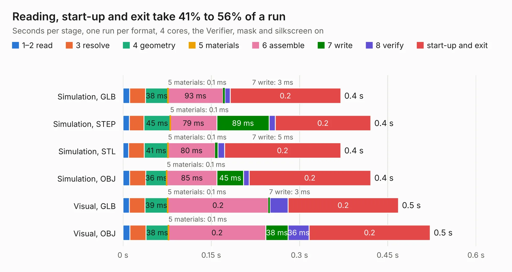

# 2870. pref-display-back-d7-gold

Board 2,870 of the 3,109 of [Corpus Testing](../Corpus-Testing.md), on [Corpus Page 27](../CorpusTestingPages/Corpus-Testing-27.md#2870-pref-display-back-d7-gold).

| Mode and format | 1–2 read | 3 resolve | 4 geometry | 5 materials | 6 assemble | 7 write | 8 verify | start-up and exit | Total |
|---|---:|---:|---:|---:|---:|---:|---:|---:|---:|
| Simulation, GLB | 11&nbsp;ms | 27&nbsp;ms | 38&nbsp;ms | 0.1&nbsp;ms | 93&nbsp;ms | 3&nbsp;ms | 9&nbsp;ms | 0.2 | 0.4 |
| Simulation, STEP | 11&nbsp;ms | 25&nbsp;ms | 45&nbsp;ms | 0.1&nbsp;ms | 79&nbsp;ms | 89&nbsp;ms | 10&nbsp;ms | 0.2 | 0.4 |
| Simulation, STL | 9&nbsp;ms | 27&nbsp;ms | 41&nbsp;ms | 0.1&nbsp;ms | 80&nbsp;ms | 5&nbsp;ms | 11&nbsp;ms | 0.2 | 0.4 |
| Simulation, OBJ | 11&nbsp;ms | 27&nbsp;ms | 36&nbsp;ms | 0.1&nbsp;ms | 85&nbsp;ms | 45&nbsp;ms | 10&nbsp;ms | 0.2 | 0.4 |
| Visual, GLB | 11&nbsp;ms | 26&nbsp;ms | 39&nbsp;ms | 0.1&nbsp;ms | 0.2 | 3&nbsp;ms | 31&nbsp;ms | 0.2 | 0.5 |
| Visual, OBJ | 12&nbsp;ms | 27&nbsp;ms | 38&nbsp;ms | 0.1&nbsp;ms | 0.2 | 38&nbsp;ms | 36&nbsp;ms | 0.2 | 0.5 |

<table align="center"><tr><td valign="top">

| Board | Repo: [torlye/pocket-reform](https://github.com/torlye/pocket-reform) Board: `pref-display-back-d7-gold.kicad_pcb` |
|---|---|
| Folder | case-plate-pcbs |
| Complexity | 82&nbsp;/&nbsp;1000 (size&nbsp;17, features&nbsp;65) |
| KESE&nbsp;features | filled zones, copper drawings, stack-up, dielectric εr and tanδ, mask and silkscreen colours |
| Tested | 9th November 2026 |
| Copper&nbsp;layers | 2 |
| File&nbsp;format | KiCad 7 (20221018) |
| Parts,&nbsp;tracks,&nbsp;vias | 0, 0, 0 |
| Triangles,&nbsp;simulation | 12,548 in 9 parts |
| Note | no components |
| Verifier | PASS in all six runs |

</td><td valign="top">

<table>
<tr><th>File type</th><th>File size</th><th>Peak memory used</th></tr>
<tr><th colspan="3" align="left">Simulation</th></tr>
<tr><td>GLB</td><td align="right">434&nbsp;kB</td><td align="right">41&nbsp;MB</td></tr>
<tr><td>STEP</td><td align="right">1.2&nbsp;MB</td><td align="right">43&nbsp;MB</td></tr>
<tr><td>STL</td><td align="right">628&nbsp;kB</td><td align="right">41&nbsp;MB</td></tr>
<tr><td>OBJ</td><td align="right">1.1&nbsp;MB</td><td align="right">43&nbsp;MB</td></tr>
<tr><th colspan="3" align="left">Visual</th></tr>
<tr><td>GLB</td><td align="right">284&nbsp;kB</td><td align="right">57&nbsp;MB</td></tr>
<tr><td>OBJ</td><td align="right">733&nbsp;kB</td><td align="right">60&nbsp;MB</td></tr>
</table>

</td></tr></table>

| Previous | Next |
|:---|---:|
| [2869. pref-display-back-d5](b2869b_pocket-reform_pref-display-back-d5.md) | [2871. pref-display-front-d7](b2871b_pocket-reform_pref-display-front-d7.md) |
