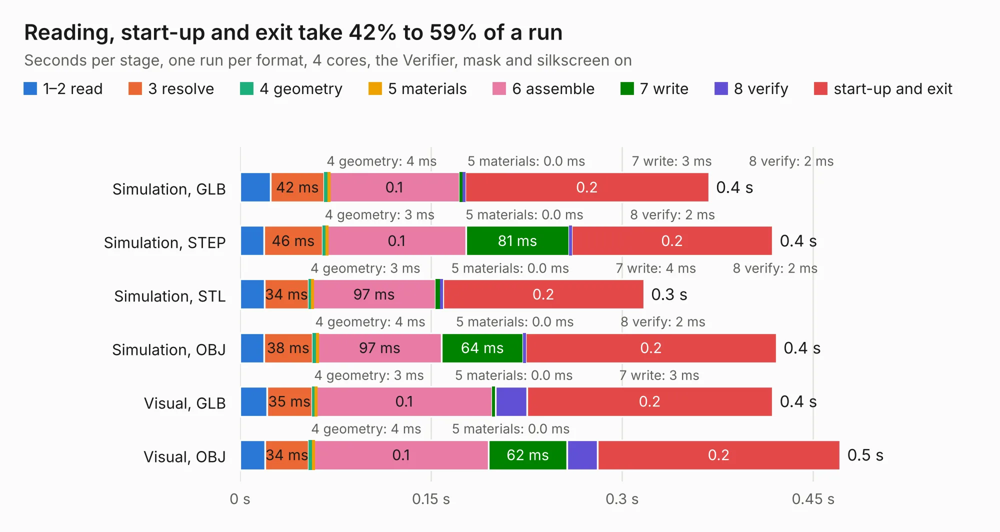

# 2870. pref-keyboard-bezel

Board 2,870 of the 3,104 of [Corpus Testing](../Corpus-Testing.md), on [Corpus Page 27](../CorpusTestingPages/Corpus-Testing-27.md#2870-pref-keyboard-bezel).

| Mode and format | 1–2 read | 3 resolve | 4 geometry | 5 materials | 6 assemble | 7 write | 8 verify | start-up and exit | Total |
|---|---:|---:|---:|---:|---:|---:|---:|---:|---:|
| Simulation, GLB | 24&nbsp;ms | 42&nbsp;ms | 4&nbsp;ms | 0.0&nbsp;ms | 0.1 | 3&nbsp;ms | 2&nbsp;ms | 0.2 | 0.4 |
| Simulation, STEP | 19&nbsp;ms | 46&nbsp;ms | 3&nbsp;ms | 0.0&nbsp;ms | 0.1 | 81&nbsp;ms | 2&nbsp;ms | 0.2 | 0.4 |
| Simulation, STL | 19&nbsp;ms | 34&nbsp;ms | 3&nbsp;ms | 0.0&nbsp;ms | 97&nbsp;ms | 4&nbsp;ms | 2&nbsp;ms | 0.2 | 0.3 |
| Simulation, OBJ | 19&nbsp;ms | 38&nbsp;ms | 4&nbsp;ms | 0.0&nbsp;ms | 97&nbsp;ms | 64&nbsp;ms | 2&nbsp;ms | 0.2 | 0.4 |
| Visual, GLB | 21&nbsp;ms | 35&nbsp;ms | 3&nbsp;ms | 0.0&nbsp;ms | 0.1 | 3&nbsp;ms | 25&nbsp;ms | 0.2 | 0.4 |
| Visual, OBJ | 20&nbsp;ms | 34&nbsp;ms | 4&nbsp;ms | 0.0&nbsp;ms | 0.1 | 62&nbsp;ms | 24&nbsp;ms | 0.2 | 0.5 |

<table align="center"><tr><td valign="top">

| Board | Repo: [torlye/pocket-reform](https://github.com/torlye/pocket-reform) Board: `pref-keyboard-bezel.kicad_pcb` |
|---|---|
| Folder | case-plate-pcbs |
| Complexity | 17&nbsp;/&nbsp;1000 (size&nbsp;17, features&nbsp;0) |
| Tested | 9th November 2026 |
| Copper&nbsp;layers | 2 |
| File&nbsp;format | KiCad 6 (20211014) |
| Parts,&nbsp;tracks,&nbsp;vias | 0, 0, 0 |
| Triangles,&nbsp;simulation | 13,452 in 3 parts |
| Note | no components |
| Verifier | PASS in all six runs |

</td><td valign="top">

<table>
<tr><th>File type</th><th>File size</th><th>Peak memory used</th></tr>
<tr><th colspan="3" align="left">Simulation</th></tr>
<tr><td>GLB</td><td align="right">370&nbsp;kB</td><td align="right">41&nbsp;MB</td></tr>
<tr><td>STEP</td><td align="right">2.0&nbsp;MB</td><td align="right">43&nbsp;MB</td></tr>
<tr><td>STL</td><td align="right">673&nbsp;kB</td><td align="right">42&nbsp;MB</td></tr>
<tr><td>OBJ</td><td align="right">1.3&nbsp;MB</td><td align="right">43&nbsp;MB</td></tr>
<tr><th colspan="3" align="left">Visual</th></tr>
<tr><td>GLB</td><td align="right">470&nbsp;kB</td><td align="right">48&nbsp;MB</td></tr>
<tr><td>OBJ</td><td align="right">1.2&nbsp;MB</td><td align="right">49&nbsp;MB</td></tr>
</table>

</td></tr></table>

| Previous | Next |
|:---|---:|
| [2869. pref-keyboard-bezel-d6](b2869b_pocket-reform_pref-keyboard-bezel-d6.md) | [2871. pref-side-panel-empty](b2871b_pocket-reform_pref-side-panel-empty.md) |
