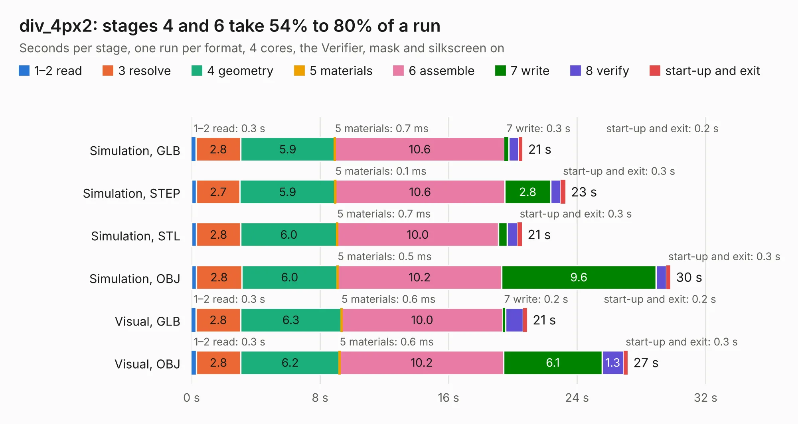

# 2872. div_4px2

Board 2,872 of the 3,139 of [Corpus Testing](../Corpus-Testing.md), on [Corpus Page 27](../CorpusTestingPages/Corpus-Testing-27.md#2872-div_4px2).

| Mode and format | 1–2 read | 3 resolve | 4 geometry | 5 materials | 6 assemble | 7 write | 8 verify | start-up and exit | Total |
|---|---:|---:|---:|---:|---:|---:|---:|---:|---:|
| Simulation, GLB | 0.3 | 2.8 | 5.9 | 0.7&nbsp;ms | 10.6 | 0.3 | 0.6 | 0.2 | 20.6 |
| Simulation, STEP | 0.3 | 2.7 | 5.9 | 0.1&nbsp;ms | 10.6 | 2.8 | 0.6 | 0.3 | 23.3 |
| Simulation, STL | 0.3 | 2.8 | 6.0 | 0.7&nbsp;ms | 10.0 | 0.6 | 0.6 | 0.3 | 20.6 |
| Simulation, OBJ | 0.3 | 2.8 | 6.0 | 0.5&nbsp;ms | 10.2 | 9.6 | 0.6 | 0.3 | 29.8 |
| Visual, GLB | 0.3 | 2.8 | 6.3 | 0.6&nbsp;ms | 10.0 | 0.2 | 1.1 | 0.2 | 20.9 |
| Visual, OBJ | 0.3 | 2.8 | 6.2 | 0.6&nbsp;ms | 10.2 | 6.1 | 1.3 | 0.3 | 27.2 |

<table align="center"><tr><td valign="top">

| Board | Repo: [tomojitakasu/PocketSDR](https://github.com/tomojitakasu/PocketSDR) Board: `div_4px2.kicad_pcb` |
|---|---|
| Folder | FE_8CH / HW / div_4px2 |
| Complexity | 294&nbsp;/&nbsp;1000 (size&nbsp;204, features&nbsp;90) |
| KESE&nbsp;features | through vias, arc tracks, filled zones, curved board outline, stack-up, dielectric εr and tanδ |
| Tested | 10th November 2026 |
| Copper&nbsp;layers | 4 |
| File&nbsp;format | KiCad 8 (20240108) |
| Parts,&nbsp;tracks,&nbsp;vias | 42, 138, 894 |
| Triangles,&nbsp;simulation | 1,796,100 in 40 parts |
| Verifier | PASS in all six runs |

</td><td valign="top">

<table>
<tr><th>File type</th><th>File size</th><th>Peak memory used</th></tr>
<tr><th colspan="3" align="left">Simulation</th></tr>
<tr><td>GLB</td><td align="right">59&nbsp;MB</td><td align="right">862&nbsp;MB</td></tr>
<tr><td>STEP</td><td align="right">87&nbsp;MB</td><td align="right">956&nbsp;MB</td></tr>
<tr><td>STL</td><td align="right">90&nbsp;MB</td><td align="right">858&nbsp;MB</td></tr>
<tr><td>OBJ</td><td align="right">183&nbsp;MB</td><td align="right">1.2&nbsp;GB</td></tr>
<tr><th colspan="3" align="left">Visual</th></tr>
<tr><td>GLB</td><td align="right">34&nbsp;MB</td><td align="right">703&nbsp;MB</td></tr>
<tr><td>OBJ</td><td align="right">106&nbsp;MB</td><td align="right">843&nbsp;MB</td></tr>
</table>

</td></tr></table>

| Previous | Next |
|:---|---:|
| [2871. v3.0](b2871b_PocketSDR_v3-0.md) | [2873. v4.0](b2873b_PocketSDR_v4-0.md) |
