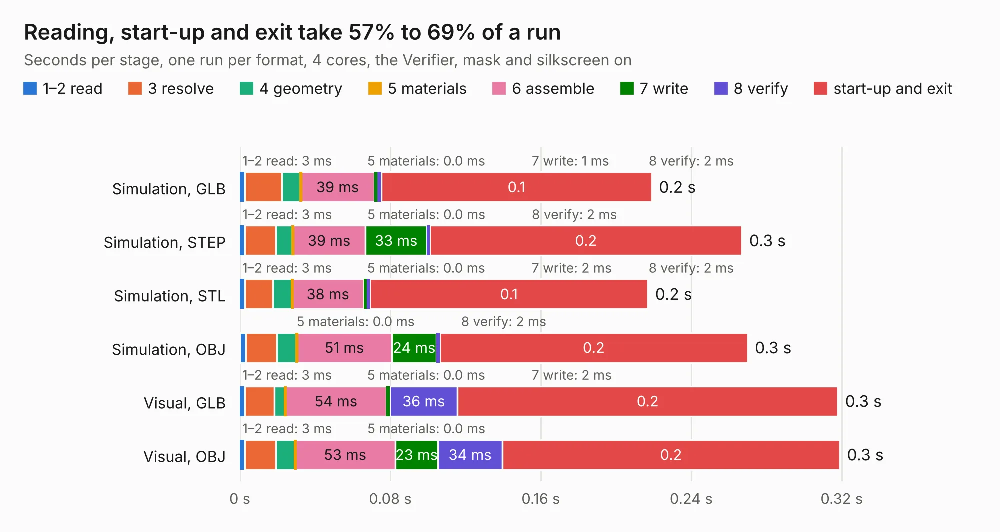

# 2872. pref-side-panel-headphones-d8

Board 2,872 of the 3,104 of [Corpus Testing](../Corpus-Testing.md), on [Corpus Page 27](../CorpusTestingPages/Corpus-Testing-27.md#2872-pref-side-panel-headphones-d8).

| Mode and format | 1–2 read | 3 resolve | 4 geometry | 5 materials | 6 assemble | 7 write | 8 verify | start-up and exit | Total |
|---|---:|---:|---:|---:|---:|---:|---:|---:|---:|
| Simulation, GLB | 3&nbsp;ms | 20&nbsp;ms | 10&nbsp;ms | 0.0&nbsp;ms | 39&nbsp;ms | 1&nbsp;ms | 2&nbsp;ms | 0.1 | 0.2 |
| Simulation, STEP | 3&nbsp;ms | 16&nbsp;ms | 9&nbsp;ms | 0.0&nbsp;ms | 39&nbsp;ms | 33&nbsp;ms | 2&nbsp;ms | 0.2 | 0.3 |
| Simulation, STL | 3&nbsp;ms | 15&nbsp;ms | 10&nbsp;ms | 0.0&nbsp;ms | 38&nbsp;ms | 2&nbsp;ms | 2&nbsp;ms | 0.1 | 0.2 |
| Simulation, OBJ | 3&nbsp;ms | 17&nbsp;ms | 10&nbsp;ms | 0.0&nbsp;ms | 51&nbsp;ms | 24&nbsp;ms | 2&nbsp;ms | 0.2 | 0.3 |
| Visual, GLB | 3&nbsp;ms | 16&nbsp;ms | 6&nbsp;ms | 0.0&nbsp;ms | 54&nbsp;ms | 2&nbsp;ms | 36&nbsp;ms | 0.2 | 0.3 |
| Visual, OBJ | 3&nbsp;ms | 16&nbsp;ms | 10&nbsp;ms | 0.0&nbsp;ms | 53&nbsp;ms | 23&nbsp;ms | 34&nbsp;ms | 0.2 | 0.3 |

<table align="center"><tr><td valign="top">

| Board | Repo: [torlye/pocket-reform](https://github.com/torlye/pocket-reform) Board: `pref-side-panel-headphones-d8.kicad_pcb` |
|---|---|
| Folder | case-plate-pcbs |
| Complexity | 62&nbsp;/&nbsp;1000 (size&nbsp;17, features&nbsp;45) |
| KESE&nbsp;features | curved board outline, stack-up, dielectric εr and tanδ, mask and silkscreen colours |
| Tested | 9th November 2026 |
| Copper&nbsp;layers | 2 |
| File&nbsp;format | KiCad 7 (20221018) |
| Parts,&nbsp;tracks,&nbsp;vias | 0, 0, 0 |
| Triangles,&nbsp;simulation | 6,036 in 3 parts |
| Note | panel, no components |
| Verifier | PASS in all six runs |

</td><td valign="top">

<table>
<tr><th>File type</th><th>File size</th><th>Peak memory used</th></tr>
<tr><th colspan="3" align="left">Simulation</th></tr>
<tr><td>GLB</td><td align="right">165&nbsp;kB</td><td align="right">38&nbsp;MB</td></tr>
<tr><td>STEP</td><td align="right">780&nbsp;kB</td><td align="right">40&nbsp;MB</td></tr>
<tr><td>STL</td><td align="right">302&nbsp;kB</td><td align="right">38&nbsp;MB</td></tr>
<tr><td>OBJ</td><td align="right">564&nbsp;kB</td><td align="right">39&nbsp;MB</td></tr>
<tr><th colspan="3" align="left">Visual</th></tr>
<tr><td>GLB</td><td align="right">209&nbsp;kB</td><td align="right">55&nbsp;MB</td></tr>
<tr><td>OBJ</td><td align="right">537&nbsp;kB</td><td align="right">56&nbsp;MB</td></tr>
</table>

</td></tr></table>

| Previous | Next |
|:---|---:|
| [2871. pref-side-panel-empty](b2871b_pocket-reform_pref-side-panel-empty.md) | [2873. pref-side-panel-ports-d8](b2873b_pocket-reform_pref-side-panel-ports-d8.md) |
