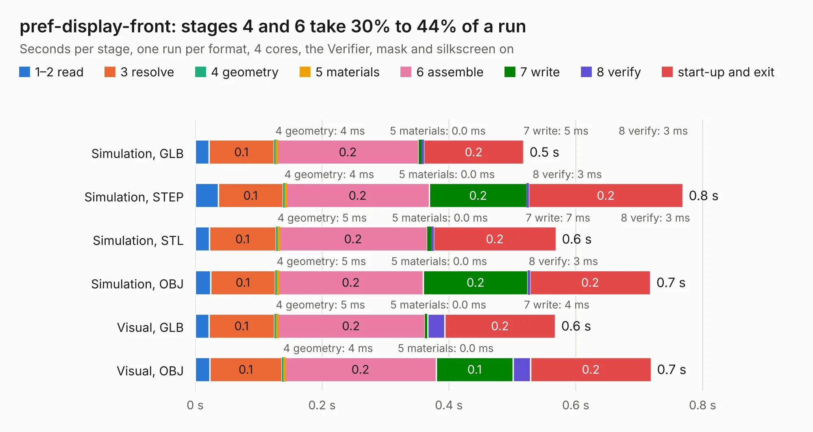

# 2875. pref-display-front

Board 2,875 of the 3,112 of [Corpus Testing](../Corpus-Testing.md), on [Corpus Page 27](../CorpusTestingPages/Corpus-Testing-27.md#2875-pref-display-front).

| Mode and format | 1–2 read | 3 resolve | 4 geometry | 5 materials | 6 assemble | 7 write | 8 verify | start-up and exit | Total |
|---|---:|---:|---:|---:|---:|---:|---:|---:|---:|
| Simulation, GLB | 22&nbsp;ms | 0.1 | 4&nbsp;ms | 0.0&nbsp;ms | 0.2 | 5&nbsp;ms | 3&nbsp;ms | 0.2 | 0.5 |
| Simulation, STEP | 36&nbsp;ms | 0.1 | 4&nbsp;ms | 0.0&nbsp;ms | 0.2 | 0.2 | 3&nbsp;ms | 0.2 | 0.8 |
| Simulation, STL | 22&nbsp;ms | 0.1 | 5&nbsp;ms | 0.0&nbsp;ms | 0.2 | 7&nbsp;ms | 3&nbsp;ms | 0.2 | 0.6 |
| Simulation, OBJ | 24&nbsp;ms | 0.1 | 5&nbsp;ms | 0.0&nbsp;ms | 0.2 | 0.2 | 3&nbsp;ms | 0.2 | 0.7 |
| Visual, GLB | 21&nbsp;ms | 0.1 | 5&nbsp;ms | 0.0&nbsp;ms | 0.2 | 4&nbsp;ms | 27&nbsp;ms | 0.2 | 0.6 |
| Visual, OBJ | 23&nbsp;ms | 0.1 | 4&nbsp;ms | 0.0&nbsp;ms | 0.2 | 0.1 | 28&nbsp;ms | 0.2 | 0.7 |

<table align="center"><tr><td valign="top">

| Board | Repo: [torlye/pocket-reform](https://github.com/torlye/pocket-reform) Board: `pref-display-front.kicad_pcb` |
|---|---|
| Folder | case-plate-pcbs |
| Complexity | 27&nbsp;/&nbsp;1000 (size&nbsp;17, features&nbsp;10) |
| KESE&nbsp;features | curved board outline |
| Tested | 9th November 2026 |
| Copper&nbsp;layers | 2 |
| File&nbsp;format | KiCad 6 (20211014) |
| Parts,&nbsp;tracks,&nbsp;vias | 0, 0, 0 |
| Triangles,&nbsp;simulation | 34,168 in 3 parts |
| Note | no components |
| Verifier | PASS in all six runs |

</td><td valign="top">

<table>
<tr><th>File type</th><th>File size</th><th>Peak memory used</th></tr>
<tr><th colspan="3" align="left">Simulation</th></tr>
<tr><td>GLB</td><td align="right">938&nbsp;kB</td><td align="right">48&nbsp;MB</td></tr>
<tr><td>STEP</td><td align="right">1.6&nbsp;MB</td><td align="right">49&nbsp;MB</td></tr>
<tr><td>STL</td><td align="right">1.7&nbsp;MB</td><td align="right">48&nbsp;MB</td></tr>
<tr><td>OBJ</td><td align="right">3.4&nbsp;MB</td><td align="right">56&nbsp;MB</td></tr>
<tr><th colspan="3" align="left">Visual</th></tr>
<tr><td>GLB</td><td align="right">888&nbsp;kB</td><td align="right">57&nbsp;MB</td></tr>
<tr><td>OBJ</td><td align="right">2.4&nbsp;MB</td><td align="right">56&nbsp;MB</td></tr>
</table>

</td></tr></table>

| Previous | Next |
|:---|---:|
| [2874. pref-display-front-d7](b2874b_pocket-reform_pref-display-front-d7.md) | [2876. pref-keyboard-back-d1-fr4](b2876b_pocket-reform_pref-keyboard-back-d1-fr4.md) |
