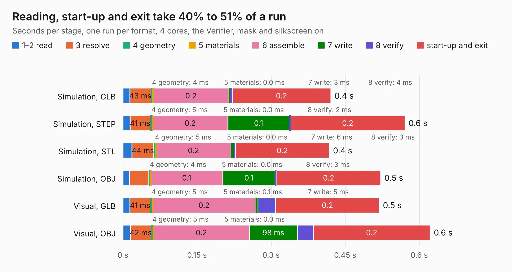

# 2876. pref-keyboard-bezel-d6

Board 2,876 of the 3,111 of [Corpus Testing](../Corpus-Testing.md), on [Corpus Page 27](../CorpusTestingPages/Corpus-Testing-27.md#2876-pref-keyboard-bezel-d6).

| Mode and format | 1–2 read | 3 resolve | 4 geometry | 5 materials | 6 assemble | 7 write | 8 verify | start-up and exit | Total |
|---|---:|---:|---:|---:|---:|---:|---:|---:|---:|
| Simulation, GLB | 14&nbsp;ms | 43&nbsp;ms | 4&nbsp;ms | 0.0&nbsp;ms | 0.2 | 3&nbsp;ms | 4&nbsp;ms | 0.2 | 0.4 |
| Simulation, STEP | 14&nbsp;ms | 41&nbsp;ms | 5&nbsp;ms | 0.0&nbsp;ms | 0.2 | 0.1 | 2&nbsp;ms | 0.2 | 0.6 |
| Simulation, STL | 18&nbsp;ms | 44&nbsp;ms | 5&nbsp;ms | 0.0&nbsp;ms | 0.2 | 6&nbsp;ms | 3&nbsp;ms | 0.2 | 0.4 |
| Simulation, OBJ | 14&nbsp;ms | 39&nbsp;ms | 4&nbsp;ms | 0.0&nbsp;ms | 0.1 | 0.1 | 3&nbsp;ms | 0.2 | 0.5 |
| Visual, GLB | 14&nbsp;ms | 41&nbsp;ms | 5&nbsp;ms | 0.1&nbsp;ms | 0.2 | 5&nbsp;ms | 36&nbsp;ms | 0.2 | 0.5 |
| Visual, OBJ | 15&nbsp;ms | 42&nbsp;ms | 5&nbsp;ms | 0.0&nbsp;ms | 0.2 | 98&nbsp;ms | 32&nbsp;ms | 0.2 | 0.6 |

<table align="center"><tr><td valign="top">

| Board | Repo: [torlye/pocket-reform](https://github.com/torlye/pocket-reform) Board: `pref-keyboard-bezel-d6.kicad_pcb` |
|---|---|
| Folder | case-plate-pcbs |
| Complexity | 57&nbsp;/&nbsp;1000 (size&nbsp;17, features&nbsp;40) |
| KESE&nbsp;features | curved board outline, stack-up, dielectric εr and tanδ |
| Tested | 9th November 2026 |
| Copper&nbsp;layers | 2 |
| File&nbsp;format | KiCad 7 (20221018) |
| Parts,&nbsp;tracks,&nbsp;vias | 0, 0, 0 |
| Triangles,&nbsp;simulation | 17,896 in 3 parts |
| Note | no components |
| Verifier | PASS in all six runs |

</td><td valign="top">

<table>
<tr><th>File type</th><th>File size</th><th>Peak memory used</th></tr>
<tr><th colspan="3" align="left">Simulation</th></tr>
<tr><td>GLB</td><td align="right">485&nbsp;kB</td><td align="right">42&nbsp;MB</td></tr>
<tr><td>STEP</td><td align="right">3.1&nbsp;MB</td><td align="right">45&nbsp;MB</td></tr>
<tr><td>STL</td><td align="right">895&nbsp;kB</td><td align="right">42&nbsp;MB</td></tr>
<tr><td>OBJ</td><td align="right">1.7&nbsp;MB</td><td align="right">45&nbsp;MB</td></tr>
<tr><th colspan="3" align="left">Visual</th></tr>
<tr><td>GLB</td><td align="right">628&nbsp;kB</td><td align="right">57&nbsp;MB</td></tr>
<tr><td>OBJ</td><td align="right">1.7&nbsp;MB</td><td align="right">50&nbsp;MB</td></tr>
</table>

</td></tr></table>

| Previous | Next |
|:---|---:|
| [2875. pref-keyboard-back-d1-fr4](b2875b_pocket-reform_pref-keyboard-back-d1-fr4.md) | [2877. pref-keyboard-bezel](b2877b_pocket-reform_pref-keyboard-bezel.md) |
