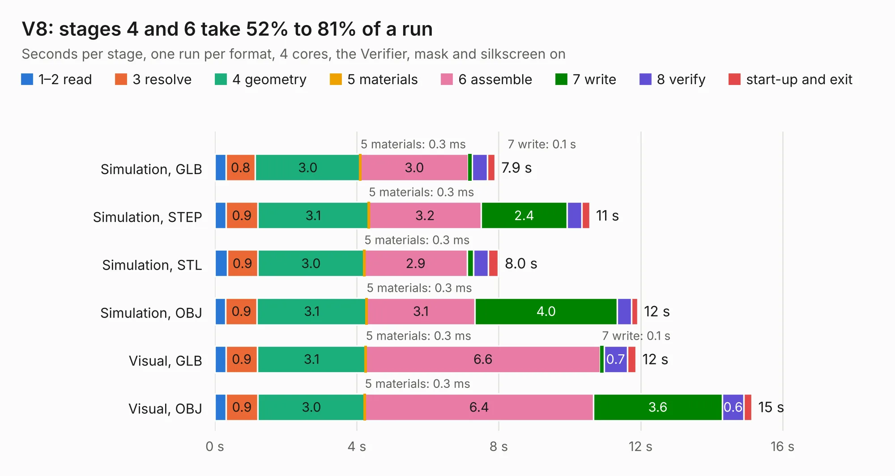

# 2876. V8

Board 2,876 of the 3,120 of [Corpus Testing](../Corpus-Testing.md), on [Corpus Page 27](../CorpusTestingPages/Corpus-Testing-27.md#2876-v8).

| Mode and format | 1–2 read | 3 resolve | 4 geometry | 5 materials | 6 assemble | 7 write | 8 verify | start-up and exit | Total |
|---|---:|---:|---:|---:|---:|---:|---:|---:|---:|
| Simulation, GLB | 0.3 | 0.8 | 3.0 | 0.3&nbsp;ms | 3.0 | 0.1 | 0.4 | 0.2 | 7.9 |
| Simulation, STEP | 0.3 | 0.9 | 3.1 | 0.3&nbsp;ms | 3.2 | 2.4 | 0.4 | 0.2 | 10.6 |
| Simulation, STL | 0.3 | 0.9 | 3.0 | 0.3&nbsp;ms | 2.9 | 0.2 | 0.4 | 0.3 | 8.0 |
| Simulation, OBJ | 0.3 | 0.9 | 3.1 | 0.3&nbsp;ms | 3.1 | 4.0 | 0.4 | 0.2 | 11.9 |
| Visual, GLB | 0.3 | 0.9 | 3.1 | 0.3&nbsp;ms | 6.6 | 0.1 | 0.7 | 0.2 | 11.9 |
| Visual, OBJ | 0.3 | 0.9 | 3.0 | 0.3&nbsp;ms | 6.4 | 3.6 | 0.6 | 0.2 | 15.1 |

<table align="center"><tr><td valign="top">

| Board | Repo: [tomrodinger/servomotor](https://github.com/tomrodinger/servomotor) Board: `V8.kicad_pcb` |
|---|---|
| Folder | PCB / Servomotor3 / V8 |
| Complexity | 342&nbsp;/&nbsp;1000 (size&nbsp;217, features&nbsp;125) |
| KESE&nbsp;features | through vias, custom pads, rounded, trapezoid or chamfered pads, filled zones, copper drawings, curved board outline, stack-up, dielectric εr and tanδ, copper finish |
| Tested | 9th November 2026 |
| Copper&nbsp;layers | 2 |
| File&nbsp;format | KiCad 8 (20240108) |
| Parts,&nbsp;tracks,&nbsp;vias | 64, 514, 214 |
| Triangles,&nbsp;simulation | 796,890 in 61 parts |
| Verifier | PASS in all six runs |

</td><td valign="top">

<table>
<tr><th>File type</th><th>File size</th><th>Peak memory used</th></tr>
<tr><th colspan="3" align="left">Simulation</th></tr>
<tr><td>GLB</td><td align="right">27&nbsp;MB</td><td align="right">389&nbsp;MB</td></tr>
<tr><td>STEP</td><td align="right">125&nbsp;MB</td><td align="right">471&nbsp;MB</td></tr>
<tr><td>STL</td><td align="right">40&nbsp;MB</td><td align="right">395&nbsp;MB</td></tr>
<tr><td>OBJ</td><td align="right">81&nbsp;MB</td><td align="right">572&nbsp;MB</td></tr>
<tr><th colspan="3" align="left">Visual</th></tr>
<tr><td>GLB</td><td align="right">23&nbsp;MB</td><td align="right">534&nbsp;MB</td></tr>
<tr><td>OBJ</td><td align="right">70&nbsp;MB</td><td align="right">579&nbsp;MB</td></tr>
</table>

</td></tr></table>

| Previous | Next |
|:---|---:|
| [2875. M3-V5](b2875b_servomotor_M3-V5.md) | [2877. V9](b2877b_servomotor_V9.md) |
