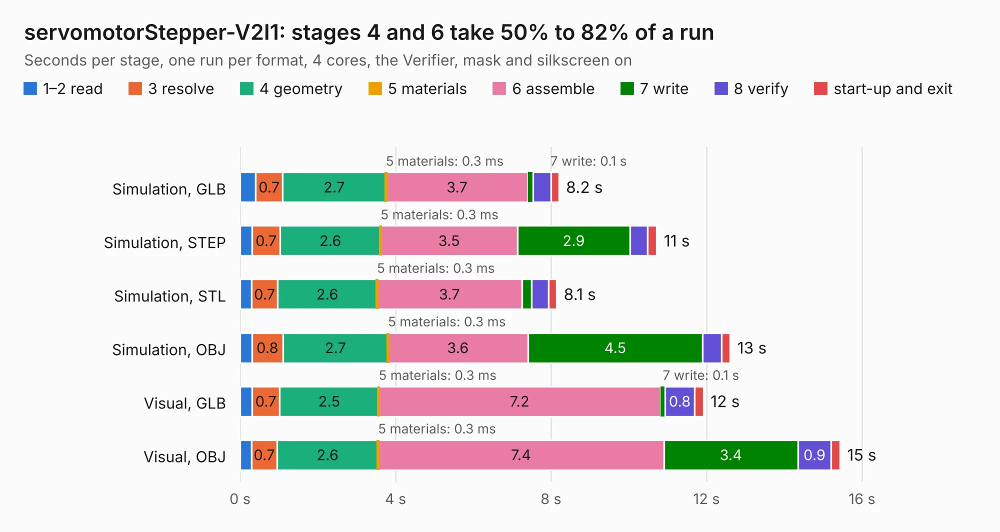

# 2876. servomotorStepper-V2I1

Board 2,876 of the 3,123 of [Corpus Testing](../Corpus-Testing.md), on [Corpus Page 27](../CorpusTestingPages/Corpus-Testing-27.md#2876-servomotorstepper-v2i1).

| Mode and format | 1–2 read | 3 resolve | 4 geometry | 5 materials | 6 assemble | 7 write | 8 verify | start-up and exit | Total |
|---|---:|---:|---:|---:|---:|---:|---:|---:|---:|
| Simulation, GLB | 0.4 | 0.7 | 2.7 | 0.3&nbsp;ms | 3.7 | 0.1 | 0.5 | 0.2 | 8.2 |
| Simulation, STEP | 0.3 | 0.7 | 2.6 | 0.3&nbsp;ms | 3.5 | 2.9 | 0.5 | 0.2 | 10.7 |
| Simulation, STL | 0.3 | 0.7 | 2.6 | 0.3&nbsp;ms | 3.7 | 0.2 | 0.4 | 0.2 | 8.1 |
| Simulation, OBJ | 0.3 | 0.8 | 2.7 | 0.3&nbsp;ms | 3.6 | 4.5 | 0.5 | 0.2 | 12.6 |
| Visual, GLB | 0.3 | 0.7 | 2.5 | 0.3&nbsp;ms | 7.2 | 0.1 | 0.8 | 0.2 | 11.9 |
| Visual, OBJ | 0.3 | 0.7 | 2.6 | 0.3&nbsp;ms | 7.4 | 3.4 | 0.9 | 0.2 | 15.4 |

<table align="center"><tr><td valign="top">

| Board | Repo: [tomrodinger/servomotor](https://github.com/tomrodinger/servomotor) Board: `servomotorStepper-V2I1.kicad_pcb` |
|---|---|
| Folder | PCB / Servomotor3 / V2 |
| Complexity | 346&nbsp;/&nbsp;1000 (size&nbsp;221, features&nbsp;125) |
| KESE&nbsp;features | through vias, custom pads, rounded, trapezoid or chamfered pads, filled zones, copper drawings, curved board outline, stack-up, dielectric εr and tanδ, copper finish |
| Tested | 9th November 2026 |
| Copper&nbsp;layers | 2 |
| File&nbsp;format | KiCad 7 (20221018) |
| Parts,&nbsp;tracks,&nbsp;vias | 65, 973, 144 |
| Triangles,&nbsp;simulation | 792,126 in 62 parts |
| Verifier | PASS in all six runs |

</td><td valign="top">

<table>
<tr><th>File type</th><th>File size</th><th>Peak memory used</th></tr>
<tr><th colspan="3" align="left">Simulation</th></tr>
<tr><td>GLB</td><td align="right">28&nbsp;MB</td><td align="right">433&nbsp;MB</td></tr>
<tr><td>STEP</td><td align="right">147&nbsp;MB</td><td align="right">497&nbsp;MB</td></tr>
<tr><td>STL</td><td align="right">40&nbsp;MB</td><td align="right">418&nbsp;MB</td></tr>
<tr><td>OBJ</td><td align="right">81&nbsp;MB</td><td align="right">573&nbsp;MB</td></tr>
<tr><th colspan="3" align="left">Visual</th></tr>
<tr><td>GLB</td><td align="right">23&nbsp;MB</td><td align="right">591&nbsp;MB</td></tr>
<tr><td>OBJ</td><td align="right">70&nbsp;MB</td><td align="right">601&nbsp;MB</td></tr>
</table>

</td></tr></table>

| Previous | Next |
|:---|---:|
| [2875. V11RC4](b2875b_servomotor_V11RC4.md) | [2877. M3-V4](b2877b_servomotor_M3-V4.md) |
