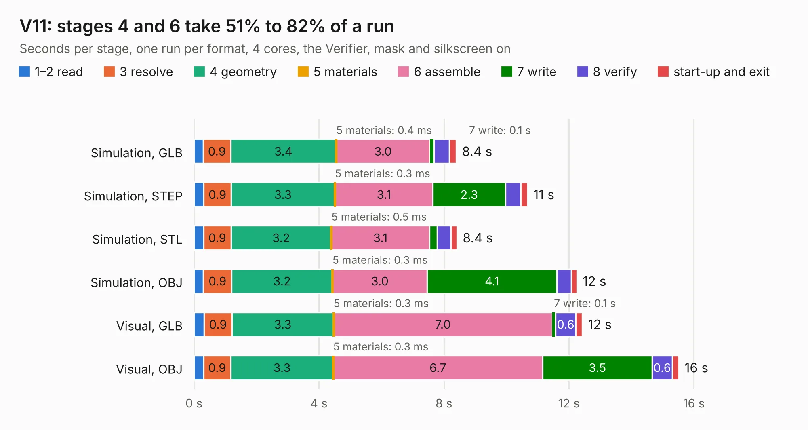

# 2879. V11

Board 2,879 of the 3,130 of [Corpus Testing](../Corpus-Testing.md), on [Corpus Page 27](../CorpusTestingPages/Corpus-Testing-27.md#2879-v11).

| Mode and format | 1–2 read | 3 resolve | 4 geometry | 5 materials | 6 assemble | 7 write | 8 verify | start-up and exit | Total |
|---|---:|---:|---:|---:|---:|---:|---:|---:|---:|
| Simulation, GLB | 0.3 | 0.9 | 3.4 | 0.4&nbsp;ms | 3.0 | 0.1 | 0.5 | 0.2 | 8.4 |
| Simulation, STEP | 0.3 | 0.9 | 3.3 | 0.3&nbsp;ms | 3.1 | 2.3 | 0.5 | 0.2 | 10.7 |
| Simulation, STL | 0.3 | 0.9 | 3.2 | 0.5&nbsp;ms | 3.1 | 0.2 | 0.4 | 0.2 | 8.4 |
| Simulation, OBJ | 0.3 | 0.9 | 3.2 | 0.3&nbsp;ms | 3.0 | 4.1 | 0.5 | 0.2 | 12.3 |
| Visual, GLB | 0.3 | 0.9 | 3.3 | 0.3&nbsp;ms | 7.0 | 0.1 | 0.6 | 0.2 | 12.4 |
| Visual, OBJ | 0.3 | 0.9 | 3.3 | 0.3&nbsp;ms | 6.7 | 3.5 | 0.6 | 0.2 | 15.5 |

<table align="center"><tr><td valign="top">

| Board | Repo: [tomrodinger/servomotor](https://github.com/tomrodinger/servomotor) Board: `V11.kicad_pcb` |
|---|---|
| Folder | PCB / Servomotor3 / V11RC1 |
| Complexity | 345&nbsp;/&nbsp;1000 (size&nbsp;220, features&nbsp;125) |
| KESE&nbsp;features | through vias, custom pads, rounded, trapezoid or chamfered pads, filled zones, copper drawings, curved board outline, stack-up, dielectric εr and tanδ, copper finish |
| Tested | 9th November 2026 |
| Copper&nbsp;layers | 2 |
| File&nbsp;format | KiCad 8 (20240108) |
| Parts,&nbsp;tracks,&nbsp;vias | 64, 531, 270 |
| Triangles,&nbsp;simulation | 876,820 in 60 parts |
| Verifier | PASS in all six runs |

</td><td valign="top">

<table>
<tr><th>File type</th><th>File size</th><th>Peak memory used</th></tr>
<tr><th colspan="3" align="left">Simulation</th></tr>
<tr><td>GLB</td><td align="right">30&nbsp;MB</td><td align="right">412&nbsp;MB</td></tr>
<tr><td>STEP</td><td align="right">133&nbsp;MB</td><td align="right">495&nbsp;MB</td></tr>
<tr><td>STL</td><td align="right">44&nbsp;MB</td><td align="right">414&nbsp;MB</td></tr>
<tr><td>OBJ</td><td align="right">89&nbsp;MB</td><td align="right">582&nbsp;MB</td></tr>
<tr><th colspan="3" align="left">Visual</th></tr>
<tr><td>GLB</td><td align="right">25&nbsp;MB</td><td align="right">545&nbsp;MB</td></tr>
<tr><td>OBJ</td><td align="right">76&nbsp;MB</td><td align="right">622&nbsp;MB</td></tr>
</table>

</td></tr></table>

| Previous | Next |
|:---|---:|
| [2878. V11](b2878b_servomotor_PCB-Servomotor3-V11_V11.md) | [2880. V11RC2](b2880b_servomotor_V11RC2.md) |
