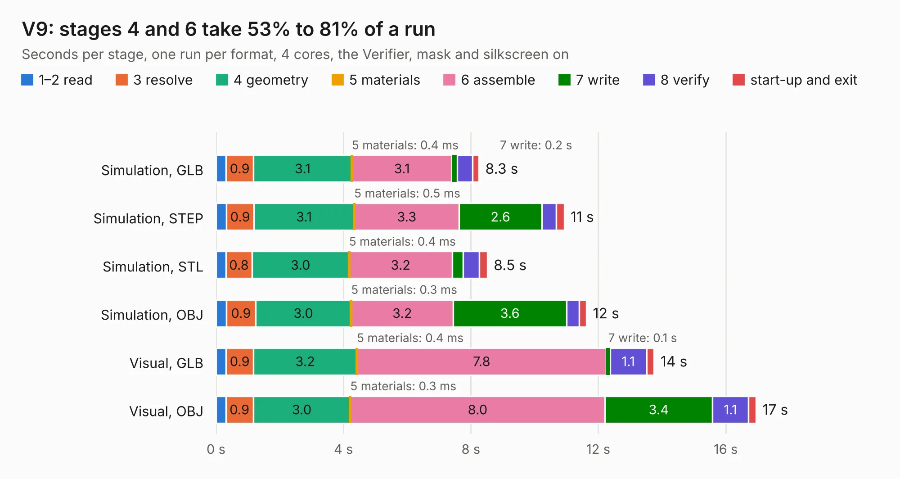

# 2880. V9

Board 2,880 of the 3,123 of [Corpus Testing](../Corpus-Testing.md), on [Corpus Page 27](../CorpusTestingPages/Corpus-Testing-27.md#2880-v9).

| Mode and format | 1–2 read | 3 resolve | 4 geometry | 5 materials | 6 assemble | 7 write | 8 verify | start-up and exit | Total |
|---|---:|---:|---:|---:|---:|---:|---:|---:|---:|
| Simulation, GLB | 0.3 | 0.9 | 3.1 | 0.4&nbsp;ms | 3.1 | 0.2 | 0.5 | 0.2 | 8.3 |
| Simulation, STEP | 0.3 | 0.9 | 3.1 | 0.5&nbsp;ms | 3.3 | 2.6 | 0.5 | 0.2 | 10.9 |
| Simulation, STL | 0.3 | 0.8 | 3.0 | 0.4&nbsp;ms | 3.2 | 0.3 | 0.5 | 0.2 | 8.5 |
| Simulation, OBJ | 0.3 | 0.9 | 3.0 | 0.3&nbsp;ms | 3.2 | 3.6 | 0.4 | 0.2 | 11.6 |
| Visual, GLB | 0.3 | 0.9 | 3.2 | 0.4&nbsp;ms | 7.8 | 0.1 | 1.1 | 0.2 | 13.8 |
| Visual, OBJ | 0.3 | 0.9 | 3.0 | 0.3&nbsp;ms | 8.0 | 3.4 | 1.1 | 0.2 | 17.0 |

<table align="center"><tr><td valign="top">

| Board | Repo: [tomrodinger/servomotor](https://github.com/tomrodinger/servomotor) Board: `V9.kicad_pcb` |
|---|---|
| Folder | PCB / Servomotor3 / V9 |
| Complexity | 344&nbsp;/&nbsp;1000 (size&nbsp;219, features&nbsp;125) |
| KESE&nbsp;features | through vias, custom pads, rounded, trapezoid or chamfered pads, filled zones, copper drawings, curved board outline, stack-up, dielectric εr and tanδ, copper finish |
| Tested | 9th November 2026 |
| Copper&nbsp;layers | 2 |
| File&nbsp;format | KiCad 8 (20240108) |
| Parts,&nbsp;tracks,&nbsp;vias | 64, 569, 225 |
| Triangles,&nbsp;simulation | 817,250 in 60 parts |
| Verifier | PASS in all six runs |

</td><td valign="top">

<table>
<tr><th>File type</th><th>File size</th><th>Peak memory used</th></tr>
<tr><th colspan="3" align="left">Simulation</th></tr>
<tr><td>GLB</td><td align="right">28&nbsp;MB</td><td align="right">405&nbsp;MB</td></tr>
<tr><td>STEP</td><td align="right">128&nbsp;MB</td><td align="right">500&nbsp;MB</td></tr>
<tr><td>STL</td><td align="right">41&nbsp;MB</td><td align="right">397&nbsp;MB</td></tr>
<tr><td>OBJ</td><td align="right">83&nbsp;MB</td><td align="right">615&nbsp;MB</td></tr>
<tr><th colspan="3" align="left">Visual</th></tr>
<tr><td>GLB</td><td align="right">24&nbsp;MB</td><td align="right">538&nbsp;MB</td></tr>
<tr><td>OBJ</td><td align="right">72&nbsp;MB</td><td align="right">572&nbsp;MB</td></tr>
</table>

</td></tr></table>

| Previous | Next |
|:---|---:|
| [2879. V8](b2879b_servomotor_V8.md) | [2881. pocket-reform-keyboard](b2881b_pocket-reform_pocket-reform-keyboard.md) |
