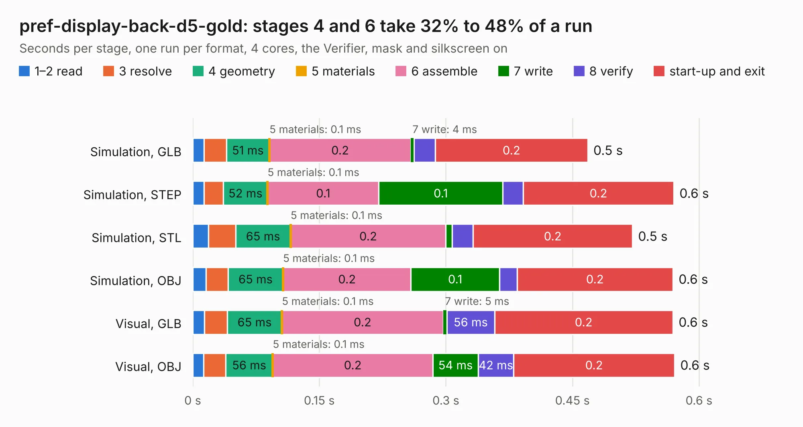

# 2883. pref-display-back-d5-gold

Board 2,883 of the 3,124 of [Corpus Testing](../Corpus-Testing.md), on [Corpus Page 27](../CorpusTestingPages/Corpus-Testing-27.md#2883-pref-display-back-d5-gold).

| Mode and format | 1–2 read | 3 resolve | 4 geometry | 5 materials | 6 assemble | 7 write | 8 verify | start-up and exit | Total |
|---|---:|---:|---:|---:|---:|---:|---:|---:|---:|
| Simulation, GLB | 13&nbsp;ms | 26&nbsp;ms | 51&nbsp;ms | 0.1&nbsp;ms | 0.2 | 4&nbsp;ms | 25&nbsp;ms | 0.2 | 0.5 |
| Simulation, STEP | 13&nbsp;ms | 23&nbsp;ms | 52&nbsp;ms | 0.1&nbsp;ms | 0.1 | 0.1 | 24&nbsp;ms | 0.2 | 0.6 |
| Simulation, STL | 19&nbsp;ms | 32&nbsp;ms | 65&nbsp;ms | 0.1&nbsp;ms | 0.2 | 7&nbsp;ms | 25&nbsp;ms | 0.2 | 0.5 |
| Simulation, OBJ | 16&nbsp;ms | 26&nbsp;ms | 65&nbsp;ms | 0.1&nbsp;ms | 0.2 | 0.1 | 21&nbsp;ms | 0.2 | 0.6 |
| Visual, GLB | 14&nbsp;ms | 27&nbsp;ms | 65&nbsp;ms | 0.1&nbsp;ms | 0.2 | 5&nbsp;ms | 56&nbsp;ms | 0.2 | 0.6 |
| Visual, OBJ | 13&nbsp;ms | 26&nbsp;ms | 56&nbsp;ms | 0.1&nbsp;ms | 0.2 | 54&nbsp;ms | 42&nbsp;ms | 0.2 | 0.6 |

<table align="center"><tr><td valign="top">

| Board | Repo: [torlye/pocket-reform](https://github.com/torlye/pocket-reform) Board: `pref-display-back-d5-gold.kicad_pcb` |
|---|---|
| Folder | case-plate-pcbs |
| Complexity | 37&nbsp;/&nbsp;1000 (size&nbsp;17, features&nbsp;20) |
| KESE&nbsp;features | filled zones |
| Tested | 9th November 2026 |
| Copper&nbsp;layers | 2 |
| File&nbsp;format | KiCad 6 (20211014) |
| Parts,&nbsp;tracks,&nbsp;vias | 0, 0, 0 |
| Triangles,&nbsp;simulation | 24,692 in 7 parts |
| Note | no components |
| Verifier | PASS in all six runs |

</td><td valign="top">

<table>
<tr><th>File type</th><th>File size</th><th>Peak memory used</th></tr>
<tr><th colspan="3" align="left">Simulation</th></tr>
<tr><td>GLB</td><td align="right">852&nbsp;kB</td><td align="right">44&nbsp;MB</td></tr>
<tr><td>STEP</td><td align="right">4.2&nbsp;MB</td><td align="right">48&nbsp;MB</td></tr>
<tr><td>STL</td><td align="right">1.2&nbsp;MB</td><td align="right">44&nbsp;MB</td></tr>
<tr><td>OBJ</td><td align="right">2.3&nbsp;MB</td><td align="right">49&nbsp;MB</td></tr>
<tr><th colspan="3" align="left">Visual</th></tr>
<tr><td>GLB</td><td align="right">464&nbsp;kB</td><td align="right">78&nbsp;MB</td></tr>
<tr><td>OBJ</td><td align="right">1.2&nbsp;MB</td><td align="right">69&nbsp;MB</td></tr>
</table>

</td></tr></table>

| Previous | Next |
|:---|---:|
| [2882. pocket-reform-keyboard](b2882b_pocket-reform_pocket-reform-keyboard.md) | [2884. pref-display-back-d5](b2884b_pocket-reform_pref-display-back-d5.md) |
