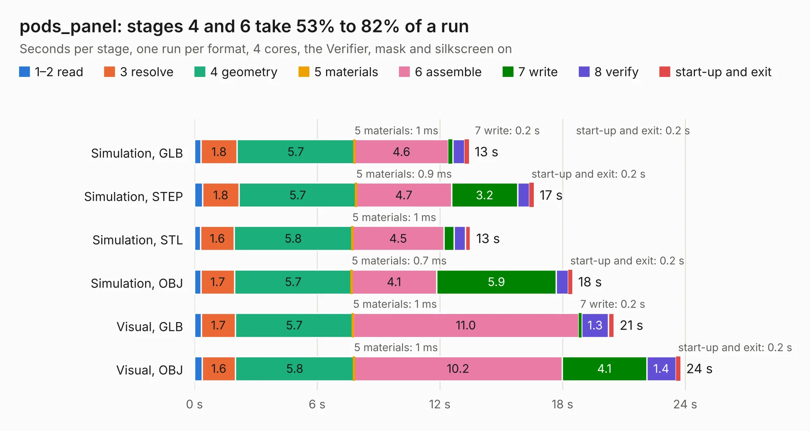

# 2884. pods_panel

Board 2,884 of the 3,107 of [Corpus Testing](../Corpus-Testing.md), on [Corpus Page 27](../CorpusTestingPages/Corpus-Testing-27.md#2884-pods_panel).

| Mode and format | 1–2 read | 3 resolve | 4 geometry | 5 materials | 6 assemble | 7 write | 8 verify | start-up and exit | Total |
|---|---:|---:|---:|---:|---:|---:|---:|---:|---:|
| Simulation, GLB | 0.3 | 1.8 | 5.7 | 1&nbsp;ms | 4.6 | 0.2 | 0.6 | 0.2 | 13.4 |
| Simulation, STEP | 0.4 | 1.8 | 5.7 | 0.9&nbsp;ms | 4.7 | 3.2 | 0.6 | 0.2 | 16.6 |
| Simulation, STL | 0.3 | 1.6 | 5.8 | 1&nbsp;ms | 4.5 | 0.5 | 0.6 | 0.2 | 13.5 |
| Simulation, OBJ | 0.3 | 1.7 | 5.7 | 0.7&nbsp;ms | 4.1 | 5.9 | 0.6 | 0.2 | 18.5 |
| Visual, GLB | 0.3 | 1.7 | 5.7 | 1&nbsp;ms | 11.0 | 0.2 | 1.3 | 0.3 | 20.5 |
| Visual, OBJ | 0.4 | 1.6 | 5.8 | 1&nbsp;ms | 10.2 | 4.1 | 1.4 | 0.2 | 23.8 |

<table align="center"><tr><td valign="top">

| Board | Repo: [ToyotaInfoTech/RAMN](https://github.com/ToyotaInfoTech/RAMN) Board: `pods_panel.kicad_pcb` |
|---|---|
| Folder | hardware / build |
| Complexity | 233&nbsp;/&nbsp;1000 (size&nbsp;168, features&nbsp;65) |
| KESE&nbsp;features | through vias, slotted holes, rounded, trapezoid or chamfered pads, filled zones, copper text |
| Tested | 9th November 2026 |
| Copper&nbsp;layers | 2 |
| File&nbsp;format | KiCad 7 (20221018) |
| Parts,&nbsp;tracks,&nbsp;vias | 50, 596, 59 |
| Triangles,&nbsp;simulation | 1,424,436 in 146 parts |
| Note | panel |
| Verifier | PASS in all six runs |

</td><td valign="top">

<table>
<tr><th>File type</th><th>File size</th><th>Peak memory used</th></tr>
<tr><th colspan="3" align="left">Simulation</th></tr>
<tr><td>GLB</td><td align="right">48&nbsp;MB</td><td align="right">569&nbsp;MB</td></tr>
<tr><td>STEP</td><td align="right">206&nbsp;MB</td><td align="right">697&nbsp;MB</td></tr>
<tr><td>STL</td><td align="right">71&nbsp;MB</td><td align="right">638&nbsp;MB</td></tr>
<tr><td>OBJ</td><td align="right">146&nbsp;MB</td><td align="right">941&nbsp;MB</td></tr>
<tr><th colspan="3" align="left">Visual</th></tr>
<tr><td>GLB</td><td align="right">32&nbsp;MB</td><td align="right">724&nbsp;MB</td></tr>
<tr><td>OBJ</td><td align="right">96&nbsp;MB</td><td align="right">725&nbsp;MB</td></tr>
</table>

</td></tr></table>

| Previous | Next |
|:---|---:|
| [2883. pocket-reform-wifi](b2883b_pocket-reform_pocket-reform-wifi.md) | [2885. ramn](b2885b_RAMN_ramn.md) |
