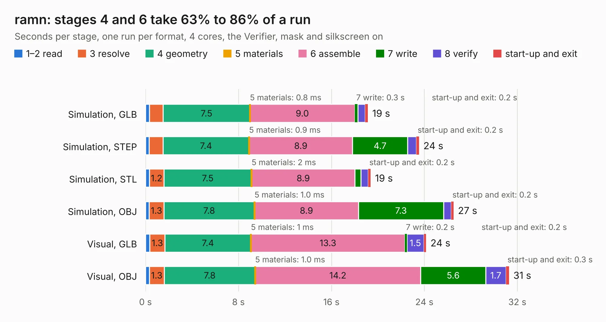

# 2885. ramn

Board 2,885 of the 3,107 of [Corpus Testing](../Corpus-Testing.md), on [Corpus Page 27](../CorpusTestingPages/Corpus-Testing-27.md#2885-ramn).

| Mode and format | 1–2 read | 3 resolve | 4 geometry | 5 materials | 6 assemble | 7 write | 8 verify | start-up and exit | Total |
|---|---:|---:|---:|---:|---:|---:|---:|---:|---:|
| Simulation, GLB | 0.3 | 1.2 | 7.5 | 0.8&nbsp;ms | 9.0 | 0.3 | 0.6 | 0.2 | 19.1 |
| Simulation, STEP | 0.3 | 1.2 | 7.4 | 0.9&nbsp;ms | 8.9 | 4.7 | 0.7 | 0.2 | 23.5 |
| Simulation, STL | 0.3 | 1.2 | 7.5 | 2&nbsp;ms | 8.9 | 0.5 | 0.6 | 0.2 | 19.4 |
| Simulation, OBJ | 0.3 | 1.3 | 7.8 | 1.0&nbsp;ms | 8.9 | 7.3 | 0.7 | 0.2 | 26.5 |
| Visual, GLB | 0.4 | 1.3 | 7.4 | 1&nbsp;ms | 13.3 | 0.2 | 1.5 | 0.2 | 24.2 |
| Visual, OBJ | 0.3 | 1.3 | 7.8 | 1.0&nbsp;ms | 14.2 | 5.6 | 1.7 | 0.3 | 31.3 |

<table align="center"><tr><td valign="top">

| Board | Repo: [ToyotaInfoTech/RAMN](https://github.com/ToyotaInfoTech/RAMN) Board: `ramn.kicad_pcb` |
|---|---|
| Folder | hardware / V1_revB / 0_ramn |
| Complexity | 320&nbsp;/&nbsp;1000 (size&nbsp;245, features&nbsp;75) |
| KESE&nbsp;features | through vias, slotted holes, rounded, trapezoid or chamfered pads, filled zones, copper text, curved board outline |
| Tested | 9th November 2026 |
| Copper&nbsp;layers | 2 |
| File&nbsp;format | KiCad 5 (20171130) |
| Parts,&nbsp;tracks,&nbsp;vias | 86, 1,705, 198 |
| Triangles,&nbsp;simulation | 1,779,576 in 184 parts |
| Verifier | PASS in all six runs |

</td><td valign="top">

<table>
<tr><th>File type</th><th>File size</th><th>Peak memory used</th></tr>
<tr><th colspan="3" align="left">Simulation</th></tr>
<tr><td>GLB</td><td align="right">60&nbsp;MB</td><td align="right">689&nbsp;MB</td></tr>
<tr><td>STEP</td><td align="right">285&nbsp;MB</td><td align="right">834&nbsp;MB</td></tr>
<tr><td>STL</td><td align="right">89&nbsp;MB</td><td align="right">708&nbsp;MB</td></tr>
<tr><td>OBJ</td><td align="right">183&nbsp;MB</td><td align="right">1.2&nbsp;GB</td></tr>
<tr><th colspan="3" align="left">Visual</th></tr>
<tr><td>GLB</td><td align="right">47&nbsp;MB</td><td align="right">839&nbsp;MB</td></tr>
<tr><td>OBJ</td><td align="right">143&nbsp;MB</td><td align="right">993&nbsp;MB</td></tr>
</table>

</td></tr></table>

| Previous | Next |
|:---|---:|
| [2884. pods_panel](b2884b_RAMN_pods-panel.md) | [2886. screens](b2886b_RAMN_screens.md) |
