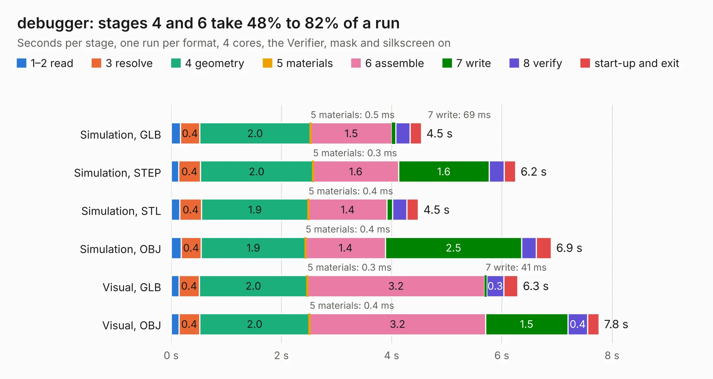

# 2886. debugger

Board 2,886 of the 3,103 of [Corpus Testing](../Corpus-Testing.md), on [Corpus Page 27](../CorpusTestingPages/Corpus-Testing-27.md#2886-debugger).

| Mode and format | 1–2 read | 3 resolve | 4 geometry | 5 materials | 6 assemble | 7 write | 8 verify | start-up and exit | Total |
|---|---:|---:|---:|---:|---:|---:|---:|---:|---:|
| Simulation, GLB | 0.2 | 0.4 | 2.0 | 0.5&nbsp;ms | 1.5 | 69&nbsp;ms | 0.3 | 0.2 | 4.5 |
| Simulation, STEP | 0.1 | 0.4 | 2.0 | 0.3&nbsp;ms | 1.6 | 1.6 | 0.3 | 0.2 | 6.2 |
| Simulation, STL | 0.2 | 0.4 | 1.9 | 0.4&nbsp;ms | 1.4 | 0.1 | 0.3 | 0.2 | 4.5 |
| Simulation, OBJ | 0.2 | 0.4 | 1.9 | 0.4&nbsp;ms | 1.4 | 2.5 | 0.3 | 0.3 | 6.9 |
| Visual, GLB | 0.1 | 0.4 | 2.0 | 0.3&nbsp;ms | 3.2 | 41&nbsp;ms | 0.3 | 0.3 | 6.3 |
| Visual, OBJ | 0.1 | 0.4 | 2.0 | 0.4&nbsp;ms | 3.2 | 1.5 | 0.4 | 0.2 | 7.8 |

<table align="center"><tr><td valign="top">

| Board | Repo: [ToyotaInfoTech/RAMN](https://github.com/ToyotaInfoTech/RAMN) Board: `debugger.kicad_pcb` |
|---|---|
| Folder | hardware / V1_revB / 5_debugger |
| Complexity | 159&nbsp;/&nbsp;1000 (size&nbsp;114, features&nbsp;45) |
| KESE&nbsp;features | through vias, filled zones, copper text |
| Tested | 9th November 2026 |
| Copper&nbsp;layers | 2 |
| File&nbsp;format | KiCad 5 (20171130) |
| Parts,&nbsp;tracks,&nbsp;vias | 2, 164, 7 |
| Triangles,&nbsp;simulation | 430,318 in 40 parts |
| Verifier | PASS in all six runs |

</td><td valign="top">

<table>
<tr><th>File type</th><th>File size</th><th>Peak memory used</th></tr>
<tr><th colspan="3" align="left">Simulation</th></tr>
<tr><td>GLB</td><td align="right">14&nbsp;MB</td><td align="right">267&nbsp;MB</td></tr>
<tr><td>STEP</td><td align="right">57&nbsp;MB</td><td align="right">306&nbsp;MB</td></tr>
<tr><td>STL</td><td align="right">22&nbsp;MB</td><td align="right">269&nbsp;MB</td></tr>
<tr><td>OBJ</td><td align="right">43&nbsp;MB</td><td align="right">323&nbsp;MB</td></tr>
<tr><th colspan="3" align="left">Visual</th></tr>
<tr><td>GLB</td><td align="right">8.7&nbsp;MB</td><td align="right">292&nbsp;MB</td></tr>
<tr><td>OBJ</td><td align="right">26&nbsp;MB</td><td align="right">295&nbsp;MB</td></tr>
</table>

</td></tr></table>

| Previous | Next |
|:---|---:|
| [2885. body](b2885b_RAMN_body.md) | [2887. 6-Slot-Backplane](b2887b_retroverse_6-Slot-Backplane.md) |
