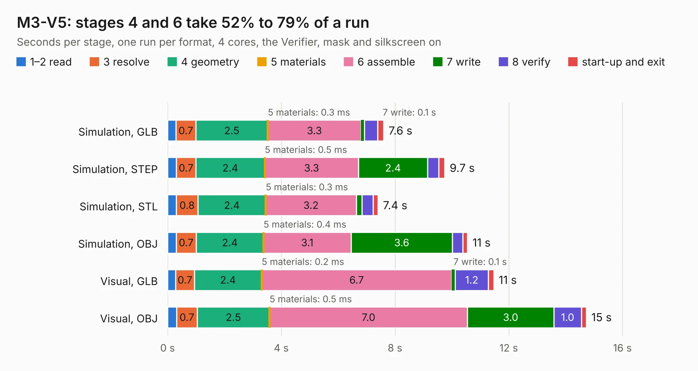

# 2886. M3-V5

Board 2,886 of the 3,131 of [Corpus Testing](../Corpus-Testing.md), on [Corpus Page 27](../CorpusTestingPages/Corpus-Testing-27.md#2886-m3-v5).

| Mode and format | 1–2 read | 3 resolve | 4 geometry | 5 materials | 6 assemble | 7 write | 8 verify | start-up and exit | Total |
|---|---:|---:|---:|---:|---:|---:|---:|---:|---:|
| Simulation, GLB | 0.3 | 0.7 | 2.5 | 0.3&nbsp;ms | 3.3 | 0.1 | 0.5 | 0.2 | 7.6 |
| Simulation, STEP | 0.3 | 0.7 | 2.4 | 0.5&nbsp;ms | 3.3 | 2.4 | 0.4 | 0.2 | 9.7 |
| Simulation, STL | 0.3 | 0.8 | 2.4 | 0.3&nbsp;ms | 3.2 | 0.2 | 0.4 | 0.2 | 7.4 |
| Simulation, OBJ | 0.3 | 0.7 | 2.4 | 0.4&nbsp;ms | 3.1 | 3.6 | 0.4 | 0.2 | 10.6 |
| Visual, GLB | 0.3 | 0.7 | 2.4 | 0.2&nbsp;ms | 6.7 | 0.1 | 1.2 | 0.2 | 11.5 |
| Visual, OBJ | 0.3 | 0.7 | 2.5 | 0.5&nbsp;ms | 7.0 | 3.0 | 1.0 | 0.2 | 14.7 |

<table align="center"><tr><td valign="top">

| Board | Repo: [tomrodinger/servomotor](https://github.com/tomrodinger/servomotor) Board: `M3-V5.kicad_pcb` |
|---|---|
| Folder | PCB / Servomotor3 / V5 |
| Complexity | 347&nbsp;/&nbsp;1000 (size&nbsp;222, features&nbsp;125) |
| KESE&nbsp;features | through vias, custom pads, rounded, trapezoid or chamfered pads, filled zones, copper drawings, curved board outline, stack-up, dielectric εr and tanδ, copper finish |
| Tested | 9th November 2026 |
| Copper&nbsp;layers | 2 |
| File&nbsp;format | KiCad 7 (20221018) |
| Parts,&nbsp;tracks,&nbsp;vias | 65, 1,035, 165 |
| Triangles,&nbsp;simulation | 886,776 in 62 parts |
| Verifier | PASS in all six runs |

</td><td valign="top">

<table>
<tr><th>File type</th><th>File size</th><th>Peak memory used</th></tr>
<tr><th colspan="3" align="left">Simulation</th></tr>
<tr><td>GLB</td><td align="right">31&nbsp;MB</td><td align="right">461&nbsp;MB</td></tr>
<tr><td>STEP</td><td align="right">162&nbsp;MB</td><td align="right">504&nbsp;MB</td></tr>
<tr><td>STL</td><td align="right">44&nbsp;MB</td><td align="right">457&nbsp;MB</td></tr>
<tr><td>OBJ</td><td align="right">90&nbsp;MB</td><td align="right">626&nbsp;MB</td></tr>
<tr><th colspan="3" align="left">Visual</th></tr>
<tr><td>GLB</td><td align="right">27&nbsp;MB</td><td align="right">660&nbsp;MB</td></tr>
<tr><td>OBJ</td><td align="right">82&nbsp;MB</td><td align="right">673&nbsp;MB</td></tr>
</table>

</td></tr></table>

| Previous | Next |
|:---|---:|
| [2885. M3-V4](b2885b_servomotor_M3-V4.md) | [2887. V8](b2887b_servomotor_V8.md) |
