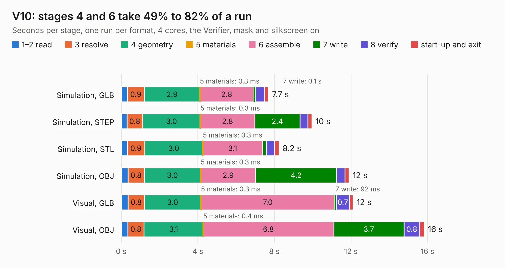

# 2886. V10

Board 2,886 of the 3,139 of [Corpus Testing](../Corpus-Testing.md), on [Corpus Page 27](../CorpusTestingPages/Corpus-Testing-27.md#2886-v10).

| Mode and format | 1–2 read | 3 resolve | 4 geometry | 5 materials | 6 assemble | 7 write | 8 verify | start-up and exit | Total |
|---|---:|---:|---:|---:|---:|---:|---:|---:|---:|
| Simulation, GLB | 0.3 | 0.9 | 2.9 | 0.3&nbsp;ms | 2.8 | 0.1 | 0.5 | 0.2 | 7.7 |
| Simulation, STEP | 0.3 | 0.8 | 3.0 | 0.3&nbsp;ms | 2.8 | 2.4 | 0.4 | 0.2 | 10.0 |
| Simulation, STL | 0.3 | 0.9 | 3.0 | 0.3&nbsp;ms | 3.1 | 0.2 | 0.4 | 0.2 | 8.2 |
| Simulation, OBJ | 0.4 | 0.8 | 3.0 | 0.3&nbsp;ms | 2.9 | 4.2 | 0.4 | 0.2 | 11.9 |
| Visual, GLB | 0.4 | 0.8 | 3.0 | 0.3&nbsp;ms | 7.0 | 92&nbsp;ms | 0.7 | 0.2 | 12.1 |
| Visual, OBJ | 0.3 | 0.8 | 3.1 | 0.4&nbsp;ms | 6.8 | 3.7 | 0.8 | 0.2 | 15.8 |

<table align="center"><tr><td valign="top">

| Board | Repo: [tomrodinger/servomotor](https://github.com/tomrodinger/servomotor) Board: `V10.kicad_pcb` |
|---|---|
| Folder | PCB / Servomotor3 / V10 |
| Complexity | 344&nbsp;/&nbsp;1000 (size&nbsp;219, features&nbsp;125) |
| KESE&nbsp;features | through vias, custom pads, rounded, trapezoid or chamfered pads, filled zones, copper drawings, curved board outline, stack-up, dielectric εr and tanδ, copper finish |
| Tested | 9th November 2026 |
| Copper&nbsp;layers | 2 |
| File&nbsp;format | KiCad 8 (20240108) |
| Parts,&nbsp;tracks,&nbsp;vias | 64, 576, 226 |
| Triangles,&nbsp;simulation | 822,874 in 60 parts |
| Verifier | PASS in all six runs |

</td><td valign="top">

<table>
<tr><th>File type</th><th>File size</th><th>Peak memory used</th></tr>
<tr><th colspan="3" align="left">Simulation</th></tr>
<tr><td>GLB</td><td align="right">28&nbsp;MB</td><td align="right">394&nbsp;MB</td></tr>
<tr><td>STEP</td><td align="right">129&nbsp;MB</td><td align="right">506&nbsp;MB</td></tr>
<tr><td>STL</td><td align="right">41&nbsp;MB</td><td align="right">407&nbsp;MB</td></tr>
<tr><td>OBJ</td><td align="right">83&nbsp;MB</td><td align="right">582&nbsp;MB</td></tr>
<tr><th colspan="3" align="left">Visual</th></tr>
<tr><td>GLB</td><td align="right">24&nbsp;MB</td><td align="right">600&nbsp;MB</td></tr>
<tr><td>OBJ</td><td align="right">72&nbsp;MB</td><td align="right">601&nbsp;MB</td></tr>
</table>

</td></tr></table>

| Previous | Next |
|:---|---:|
| [2885. 1.5](b2885b_servomotor_1-5.md) | [2887. V11](b2887b_servomotor_PCB-Servomotor3-V11_V11.md) |
