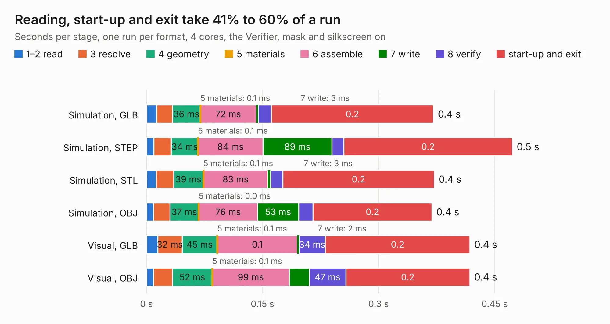

# 2887. pref-display-back-d5

Board 2,887 of the 3,127 of [Corpus Testing](../Corpus-Testing.md), on [Corpus Page 27](../CorpusTestingPages/Corpus-Testing-27.md#2887-pref-display-back-d5).

| Mode and format | 1–2 read | 3 resolve | 4 geometry | 5 materials | 6 assemble | 7 write | 8 verify | start-up and exit | Total |
|---|---:|---:|---:|---:|---:|---:|---:|---:|---:|
| Simulation, GLB | 13&nbsp;ms | 21&nbsp;ms | 36&nbsp;ms | 0.1&nbsp;ms | 72&nbsp;ms | 3&nbsp;ms | 17&nbsp;ms | 0.2 | 0.4 |
| Simulation, STEP | 9&nbsp;ms | 23&nbsp;ms | 34&nbsp;ms | 0.1&nbsp;ms | 84&nbsp;ms | 89&nbsp;ms | 15&nbsp;ms | 0.2 | 0.5 |
| Simulation, STL | 13&nbsp;ms | 22&nbsp;ms | 39&nbsp;ms | 0.1&nbsp;ms | 83&nbsp;ms | 3&nbsp;ms | 16&nbsp;ms | 0.2 | 0.4 |
| Simulation, OBJ | 9&nbsp;ms | 21&nbsp;ms | 37&nbsp;ms | 0.0&nbsp;ms | 76&nbsp;ms | 53&nbsp;ms | 18&nbsp;ms | 0.2 | 0.4 |
| Visual, GLB | 14&nbsp;ms | 32&nbsp;ms | 45&nbsp;ms | 0.1&nbsp;ms | 0.1 | 2&nbsp;ms | 34&nbsp;ms | 0.2 | 0.4 |
| Visual, OBJ | 9&nbsp;ms | 24&nbsp;ms | 52&nbsp;ms | 0.1&nbsp;ms | 99&nbsp;ms | 26&nbsp;ms | 47&nbsp;ms | 0.2 | 0.4 |

<table align="center"><tr><td valign="top">

| Board | Repo: [torlye/pocket-reform](https://github.com/torlye/pocket-reform) Board: `pref-display-back-d5.kicad_pcb` |
|---|---|
| Folder | case-plate-pcbs |
| Complexity | 47&nbsp;/&nbsp;1000 (size&nbsp;17, features&nbsp;30) |
| KESE&nbsp;features | filled zones, copper drawings |
| Tested | 9th November 2026 |
| Copper&nbsp;layers | 2 |
| File&nbsp;format | KiCad 6 (20211014) |
| Parts,&nbsp;tracks,&nbsp;vias | 0, 0, 0 |
| Triangles,&nbsp;simulation | 12,644 in 6 parts |
| Note | no components |
| Verifier | PASS in all six runs |

</td><td valign="top">

<table>
<tr><th>File type</th><th>File size</th><th>Peak memory used</th></tr>
<tr><th colspan="3" align="left">Simulation</th></tr>
<tr><td>GLB</td><td align="right">452&nbsp;kB</td><td align="right">41&nbsp;MB</td></tr>
<tr><td>STEP</td><td align="right">2.2&nbsp;MB</td><td align="right">44&nbsp;MB</td></tr>
<tr><td>STL</td><td align="right">633&nbsp;kB</td><td align="right">41&nbsp;MB</td></tr>
<tr><td>OBJ</td><td align="right">1.2&nbsp;MB</td><td align="right">43&nbsp;MB</td></tr>
<tr><th colspan="3" align="left">Visual</th></tr>
<tr><td>GLB</td><td align="right">211&nbsp;kB</td><td align="right">57&nbsp;MB</td></tr>
<tr><td>OBJ</td><td align="right">540&nbsp;kB</td><td align="right">67&nbsp;MB</td></tr>
</table>

</td></tr></table>

| Previous | Next |
|:---|---:|
| [2886. pref-display-back-d5-gold](b2886b_pocket-reform_pref-display-back-d5-gold.md) | [2888. pref-display-back-d7-gold](b2888b_pocket-reform_pref-display-back-d7-gold.md) |
