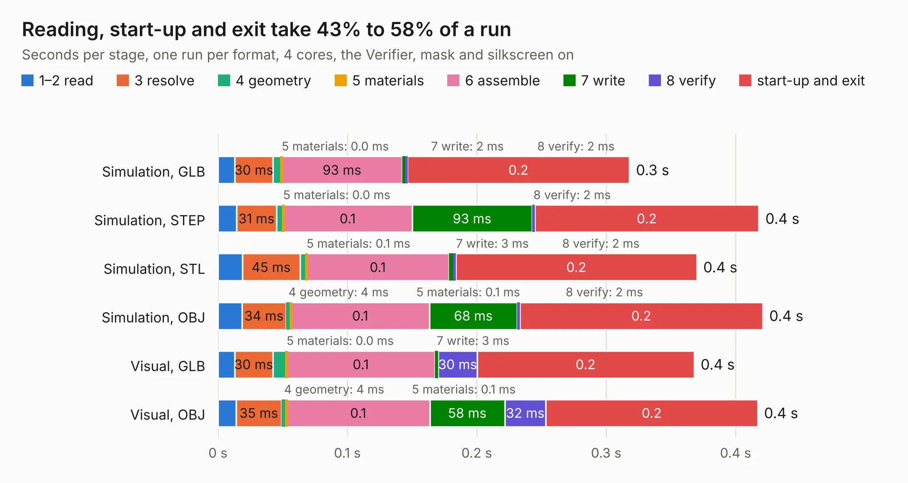

# 2887. pref-side-panel-ports-d8

Board 2,887 of the 3,118 of [Corpus Testing](../Corpus-Testing.md), on [Corpus Page 27](../CorpusTestingPages/Corpus-Testing-27.md#2887-pref-side-panel-ports-d8).

| Mode and format | 1–2 read | 3 resolve | 4 geometry | 5 materials | 6 assemble | 7 write | 8 verify | start-up and exit | Total |
|---|---:|---:|---:|---:|---:|---:|---:|---:|---:|
| Simulation, GLB | 13&nbsp;ms | 30&nbsp;ms | 7&nbsp;ms | 0.0&nbsp;ms | 93&nbsp;ms | 2&nbsp;ms | 2&nbsp;ms | 0.2 | 0.3 |
| Simulation, STEP | 14&nbsp;ms | 31&nbsp;ms | 5&nbsp;ms | 0.0&nbsp;ms | 0.1 | 93&nbsp;ms | 2&nbsp;ms | 0.2 | 0.4 |
| Simulation, STL | 19&nbsp;ms | 45&nbsp;ms | 5&nbsp;ms | 0.1&nbsp;ms | 0.1 | 3&nbsp;ms | 2&nbsp;ms | 0.2 | 0.4 |
| Simulation, OBJ | 19&nbsp;ms | 34&nbsp;ms | 4&nbsp;ms | 0.1&nbsp;ms | 0.1 | 68&nbsp;ms | 2&nbsp;ms | 0.2 | 0.4 |
| Visual, GLB | 13&nbsp;ms | 30&nbsp;ms | 11&nbsp;ms | 0.0&nbsp;ms | 0.1 | 3&nbsp;ms | 30&nbsp;ms | 0.2 | 0.4 |
| Visual, OBJ | 14&nbsp;ms | 35&nbsp;ms | 4&nbsp;ms | 0.1&nbsp;ms | 0.1 | 58&nbsp;ms | 32&nbsp;ms | 0.2 | 0.4 |

<table align="center"><tr><td valign="top">

| Board | Repo: [torlye/pocket-reform](https://github.com/torlye/pocket-reform) Board: `pref-side-panel-ports-d8.kicad_pcb` |
|---|---|
| Folder | case-plate-pcbs |
| Complexity | 62&nbsp;/&nbsp;1000 (size&nbsp;17, features&nbsp;45) |
| KESE&nbsp;features | curved board outline, stack-up, dielectric εr and tanδ, mask and silkscreen colours |
| Tested | 9th November 2026 |
| Copper&nbsp;layers | 2 |
| File&nbsp;format | KiCad 7 (20221018) |
| Parts,&nbsp;tracks,&nbsp;vias | 0, 0, 0 |
| Triangles,&nbsp;simulation | 12,548 in 3 parts |
| Note | panel, no components |
| Verifier | PASS in all six runs |

</td><td valign="top">

<table>
<tr><th>File type</th><th>File size</th><th>Peak memory used</th></tr>
<tr><th colspan="3" align="left">Simulation</th></tr>
<tr><td>GLB</td><td align="right">337&nbsp;kB</td><td align="right">41&nbsp;MB</td></tr>
<tr><td>STEP</td><td align="right">2.0&nbsp;MB</td><td align="right">43&nbsp;MB</td></tr>
<tr><td>STL</td><td align="right">628&nbsp;kB</td><td align="right">41&nbsp;MB</td></tr>
<tr><td>OBJ</td><td align="right">1.2&nbsp;MB</td><td align="right">44&nbsp;MB</td></tr>
<tr><th colspan="3" align="left">Visual</th></tr>
<tr><td>GLB</td><td align="right">444&nbsp;kB</td><td align="right">54&nbsp;MB</td></tr>
<tr><td>OBJ</td><td align="right">1.2&nbsp;MB</td><td align="right">56&nbsp;MB</td></tr>
</table>

</td></tr></table>

| Previous | Next |
|:---|---:|
| [2886. pref-side-panel-headphones-d8](b2886b_pocket-reform_pref-side-panel-headphones-d8.md) | [2888. pref-side-panel-ports](b2888b_pocket-reform_pref-side-panel-ports.md) |
