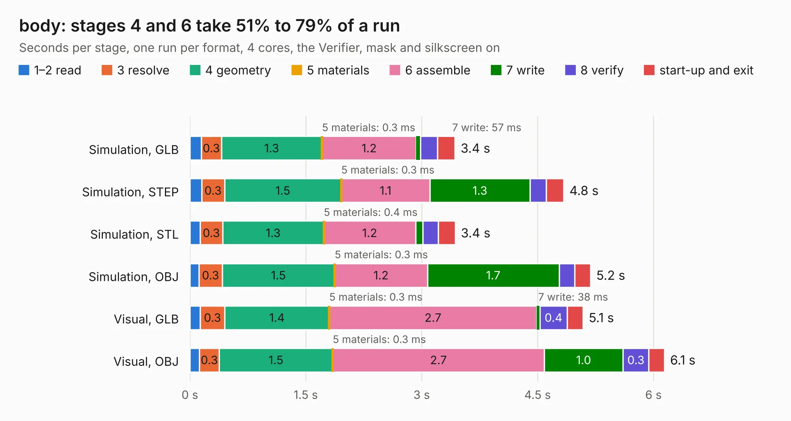

# 2889. body

Board 2,889 of the 3,107 of [Corpus Testing](../Corpus-Testing.md), on [Corpus Page 27](../CorpusTestingPages/Corpus-Testing-27.md#2889-body).

| Mode and format | 1–2 read | 3 resolve | 4 geometry | 5 materials | 6 assemble | 7 write | 8 verify | start-up and exit | Total |
|---|---:|---:|---:|---:|---:|---:|---:|---:|---:|
| Simulation, GLB | 0.1 | 0.3 | 1.3 | 0.3&nbsp;ms | 1.2 | 57&nbsp;ms | 0.2 | 0.2 | 3.4 |
| Simulation, STEP | 0.2 | 0.3 | 1.5 | 0.3&nbsp;ms | 1.1 | 1.3 | 0.2 | 0.2 | 4.8 |
| Simulation, STL | 0.1 | 0.3 | 1.3 | 0.4&nbsp;ms | 1.2 | 93&nbsp;ms | 0.2 | 0.2 | 3.4 |
| Simulation, OBJ | 0.1 | 0.3 | 1.5 | 0.3&nbsp;ms | 1.2 | 1.7 | 0.2 | 0.2 | 5.2 |
| Visual, GLB | 0.1 | 0.3 | 1.4 | 0.3&nbsp;ms | 2.7 | 38&nbsp;ms | 0.4 | 0.2 | 5.1 |
| Visual, OBJ | 0.1 | 0.3 | 1.5 | 0.3&nbsp;ms | 2.7 | 1.0 | 0.3 | 0.2 | 6.1 |

<table align="center"><tr><td valign="top">

| Board | Repo: [ToyotaInfoTech/RAMN](https://github.com/ToyotaInfoTech/RAMN) Board: `body.kicad_pcb` |
|---|---|
| Folder | hardware / V1_revB / 4_body |
| Complexity | 204&nbsp;/&nbsp;1000 (size&nbsp;139, features&nbsp;65) |
| KESE&nbsp;features | through vias, rounded, trapezoid or chamfered pads, filled zones, copper text, curved board outline |
| Tested | 9th November 2026 |
| Copper&nbsp;layers | 2 |
| File&nbsp;format | KiCad 5 (20171130) |
| Parts,&nbsp;tracks,&nbsp;vias | 17, 191, 24 |
| Triangles,&nbsp;simulation | 369,154 in 48 parts |
| Verifier | PASS in all six runs |

</td><td valign="top">

<table>
<tr><th>File type</th><th>File size</th><th>Peak memory used</th></tr>
<tr><th colspan="3" align="left">Simulation</th></tr>
<tr><td>GLB</td><td align="right">12&nbsp;MB</td><td align="right">246&nbsp;MB</td></tr>
<tr><td>STEP</td><td align="right">55&nbsp;MB</td><td align="right">295&nbsp;MB</td></tr>
<tr><td>STL</td><td align="right">18&nbsp;MB</td><td align="right">273&nbsp;MB</td></tr>
<tr><td>OBJ</td><td align="right">37&nbsp;MB</td><td align="right">300&nbsp;MB</td></tr>
<tr><th colspan="3" align="left">Visual</th></tr>
<tr><td>GLB</td><td align="right">9.1&nbsp;MB</td><td align="right">287&nbsp;MB</td></tr>
<tr><td>OBJ</td><td align="right">27&nbsp;MB</td><td align="right">293&nbsp;MB</td></tr>
</table>

</td></tr></table>

| Previous | Next |
|:---|---:|
| [2888. powertrain](b2888b_RAMN_powertrain.md) | [2890. debugger](b2890b_RAMN_debugger.md) |
