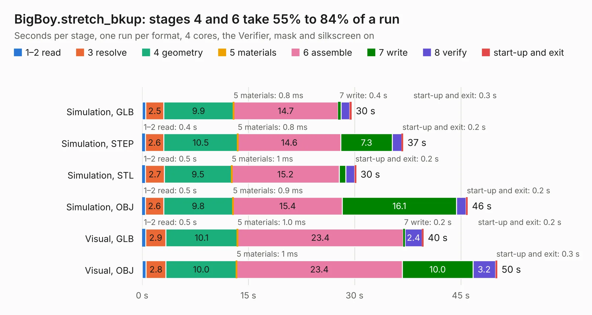

# 2889. BigBoy.stretch_bkup

Board 2,889 of the 3,101 of [Corpus Testing](../Corpus-Testing.md), on [Corpus Page 27](../CorpusTestingPages/Corpus-Testing-27.md#2889-bigboystretch_bkup).

| Mode and format | 1–2 read | 3 resolve | 4 geometry | 5 materials | 6 assemble | 7 write | 8 verify | start-up and exit | Total |
|---|---:|---:|---:|---:|---:|---:|---:|---:|---:|
| Simulation, GLB | 0.5 | 2.5 | 9.9 | 0.8&nbsp;ms | 14.7 | 0.4 | 1.2 | 0.3 | 29.6 |
| Simulation, STEP | 0.4 | 2.6 | 10.5 | 0.8&nbsp;ms | 14.6 | 7.3 | 1.3 | 0.2 | 36.9 |
| Simulation, STL | 0.5 | 2.7 | 9.5 | 1&nbsp;ms | 15.2 | 0.9 | 1.2 | 0.2 | 30.2 |
| Simulation, OBJ | 0.5 | 2.6 | 9.8 | 0.9&nbsp;ms | 15.4 | 16.1 | 1.4 | 0.2 | 46.0 |
| Visual, GLB | 0.5 | 2.9 | 10.1 | 1.0&nbsp;ms | 23.4 | 0.2 | 2.4 | 0.2 | 39.7 |
| Visual, OBJ | 0.6 | 2.8 | 10.0 | 1&nbsp;ms | 23.4 | 10.0 | 3.2 | 0.3 | 50.2 |

<table align="center"><tr><td valign="top">

| Board | Repo: [transistorfet/retroverse](https://github.com/transistorfet/retroverse) Board: `BigBoy.stretch_bkup.kicad_pcb` |
|---|---|
| Folder | components / bigboy / hardware / BigBoy |
| Complexity | 355&nbsp;/&nbsp;1000 (size&nbsp;265, features&nbsp;90) |
| KESE&nbsp;features | through vias, slotted holes, custom pads, rounded, trapezoid or chamfered pads, copper drawings, stack-up, dielectric εr and tanδ |
| Tested | 9th November 2026 |
| Copper&nbsp;layers | 4 |
| File&nbsp;format | KiCad 7 (20221018) |
| Parts,&nbsp;tracks,&nbsp;vias | 117, 1,093, 184 |
| Triangles,&nbsp;simulation | 2,842,700 in 315 parts |
| Verifier | PASS in all six runs |

</td><td valign="top">

<table>
<tr><th>File type</th><th>File size</th><th>Peak memory used</th></tr>
<tr><th colspan="3" align="left">Simulation</th></tr>
<tr><td>GLB</td><td align="right">94&nbsp;MB</td><td align="right">901&nbsp;MB</td></tr>
<tr><td>STEP</td><td align="right">355&nbsp;MB</td><td align="right">1.1&nbsp;GB</td></tr>
<tr><td>STL</td><td align="right">142&nbsp;MB</td><td align="right">909&nbsp;MB</td></tr>
<tr><td>OBJ</td><td align="right">295&nbsp;MB</td><td align="right">1.8&nbsp;GB</td></tr>
<tr><th colspan="3" align="left">Visual</th></tr>
<tr><td>GLB</td><td align="right">58&nbsp;MB</td><td align="right">1.1&nbsp;GB</td></tr>
<tr><td>OBJ</td><td align="right">181&nbsp;MB</td><td align="right">1.2&nbsp;GB</td></tr>
</table>

</td></tr></table>

| Previous | Next |
|:---|---:|
| [2888. BigBoy](b2888b_retroverse_BigBoy.md) | [2890. k30p-VME-Frontpanel](b2890b_retroverse_k30p-VME-Frontpanel.md) |
