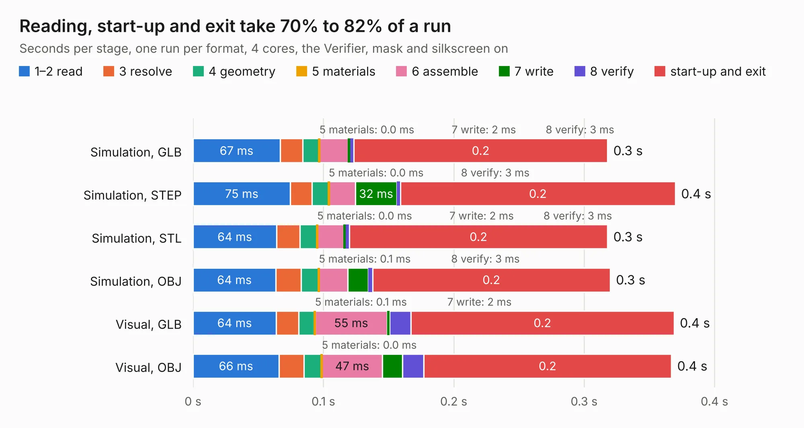

# 2890. pref-side-panel-empty

Board 2,890 of the 3,123 of [Corpus Testing](../Corpus-Testing.md), on [Corpus Page 27](../CorpusTestingPages/Corpus-Testing-27.md#2890-pref-side-panel-empty).

| Mode and format | 1–2 read | 3 resolve | 4 geometry | 5 materials | 6 assemble | 7 write | 8 verify | start-up and exit | Total |
|---|---:|---:|---:|---:|---:|---:|---:|---:|---:|
| Simulation, GLB | 67&nbsp;ms | 17&nbsp;ms | 13&nbsp;ms | 0.0&nbsp;ms | 22&nbsp;ms | 2&nbsp;ms | 3&nbsp;ms | 0.2 | 0.3 |
| Simulation, STEP | 75&nbsp;ms | 17&nbsp;ms | 13&nbsp;ms | 0.0&nbsp;ms | 20&nbsp;ms | 32&nbsp;ms | 3&nbsp;ms | 0.2 | 0.4 |
| Simulation, STL | 64&nbsp;ms | 18&nbsp;ms | 13&nbsp;ms | 0.0&nbsp;ms | 20&nbsp;ms | 2&nbsp;ms | 3&nbsp;ms | 0.2 | 0.3 |
| Simulation, OBJ | 64&nbsp;ms | 19&nbsp;ms | 14&nbsp;ms | 0.1&nbsp;ms | 22&nbsp;ms | 16&nbsp;ms | 3&nbsp;ms | 0.2 | 0.3 |
| Visual, GLB | 64&nbsp;ms | 17&nbsp;ms | 12&nbsp;ms | 0.1&nbsp;ms | 55&nbsp;ms | 2&nbsp;ms | 16&nbsp;ms | 0.2 | 0.4 |
| Visual, OBJ | 66&nbsp;ms | 19&nbsp;ms | 14&nbsp;ms | 0.0&nbsp;ms | 47&nbsp;ms | 15&nbsp;ms | 16&nbsp;ms | 0.2 | 0.4 |

<table align="center"><tr><td valign="top">

| Board | Repo: [torlye/pocket-reform](https://github.com/torlye/pocket-reform) Board: `pref-side-panel-empty.kicad_pcb` |
|---|---|
| Folder | case-plate-pcbs |
| Complexity | 17&nbsp;/&nbsp;1000 (size&nbsp;17, features&nbsp;0) |
| Tested | 9th November 2026 |
| Copper&nbsp;layers | 2 |
| File&nbsp;format | KiCad 6 (20211014) |
| Parts,&nbsp;tracks,&nbsp;vias | 0, 0, 0 |
| Triangles,&nbsp;simulation | 2,732 in 4 parts |
| Note | panel, no components |
| Verifier | PASS in all six runs |

</td><td valign="top">

<table>
<tr><th>File type</th><th>File size</th><th>Peak memory used</th></tr>
<tr><th colspan="3" align="left">Simulation</th></tr>
<tr><td>GLB</td><td align="right">98&nbsp;kB</td><td align="right">61&nbsp;MB</td></tr>
<tr><td>STEP</td><td align="right">225&nbsp;kB</td><td align="right">58&nbsp;MB</td></tr>
<tr><td>STL</td><td align="right">137&nbsp;kB</td><td align="right">57&nbsp;MB</td></tr>
<tr><td>OBJ</td><td align="right">261&nbsp;kB</td><td align="right">58&nbsp;MB</td></tr>
<tr><th colspan="3" align="left">Visual</th></tr>
<tr><td>GLB</td><td align="right">96&nbsp;kB</td><td align="right">69&nbsp;MB</td></tr>
<tr><td>OBJ</td><td align="right">234&nbsp;kB</td><td align="right">69&nbsp;MB</td></tr>
</table>

</td></tr></table>

| Previous | Next |
|:---|---:|
| [2889. pref-keyboard-bezel](b2889b_pocket-reform_pref-keyboard-bezel.md) | [2891. pref-side-panel-headphones-d8](b2891b_pocket-reform_pref-side-panel-headphones-d8.md) |
