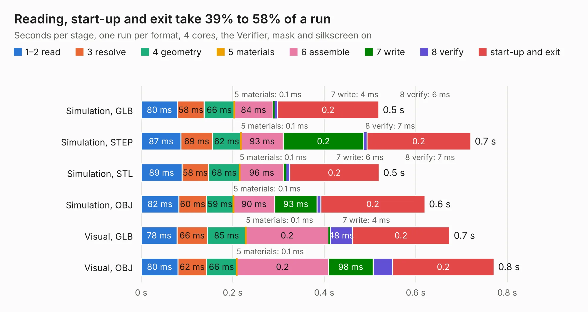

# 2890. k30p-VME-Frontpanel

Board 2,890 of the 3,101 of [Corpus Testing](../Corpus-Testing.md), on [Corpus Page 27](../CorpusTestingPages/Corpus-Testing-27.md#2890-k30p-vme-frontpanel).

| Mode and format | 1–2 read | 3 resolve | 4 geometry | 5 materials | 6 assemble | 7 write | 8 verify | start-up and exit | Total |
|---|---:|---:|---:|---:|---:|---:|---:|---:|---:|
| Simulation, GLB | 80&nbsp;ms | 58&nbsp;ms | 66&nbsp;ms | 0.1&nbsp;ms | 84&nbsp;ms | 4&nbsp;ms | 6&nbsp;ms | 0.2 | 0.5 |
| Simulation, STEP | 87&nbsp;ms | 69&nbsp;ms | 62&nbsp;ms | 0.1&nbsp;ms | 93&nbsp;ms | 0.2 | 7&nbsp;ms | 0.2 | 0.7 |
| Simulation, STL | 89&nbsp;ms | 58&nbsp;ms | 68&nbsp;ms | 0.1&nbsp;ms | 96&nbsp;ms | 6&nbsp;ms | 7&nbsp;ms | 0.2 | 0.5 |
| Simulation, OBJ | 82&nbsp;ms | 60&nbsp;ms | 59&nbsp;ms | 0.1&nbsp;ms | 90&nbsp;ms | 93&nbsp;ms | 8&nbsp;ms | 0.2 | 0.6 |
| Visual, GLB | 78&nbsp;ms | 66&nbsp;ms | 85&nbsp;ms | 0.1&nbsp;ms | 0.2 | 4&nbsp;ms | 48&nbsp;ms | 0.2 | 0.7 |
| Visual, OBJ | 80&nbsp;ms | 62&nbsp;ms | 66&nbsp;ms | 0.1&nbsp;ms | 0.2 | 98&nbsp;ms | 43&nbsp;ms | 0.2 | 0.8 |

<table align="center"><tr><td valign="top">

| Board | Repo: [transistorfet/retroverse](https://github.com/transistorfet/retroverse) Board: `k30p-VME-Frontpanel.kicad_pcb` |
|---|---|
| Folder | components / computie-vme / hardware / k30p-VME-Frontpanel |
| Complexity | 39&nbsp;/&nbsp;1000 (size&nbsp;29, features&nbsp;10) |
| KESE&nbsp;features | slotted holes |
| Tested | 9th November 2026 |
| Copper&nbsp;layers | 2 |
| File&nbsp;format | KiCad 8 (20240108) |
| Parts,&nbsp;tracks,&nbsp;vias | 2, 0, 0 |
| Triangles,&nbsp;simulation | 19,828 in 4 parts |
| Note | panel |
| Verifier | PASS in all six runs |

</td><td valign="top">

<table>
<tr><th>File type</th><th>File size</th><th>Peak memory used</th></tr>
<tr><th colspan="3" align="left">Simulation</th></tr>
<tr><td>GLB</td><td align="right">689&nbsp;kB</td><td align="right">66&nbsp;MB</td></tr>
<tr><td>STEP</td><td align="right">2.5&nbsp;MB</td><td align="right">67&nbsp;MB</td></tr>
<tr><td>STL</td><td align="right">992&nbsp;kB</td><td align="right">66&nbsp;MB</td></tr>
<tr><td>OBJ</td><td align="right">2.0&nbsp;MB</td><td align="right">70&nbsp;MB</td></tr>
<tr><th colspan="3" align="left">Visual</th></tr>
<tr><td>GLB</td><td align="right">668&nbsp;kB</td><td align="right">88&nbsp;MB</td></tr>
<tr><td>OBJ</td><td align="right">1.8&nbsp;MB</td><td align="right">89&nbsp;MB</td></tr>
</table>

</td></tr></table>

| Previous | Next |
|:---|---:|
| [2889. BigBoy.stretch_bkup](b2889b_retroverse_BigBoy-stretch-bkup.md) | [2891. k30p-VME](b2891b_retroverse_k30p-VME.md) |
