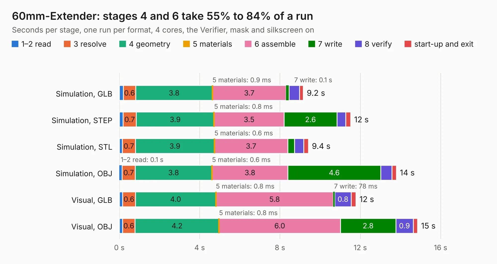

# 2891. 60mm-Extender

Board 2,891 of the 3,106 of [Corpus Testing](../Corpus-Testing.md), on [Corpus Page 27](../CorpusTestingPages/Corpus-Testing-27.md#2891-60mm-extender).

| Mode and format | 1–2 read | 3 resolve | 4 geometry | 5 materials | 6 assemble | 7 write | 8 verify | start-up and exit | Total |
|---|---:|---:|---:|---:|---:|---:|---:|---:|---:|
| Simulation, GLB | 0.2 | 0.6 | 3.8 | 0.9&nbsp;ms | 3.7 | 0.1 | 0.5 | 0.2 | 9.2 |
| Simulation, STEP | 0.2 | 0.7 | 3.9 | 0.8&nbsp;ms | 3.5 | 2.6 | 0.4 | 0.2 | 11.5 |
| Simulation, STL | 0.2 | 0.7 | 3.9 | 0.6&nbsp;ms | 3.7 | 0.3 | 0.5 | 0.2 | 9.4 |
| Simulation, OBJ | 0.1 | 0.7 | 3.8 | 0.6&nbsp;ms | 3.8 | 4.6 | 0.6 | 0.2 | 13.8 |
| Visual, GLB | 0.2 | 0.6 | 4.0 | 0.8&nbsp;ms | 5.8 | 78&nbsp;ms | 0.8 | 0.2 | 11.8 |
| Visual, OBJ | 0.2 | 0.6 | 4.2 | 0.8&nbsp;ms | 6.0 | 2.8 | 0.9 | 0.2 | 14.8 |

<table align="center"><tr><td valign="top">

| Board | Repo: [transistorfet/retroverse](https://github.com/transistorfet/retroverse) Board: `60mm-Extender.kicad_pcb` |
|---|---|
| Folder | components / backplane / 60mm-Extender |
| Complexity | 175&nbsp;/&nbsp;1000 (size&nbsp;130, features&nbsp;45) |
| KESE&nbsp;features | through vias, rounded, trapezoid or chamfered pads, filled zones |
| Tested | 9th November 2026 |
| Copper&nbsp;layers | 2 |
| File&nbsp;format | KiCad 8 (20240108) |
| Parts,&nbsp;tracks,&nbsp;vias | 2, 474, 9 |
| Triangles,&nbsp;simulation | 1,019,032 in 97 parts |
| Verifier | PASS in all six runs |

</td><td valign="top">

<table>
<tr><th>File type</th><th>File size</th><th>Peak memory used</th></tr>
<tr><th colspan="3" align="left">Simulation</th></tr>
<tr><td>GLB</td><td align="right">32&nbsp;MB</td><td align="right">458&nbsp;MB</td></tr>
<tr><td>STEP</td><td align="right">136&nbsp;MB</td><td align="right">538&nbsp;MB</td></tr>
<tr><td>STL</td><td align="right">51&nbsp;MB</td><td align="right">438&nbsp;MB</td></tr>
<tr><td>OBJ</td><td align="right">101&nbsp;MB</td><td align="right">696&nbsp;MB</td></tr>
<tr><th colspan="3" align="left">Visual</th></tr>
<tr><td>GLB</td><td align="right">18&nbsp;MB</td><td align="right">519&nbsp;MB</td></tr>
<tr><td>OBJ</td><td align="right">55&nbsp;MB</td><td align="right">483&nbsp;MB</td></tr>
</table>

</td></tr></table>

| Previous | Next |
|:---|---:|
| [2890. 6-Slot-Backplane](b2890b_retroverse_6-Slot-Backplane.md) | [2892. BigBoy-Frontpanel](b2892b_retroverse_BigBoy-Frontpanel.md) |
