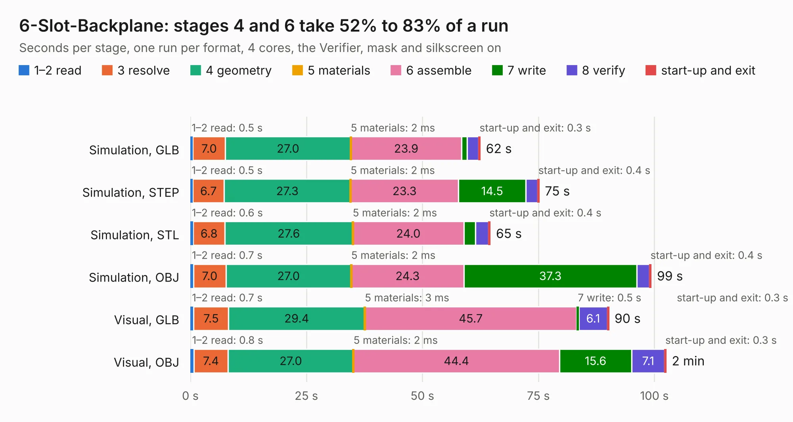

# 2892. 6-Slot-Backplane

Board 2,892 of the 3,108 of [Corpus Testing](../Corpus-Testing.md), on [Corpus Page 27](../CorpusTestingPages/Corpus-Testing-27.md#2892-6-slot-backplane).

| Mode and format | 1–2 read | 3 resolve | 4 geometry | 5 materials | 6 assemble | 7 write | 8 verify | start-up and exit | Total |
|---|---:|---:|---:|---:|---:|---:|---:|---:|---:|
| Simulation, GLB | 0.5 | 7.0 | 27.0 | 2&nbsp;ms | 23.9 | 1.1 | 2.6 | 0.3 | 62.5 |
| Simulation, STEP | 0.5 | 6.7 | 27.3 | 2&nbsp;ms | 23.3 | 14.5 | 2.5 | 0.4 | 75.2 |
| Simulation, STL | 0.6 | 6.8 | 27.6 | 2&nbsp;ms | 24.0 | 2.5 | 2.8 | 0.4 | 64.6 |
| Simulation, OBJ | 0.7 | 7.0 | 27.0 | 2&nbsp;ms | 24.3 | 37.3 | 2.7 | 0.4 | 99.3 |
| Visual, GLB | 0.7 | 7.5 | 29.4 | 3&nbsp;ms | 45.7 | 0.5 | 6.1 | 0.3 | 90.2 |
| Visual, OBJ | 0.8 | 7.4 | 27.0 | 2&nbsp;ms | 44.4 | 15.6 | 7.1 | 0.3 | 102.5 |

<table align="center"><tr><td valign="top">

| Board | Repo: [transistorfet/retroverse](https://github.com/transistorfet/retroverse) Board: `6-Slot-Backplane.kicad_pcb` |
|---|---|
| Folder | components / backplane / 6-Slot-Backplane |
| Complexity | 201&nbsp;/&nbsp;1000 (size&nbsp;151, features&nbsp;50) |
| KESE&nbsp;features | rounded, trapezoid or chamfered pads, copper drawings, stack-up, dielectric εr and tanδ |
| Tested | 9th November 2026 |
| Copper&nbsp;layers | 4 |
| File&nbsp;format | KiCad 8 (20240108) |
| Parts,&nbsp;tracks,&nbsp;vias | 123, 52, 0 |
| Triangles,&nbsp;simulation | 6,834,688 in 155 parts |
| Verifier | PASS in all six runs |

</td><td valign="top">

<table>
<tr><th>File type</th><th>File size</th><th>Peak memory used</th></tr>
<tr><th colspan="3" align="left">Simulation</th></tr>
<tr><td>GLB</td><td align="right">214&nbsp;MB</td><td align="right">1.6&nbsp;GB</td></tr>
<tr><td>STEP</td><td align="right">694&nbsp;MB</td><td align="right">2.2&nbsp;GB</td></tr>
<tr><td>STL</td><td align="right">342&nbsp;MB</td><td align="right">1.6&nbsp;GB</td></tr>
<tr><td>OBJ</td><td align="right">713&nbsp;MB</td><td align="right">4.2&nbsp;GB</td></tr>
<tr><th colspan="3" align="left">Visual</th></tr>
<tr><td>GLB</td><td align="right">103&nbsp;MB</td><td align="right">2.0&nbsp;GB</td></tr>
<tr><td>OBJ</td><td align="right">331&nbsp;MB</td><td align="right">2.2&nbsp;GB</td></tr>
</table>

</td></tr></table>

| Previous | Next |
|:---|---:|
| [2891. debugger](b2891b_RAMN_debugger.md) | [2893. 60mm-Extender](b2893b_retroverse_60mm-Extender.md) |
