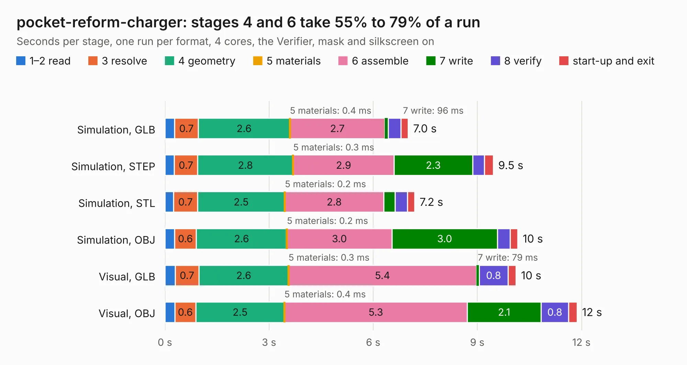

# 2894. pocket-reform-charger

Board 2,894 of the 3,123 of [Corpus Testing](../Corpus-Testing.md), on [Corpus Page 27](../CorpusTestingPages/Corpus-Testing-27.md#2894-pocket-reform-charger).

| Mode and format | 1–2 read | 3 resolve | 4 geometry | 5 materials | 6 assemble | 7 write | 8 verify | start-up and exit | Total |
|---|---:|---:|---:|---:|---:|---:|---:|---:|---:|
| Simulation, GLB | 0.3 | 0.7 | 2.6 | 0.4&nbsp;ms | 2.7 | 96&nbsp;ms | 0.4 | 0.2 | 7.0 |
| Simulation, STEP | 0.3 | 0.7 | 2.8 | 0.3&nbsp;ms | 2.9 | 2.3 | 0.3 | 0.3 | 9.5 |
| Simulation, STL | 0.2 | 0.7 | 2.5 | 0.2&nbsp;ms | 2.8 | 0.3 | 0.4 | 0.2 | 7.2 |
| Simulation, OBJ | 0.3 | 0.6 | 2.6 | 0.2&nbsp;ms | 3.0 | 3.0 | 0.4 | 0.2 | 10.2 |
| Visual, GLB | 0.3 | 0.7 | 2.6 | 0.3&nbsp;ms | 5.4 | 79&nbsp;ms | 0.8 | 0.2 | 10.1 |
| Visual, OBJ | 0.3 | 0.6 | 2.5 | 0.4&nbsp;ms | 5.3 | 2.1 | 0.8 | 0.2 | 11.9 |

<table align="center"><tr><td valign="top">

| Board | Repo: [torlye/pocket-reform](https://github.com/torlye/pocket-reform) Board: `pocket-reform-charger.kicad_pcb` |
|---|---|
| Folder | pocket-reform-charger |
| Complexity | 301&nbsp;/&nbsp;1000 (size&nbsp;226, features&nbsp;75) |
| KESE&nbsp;features | through vias, rounded, trapezoid or chamfered pads, filled zones, stack-up, dielectric εr and tanδ |
| Tested | 9th November 2026 |
| Copper&nbsp;layers | 4 |
| File&nbsp;format | KiCad 9 (20241229) |
| Parts,&nbsp;tracks,&nbsp;vias | 67, 352, 108 |
| Triangles,&nbsp;simulation | 710,712 in 77 parts |
| Verifier | PASS in all six runs |

</td><td valign="top">

<table>
<tr><th>File type</th><th>File size</th><th>Peak memory used</th></tr>
<tr><th colspan="3" align="left">Simulation</th></tr>
<tr><td>GLB</td><td align="right">25&nbsp;MB</td><td align="right">373&nbsp;MB</td></tr>
<tr><td>STEP</td><td align="right">109&nbsp;MB</td><td align="right">432&nbsp;MB</td></tr>
<tr><td>STL</td><td align="right">36&nbsp;MB</td><td align="right">380&nbsp;MB</td></tr>
<tr><td>OBJ</td><td align="right">72&nbsp;MB</td><td align="right">521&nbsp;MB</td></tr>
<tr><th colspan="3" align="left">Visual</th></tr>
<tr><td>GLB</td><td align="right">17&nbsp;MB</td><td align="right">483&nbsp;MB</td></tr>
<tr><td>OBJ</td><td align="right">51&nbsp;MB</td><td align="right">487&nbsp;MB</td></tr>
</table>

</td></tr></table>

| Previous | Next |
|:---|---:|
| [2893. pref-side-panel-ports](b2893b_pocket-reform_pref-side-panel-ports.md) | [2895. pocket-reform-headphones](b2895b_pocket-reform_pocket-reform-headphones.md) |
