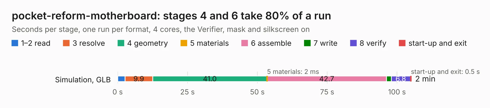

# 2894. pocket-reform-motherboard

Board 2,894 of the 3,120 of [Corpus Testing](../Corpus-Testing.md), on [Corpus Page 27](../CorpusTestingPages/Corpus-Testing-27.md#2894-pocket-reform-motherboard).

| Mode and format | 1–2 read | 3 resolve | 4 geometry | 5 materials | 6 assemble | 7 write | 8 verify | start-up and exit | Total |
|---|---:|---:|---:|---:|---:|---:|---:|---:|---:|
| Simulation, GLB | 2.6 | 9.9 | 41.0 | 2&nbsp;ms | 42.7 | 1.7 | 6.8 | 0.5 | 105.2 |
| Simulation, STEP | 2.6 | 10.5 | 42.6 | 2&nbsp;ms | 42.7 | 24.8 | 7.1 | 0.5 | 130.7 |
| Simulation, STL | 3.0 | 10.1 | 41.3 | 3&nbsp;ms | 41.0 | 3.7 | 6.6 | 0.4 | 106.1 |
| Simulation, OBJ | 2.9 | 10.4 | 41.3 | 2&nbsp;ms | 41.2 | 57.7 | 6.4 | 0.4 | 160.3 |
| Visual, GLB | 2.9 | 10.6 | 40.9 | 3&nbsp;ms | 83.1 | 0.8 | 9.0 | 0.4 | 147.7 |
| Visual, OBJ | 2.8 | 9.6 | 38.7 | 2&nbsp;ms | 84.6 | 33.2 | 9.1 | 0.3 | 178.4 |

<table align="center"><tr><td valign="top">

| Board | Repo: [torlye/pocket-reform](https://github.com/torlye/pocket-reform) Board: `pocket-reform-motherboard.kicad_pcb` |
|---|---|
| Folder | pocket-reform-motherboard |
| Complexity | 446&nbsp;/&nbsp;1000 (size&nbsp;316, features&nbsp;130) |
| KESE&nbsp;features | through vias, slotted holes, custom pads, rounded, trapezoid or chamfered pads, filled zones, copper drawings, stack-up, dielectric εr and tanδ, copper finish, mask and silkscreen colours |
| Tested | 9th November 2026 |
| Copper&nbsp;layers | 6 |
| File&nbsp;format | KiCad 10 (20260206) |
| Parts,&nbsp;tracks,&nbsp;vias | 412, 6,707, 1,318 |
| Triangles,&nbsp;simulation | 9,380,390 in 633 parts |
| Verifier | PASS in all six runs |

</td><td valign="top">

<table>
<tr><th>File type</th><th>File size</th><th>Peak memory used</th></tr>
<tr><th colspan="3" align="left">Simulation</th></tr>
<tr><td>GLB</td><td align="right">315&nbsp;MB</td><td align="right">2.4&nbsp;GB</td></tr>
<tr><td>STEP</td><td align="right">1.3&nbsp;GB</td><td align="right">3.4&nbsp;GB</td></tr>
<tr><td>STL</td><td align="right">469&nbsp;MB</td><td align="right">2.4&nbsp;GB</td></tr>
<tr><td>OBJ</td><td align="right">996&nbsp;MB</td><td align="right">5.9&nbsp;GB</td></tr>
<tr><th colspan="3" align="left">Visual</th></tr>
<tr><td>GLB</td><td align="right">182&nbsp;MB</td><td align="right">2.9&nbsp;GB</td></tr>
<tr><td>OBJ</td><td align="right">592&nbsp;MB</td><td align="right">3.8&nbsp;GB</td></tr>
</table>

</td></tr></table>

| Previous | Next |
|:---|---:|
| [2893. pocket-reform-keyboard-kailh-ortho](b2893b_pocket-reform_pocket-reform-keyboard-kailh-ortho.md) | [2895. nref-wifi-m2](b2895b_pocket-reform_nref-wifi-m2.md) |
