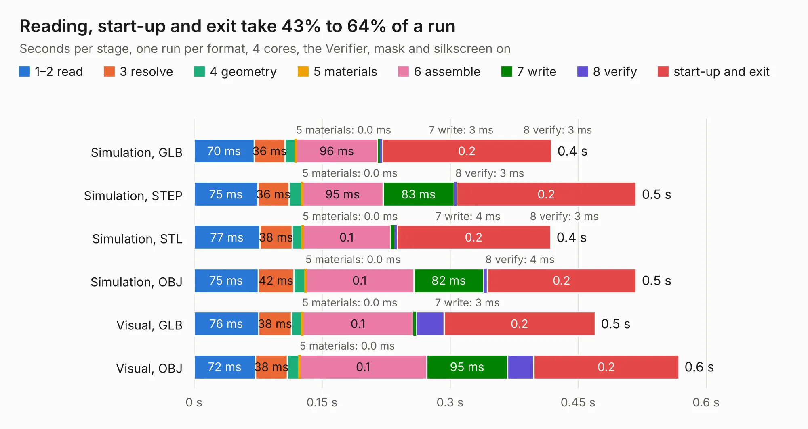

# 2894. pref-side-panel-ports

Board 2,894 of the 3,124 of [Corpus Testing](../Corpus-Testing.md), on [Corpus Page 27](../CorpusTestingPages/Corpus-Testing-27.md#2894-pref-side-panel-ports).

| Mode and format | 1–2 read | 3 resolve | 4 geometry | 5 materials | 6 assemble | 7 write | 8 verify | start-up and exit | Total |
|---|---:|---:|---:|---:|---:|---:|---:|---:|---:|
| Simulation, GLB | 70&nbsp;ms | 36&nbsp;ms | 13&nbsp;ms | 0.0&nbsp;ms | 96&nbsp;ms | 3&nbsp;ms | 3&nbsp;ms | 0.2 | 0.4 |
| Simulation, STEP | 75&nbsp;ms | 36&nbsp;ms | 16&nbsp;ms | 0.0&nbsp;ms | 95&nbsp;ms | 83&nbsp;ms | 3&nbsp;ms | 0.2 | 0.5 |
| Simulation, STL | 77&nbsp;ms | 38&nbsp;ms | 12&nbsp;ms | 0.0&nbsp;ms | 0.1 | 4&nbsp;ms | 3&nbsp;ms | 0.2 | 0.4 |
| Simulation, OBJ | 75&nbsp;ms | 42&nbsp;ms | 13&nbsp;ms | 0.0&nbsp;ms | 0.1 | 82&nbsp;ms | 4&nbsp;ms | 0.2 | 0.5 |
| Visual, GLB | 76&nbsp;ms | 38&nbsp;ms | 13&nbsp;ms | 0.0&nbsp;ms | 0.1 | 3&nbsp;ms | 32&nbsp;ms | 0.2 | 0.5 |
| Visual, OBJ | 72&nbsp;ms | 38&nbsp;ms | 14&nbsp;ms | 0.0&nbsp;ms | 0.1 | 95&nbsp;ms | 31&nbsp;ms | 0.2 | 0.6 |

<table align="center"><tr><td valign="top">

| Board | Repo: [torlye/pocket-reform](https://github.com/torlye/pocket-reform) Board: `pref-side-panel-ports.kicad_pcb` |
|---|---|
| Folder | case-plate-pcbs |
| Complexity | 17&nbsp;/&nbsp;1000 (size&nbsp;17, features&nbsp;0) |
| Tested | 9th November 2026 |
| Copper&nbsp;layers | 2 |
| File&nbsp;format | KiCad 6 (20211014) |
| Parts,&nbsp;tracks,&nbsp;vias | 0, 0, 0 |
| Triangles,&nbsp;simulation | 14,848 in 4 parts |
| Note | panel, no components |
| Verifier | PASS in all six runs |

</td><td valign="top">

<table>
<tr><th>File type</th><th>File size</th><th>Peak memory used</th></tr>
<tr><th colspan="3" align="left">Simulation</th></tr>
<tr><td>GLB</td><td align="right">426&nbsp;kB</td><td align="right">61&nbsp;MB</td></tr>
<tr><td>STEP</td><td align="right">2.7&nbsp;MB</td><td align="right">64&nbsp;MB</td></tr>
<tr><td>STL</td><td align="right">743&nbsp;kB</td><td align="right">62&nbsp;MB</td></tr>
<tr><td>OBJ</td><td align="right">1.5&nbsp;MB</td><td align="right">65&nbsp;MB</td></tr>
<tr><th colspan="3" align="left">Visual</th></tr>
<tr><td>GLB</td><td align="right">537&nbsp;kB</td><td align="right">86&nbsp;MB</td></tr>
<tr><td>OBJ</td><td align="right">1.4&nbsp;MB</td><td align="right">90&nbsp;MB</td></tr>
</table>

</td></tr></table>

| Previous | Next |
|:---|---:|
| [2893. pref-side-panel-ports-d8](b2893b_pocket-reform_pref-side-panel-ports-d8.md) | [2895. pocket-reform-charger](b2895b_pocket-reform_pocket-reform-charger.md) |
