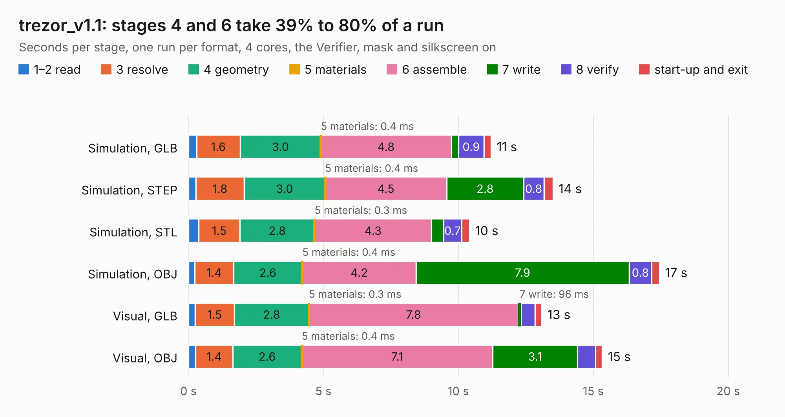

# 2895. trezor_v1.1

Board 2,895 of the 3,100 of [Corpus Testing](../Corpus-Testing.md), on [Corpus Page 27](../CorpusTestingPages/Corpus-Testing-27.md#2895-trezor_v11).

| Mode and format | 1–2 read | 3 resolve | 4 geometry | 5 materials | 6 assemble | 7 write | 8 verify | start-up and exit | Total |
|---|---:|---:|---:|---:|---:|---:|---:|---:|---:|
| Simulation, GLB | 0.3 | 1.6 | 3.0 | 0.4&nbsp;ms | 4.8 | 0.3 | 0.9 | 0.3 | 11.2 |
| Simulation, STEP | 0.3 | 1.8 | 3.0 | 0.4&nbsp;ms | 4.5 | 2.8 | 0.8 | 0.3 | 13.5 |
| Simulation, STL | 0.4 | 1.5 | 2.8 | 0.3&nbsp;ms | 4.3 | 0.4 | 0.7 | 0.3 | 10.4 |
| Simulation, OBJ | 0.2 | 1.4 | 2.6 | 0.4&nbsp;ms | 4.2 | 7.9 | 0.8 | 0.3 | 17.4 |
| Visual, GLB | 0.2 | 1.5 | 2.8 | 0.3&nbsp;ms | 7.8 | 96&nbsp;ms | 0.5 | 0.3 | 13.1 |
| Visual, OBJ | 0.3 | 1.4 | 2.6 | 0.4&nbsp;ms | 7.1 | 3.1 | 0.7 | 0.3 | 15.3 |

<table align="center"><tr><td valign="top">

| Board | Repo: [trezor/trezor-hardware](https://github.com/trezor/trezor-hardware) Board: `trezor_v1.1.kicad_pcb` |
|---|---|
| Folder | electronics / trezor_one / kicad |
| Complexity | 301&nbsp;/&nbsp;1000 (size&nbsp;256, features&nbsp;45) |
| KESE&nbsp;features | through vias, rounded, trapezoid or chamfered pads, filled zones |
| Tested | 9th November 2026 |
| Copper&nbsp;layers | 16 |
| File&nbsp;format | KiCad 5 (20171130) |
| Parts,&nbsp;tracks,&nbsp;vias | 37, 545, 89 |
| Triangles,&nbsp;simulation | 1,305,058 in 88 parts |
| Verifier | PASS in all six runs |

</td><td valign="top">

<table>
<tr><th>File type</th><th>File size</th><th>Peak memory used</th></tr>
<tr><th colspan="3" align="left">Simulation</th></tr>
<tr><td>GLB</td><td align="right">39&nbsp;MB</td><td align="right">480&nbsp;MB</td></tr>
<tr><td>STEP</td><td align="right">99&nbsp;MB</td><td align="right">563&nbsp;MB</td></tr>
<tr><td>STL</td><td align="right">65&nbsp;MB</td><td align="right">470&nbsp;MB</td></tr>
<tr><td>OBJ</td><td align="right">134&nbsp;MB</td><td align="right">854&nbsp;MB</td></tr>
<tr><th colspan="3" align="left">Visual</th></tr>
<tr><td>GLB</td><td align="right">17&nbsp;MB</td><td align="right">446&nbsp;MB</td></tr>
<tr><td>OBJ</td><td align="right">51&nbsp;MB</td><td align="right">439&nbsp;MB</td></tr>
</table>

</td></tr></table>

| Previous | Next |
|:---|---:|
| [2894. CYM1A113](b2894b_trezor-hardware_CYM1A113.md) | [2896. iMX6 Demo Board](b2896b_imx6-demo-board_iMX6-Demo-Board.md) |
