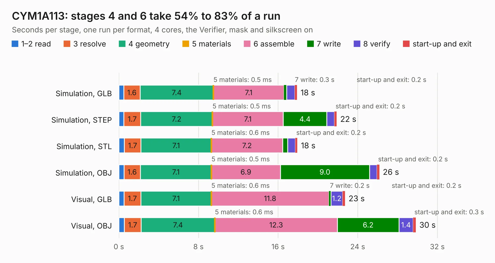

# 2897. CYM1A113

Board 2,897 of the 3,103 of [Corpus Testing](../Corpus-Testing.md), on [Corpus Page 27](../CorpusTestingPages/Corpus-Testing-27.md#2897-cym1a113).

| Mode and format | 1–2 read | 3 resolve | 4 geometry | 5 materials | 6 assemble | 7 write | 8 verify | start-up and exit | Total |
|---|---:|---:|---:|---:|---:|---:|---:|---:|---:|
| Simulation, GLB | 0.5 | 1.6 | 7.4 | 0.5&nbsp;ms | 7.1 | 0.3 | 0.8 | 0.2 | 17.9 |
| Simulation, STEP | 0.5 | 1.7 | 7.2 | 0.5&nbsp;ms | 7.1 | 4.4 | 0.8 | 0.2 | 21.9 |
| Simulation, STL | 0.6 | 1.7 | 7.1 | 0.6&nbsp;ms | 7.2 | 0.5 | 0.8 | 0.2 | 17.9 |
| Simulation, OBJ | 0.5 | 1.6 | 7.1 | 0.5&nbsp;ms | 6.9 | 9.0 | 0.8 | 0.2 | 26.2 |
| Visual, GLB | 0.5 | 1.7 | 7.1 | 0.6&nbsp;ms | 11.8 | 0.2 | 1.2 | 0.2 | 22.7 |
| Visual, OBJ | 0.5 | 1.7 | 7.4 | 0.6&nbsp;ms | 12.3 | 6.2 | 1.4 | 0.3 | 29.8 |

<table align="center"><tr><td valign="top">

| Board | Repo: [trezor/trezor-hardware](https://github.com/trezor/trezor-hardware) Board: `CYM1A113.kicad_pcb` |
|---|---|
| Folder | electronics / trezor_model_t / kicad |
| Complexity | 339&nbsp;/&nbsp;1000 (size&nbsp;244, features&nbsp;95) |
| KESE&nbsp;features | through vias, microvias, rounded, trapezoid or chamfered pads, filled zones, curved board outline |
| Tested | 10th November 2026 |
| Copper&nbsp;layers | 4 |
| File&nbsp;format | KiCad 5 (20171130) |
| Parts,&nbsp;tracks,&nbsp;vias | 105, 971, 177 |
| Triangles,&nbsp;simulation | 1,570,744 in 133 parts |
| Verifier | PASS in all six runs |

</td><td valign="top">

<table>
<tr><th>File type</th><th>File size</th><th>Peak memory used</th></tr>
<tr><th colspan="3" align="left">Simulation</th></tr>
<tr><td>GLB</td><td align="right">55&nbsp;MB</td><td align="right">588&nbsp;MB</td></tr>
<tr><td>STEP</td><td align="right">230&nbsp;MB</td><td align="right">743&nbsp;MB</td></tr>
<tr><td>STL</td><td align="right">79&nbsp;MB</td><td align="right">601&nbsp;MB</td></tr>
<tr><td>OBJ</td><td align="right">164&nbsp;MB</td><td align="right">1.1&nbsp;GB</td></tr>
<tr><th colspan="3" align="left">Visual</th></tr>
<tr><td>GLB</td><td align="right">34&nbsp;MB</td><td align="right">754&nbsp;MB</td></tr>
<tr><td>OBJ</td><td align="right">103&nbsp;MB</td><td align="right">818&nbsp;MB</td></tr>
</table>

</td></tr></table>

| Previous | Next |
|:---|---:|
| [2896. SystemBoardSMT](b2896b_retroverse_SystemBoardSMT.md) | [2898. trezor_v1.1](b2898b_trezor-hardware_trezor-v1-1.md) |
