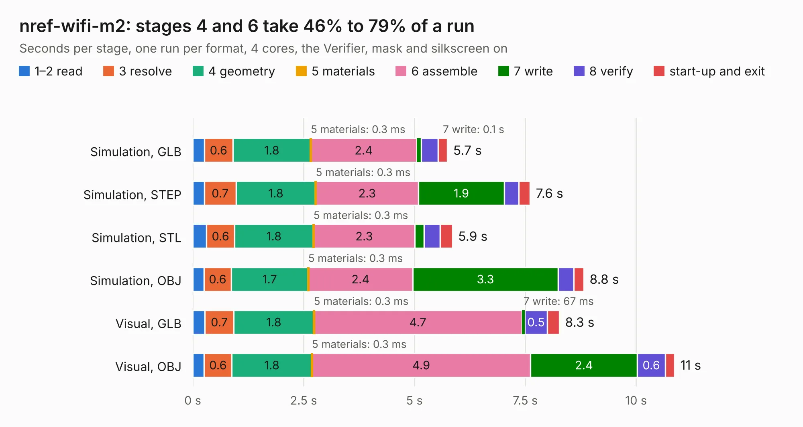

# 2899. nref-wifi-m2

Board 2,899 of the 3,124 of [Corpus Testing](../Corpus-Testing.md), on [Corpus Page 27](../CorpusTestingPages/Corpus-Testing-27.md#2899-nref-wifi-m2).

| Mode and format | 1–2 read | 3 resolve | 4 geometry | 5 materials | 6 assemble | 7 write | 8 verify | start-up and exit | Total |
|---|---:|---:|---:|---:|---:|---:|---:|---:|---:|
| Simulation, GLB | 0.3 | 0.6 | 1.8 | 0.3&nbsp;ms | 2.4 | 0.1 | 0.4 | 0.2 | 5.7 |
| Simulation, STEP | 0.3 | 0.7 | 1.8 | 0.3&nbsp;ms | 2.3 | 1.9 | 0.3 | 0.3 | 7.6 |
| Simulation, STL | 0.3 | 0.6 | 1.8 | 0.3&nbsp;ms | 2.3 | 0.2 | 0.4 | 0.3 | 5.9 |
| Simulation, OBJ | 0.3 | 0.6 | 1.7 | 0.3&nbsp;ms | 2.4 | 3.3 | 0.4 | 0.2 | 8.8 |
| Visual, GLB | 0.3 | 0.7 | 1.8 | 0.3&nbsp;ms | 4.7 | 67&nbsp;ms | 0.5 | 0.3 | 8.3 |
| Visual, OBJ | 0.3 | 0.6 | 1.8 | 0.3&nbsp;ms | 4.9 | 2.4 | 0.6 | 0.2 | 10.9 |

<table align="center"><tr><td valign="top">

| Board | Repo: [torlye/pocket-reform](https://github.com/torlye/pocket-reform) Board: `nref-wifi-m2.kicad_pcb` |
|---|---|
| Folder | pocket-reform-wifi |
| Complexity | 279&nbsp;/&nbsp;1000 (size&nbsp;179, features&nbsp;100) |
| KESE&nbsp;features | through vias, custom pads, rounded, trapezoid or chamfered pads, filled zones, copper drawings, stack-up, dielectric εr and tanδ |
| Tested | 9th November 2026 |
| Copper&nbsp;layers | 4 |
| File&nbsp;format | KiCad 9 (20241229) |
| Parts,&nbsp;tracks,&nbsp;vias | 28, 394, 129 |
| Triangles,&nbsp;simulation | 567,428 in 76 parts |
| Verifier | PASS in all six runs |

</td><td valign="top">

<table>
<tr><th>File type</th><th>File size</th><th>Peak memory used</th></tr>
<tr><th colspan="3" align="left">Simulation</th></tr>
<tr><td>GLB</td><td align="right">20&nbsp;MB</td><td align="right">318&nbsp;MB</td></tr>
<tr><td>STEP</td><td align="right">79&nbsp;MB</td><td align="right">382&nbsp;MB</td></tr>
<tr><td>STL</td><td align="right">28&nbsp;MB</td><td align="right">315&nbsp;MB</td></tr>
<tr><td>OBJ</td><td align="right">57&nbsp;MB</td><td align="right">439&nbsp;MB</td></tr>
<tr><th colspan="3" align="left">Visual</th></tr>
<tr><td>GLB</td><td align="right">14&nbsp;MB</td><td align="right">401&nbsp;MB</td></tr>
<tr><td>OBJ</td><td align="right">42&nbsp;MB</td><td align="right">395&nbsp;MB</td></tr>
</table>

</td></tr></table>

| Previous | Next |
|:---|---:|
| [2898. pocket-reform-motherboard](b2898b_pocket-reform_pocket-reform-motherboard.md) | [2900. pocket-reform-wifi](b2900b_pocket-reform_pocket-reform-wifi.md) |
