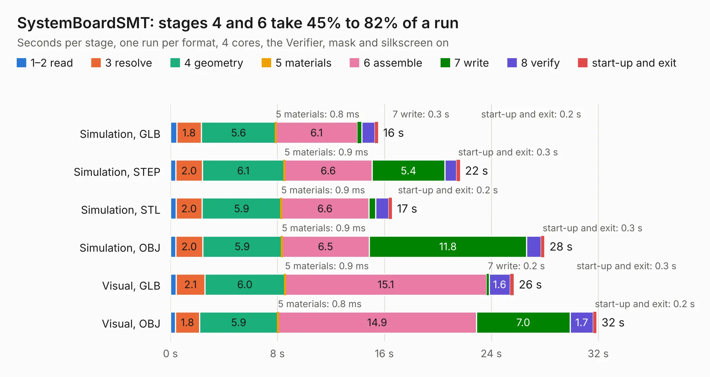

# 2899. SystemBoardSMT

Board 2,899 of the 3,106 of [Corpus Testing](../Corpus-Testing.md), on [Corpus Page 27](../CorpusTestingPages/Corpus-Testing-27.md#2899-systemboardsmt).

| Mode and format | 1–2 read | 3 resolve | 4 geometry | 5 materials | 6 assemble | 7 write | 8 verify | start-up and exit | Total |
|---|---:|---:|---:|---:|---:|---:|---:|---:|---:|
| Simulation, GLB | 0.5 | 1.8 | 5.6 | 0.8&nbsp;ms | 6.1 | 0.3 | 1.0 | 0.2 | 15.5 |
| Simulation, STEP | 0.4 | 2.0 | 6.1 | 0.9&nbsp;ms | 6.6 | 5.4 | 0.9 | 0.3 | 21.7 |
| Simulation, STL | 0.4 | 2.0 | 5.9 | 0.9&nbsp;ms | 6.6 | 0.5 | 1.0 | 0.2 | 16.6 |
| Simulation, OBJ | 0.4 | 2.0 | 5.9 | 0.9&nbsp;ms | 6.5 | 11.8 | 1.1 | 0.3 | 28.0 |
| Visual, GLB | 0.4 | 2.1 | 6.0 | 0.9&nbsp;ms | 15.1 | 0.2 | 1.6 | 0.3 | 25.7 |
| Visual, OBJ | 0.4 | 1.8 | 5.9 | 0.8&nbsp;ms | 14.9 | 7.0 | 1.7 | 0.2 | 31.9 |

<table align="center"><tr><td valign="top">

| Board | Repo: [transistorfet/retroverse](https://github.com/transistorfet/retroverse) Board: `SystemBoardSMT.kicad_pcb` |
|---|---|
| Folder | components / systemboard / hardware / SystemBoardSMT |
| Complexity | 332&nbsp;/&nbsp;1000 (size&nbsp;232, features&nbsp;100) |
| KESE&nbsp;features | through vias, custom pads, rounded, trapezoid or chamfered pads, filled zones, copper drawings, stack-up, dielectric εr and tanδ |
| Tested | 9th November 2026 |
| Copper&nbsp;layers | 4 |
| File&nbsp;format | KiCad 8 (20240108) |
| Parts,&nbsp;tracks,&nbsp;vias | 32, 896, 220 |
| Triangles,&nbsp;simulation | 2,137,672 in 128 parts |
| Verifier | PASS in all six runs |

</td><td valign="top">

<table>
<tr><th>File type</th><th>File size</th><th>Peak memory used</th></tr>
<tr><th colspan="3" align="left">Simulation</th></tr>
<tr><td>GLB</td><td align="right">72&nbsp;MB</td><td align="right">676&nbsp;MB</td></tr>
<tr><td>STEP</td><td align="right">255&nbsp;MB</td><td align="right">839&nbsp;MB</td></tr>
<tr><td>STL</td><td align="right">107&nbsp;MB</td><td align="right">687&nbsp;MB</td></tr>
<tr><td>OBJ</td><td align="right">221&nbsp;MB</td><td align="right">1.4&nbsp;GB</td></tr>
<tr><th colspan="3" align="left">Visual</th></tr>
<tr><td>GLB</td><td align="right">40&nbsp;MB</td><td align="right">805&nbsp;MB</td></tr>
<tr><td>OBJ</td><td align="right">124&nbsp;MB</td><td align="right">978&nbsp;MB</td></tr>
</table>

</td></tr></table>

| Previous | Next |
|:---|---:|
| [2898. SystemBoardPLCC](b2898b_retroverse_SystemBoardPLCC.md) | [2900. CYM1A113](b2900b_trezor-hardware_CYM1A113.md) |
