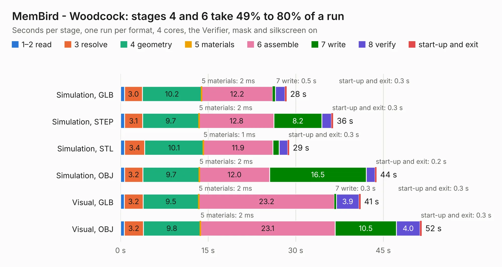

# 2900. MemBird - Woodcock

Board 2,900 of the 3,109 of [Corpus Testing](../Corpus-Testing.md), on [Corpus Page 27](../CorpusTestingPages/Corpus-Testing-27.md#2900-membird---woodcock).

| Mode and format | 1–2 read | 3 resolve | 4 geometry | 5 materials | 6 assemble | 7 write | 8 verify | start-up and exit | Total |
|---|---:|---:|---:|---:|---:|---:|---:|---:|---:|
| Simulation, GLB | 0.7 | 3.0 | 10.2 | 2&nbsp;ms | 12.2 | 0.5 | 1.6 | 0.3 | 28.4 |
| Simulation, STEP | 0.7 | 3.1 | 9.7 | 2&nbsp;ms | 12.8 | 8.2 | 1.6 | 0.3 | 36.4 |
| Simulation, STL | 0.7 | 3.4 | 10.1 | 1&nbsp;ms | 11.9 | 1.1 | 1.5 | 0.3 | 28.9 |
| Simulation, OBJ | 0.7 | 3.2 | 9.7 | 2&nbsp;ms | 12.0 | 16.5 | 1.5 | 0.2 | 43.9 |
| Visual, GLB | 0.6 | 3.2 | 9.5 | 2&nbsp;ms | 23.2 | 0.3 | 3.9 | 0.3 | 41.1 |
| Visual, OBJ | 0.7 | 3.2 | 9.8 | 2&nbsp;ms | 23.1 | 10.5 | 4.0 | 0.3 | 51.6 |

<table align="center"><tr><td valign="top">

| Board | Repo: [transistorfet/retroverse](https://github.com/transistorfet/retroverse) Board: `MemBird - Woodcock.kicad_pcb` |
|---|---|
| Folder | components / membird / hardware / MemBird - Woodcock |
| Complexity | 355&nbsp;/&nbsp;1000 (size&nbsp;255, features&nbsp;100) |
| KESE&nbsp;features | through vias, custom pads, rounded, trapezoid or chamfered pads, filled zones, copper drawings, stack-up, dielectric εr and tanδ |
| Tested | 9th November 2026 |
| Copper&nbsp;layers | 4 |
| File&nbsp;format | KiCad 8 (20240108) |
| Parts,&nbsp;tracks,&nbsp;vias | 55, 1,616, 454 |
| Triangles,&nbsp;simulation | 3,422,492 in 195 parts |
| Verifier | PASS in all six runs |

</td><td valign="top">

<table>
<tr><th>File type</th><th>File size</th><th>Peak memory used</th></tr>
<tr><th colspan="3" align="left">Simulation</th></tr>
<tr><td>GLB</td><td align="right">116&nbsp;MB</td><td align="right">1.0&nbsp;GB</td></tr>
<tr><td>STEP</td><td align="right">439&nbsp;MB</td><td align="right">1.3&nbsp;GB</td></tr>
<tr><td>STL</td><td align="right">171&nbsp;MB</td><td align="right">1.1&nbsp;GB</td></tr>
<tr><td>OBJ</td><td align="right">360&nbsp;MB</td><td align="right">2.2&nbsp;GB</td></tr>
<tr><th colspan="3" align="left">Visual</th></tr>
<tr><td>GLB</td><td align="right">73&nbsp;MB</td><td align="right">1.3&nbsp;GB</td></tr>
<tr><td>OBJ</td><td align="right">232&nbsp;MB</td><td align="right">1.5&nbsp;GB</td></tr>
</table>

</td></tr></table>

| Previous | Next |
|:---|---:|
| [2899. k30p-VME](b2899b_retroverse_k30p-VME.md) | [2901. SystemBoardPLCC](b2901b_retroverse_SystemBoardPLCC.md) |
