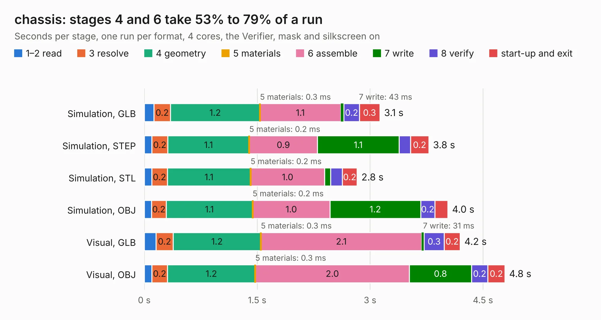

# 2901. chassis

Board 2,901 of the 3,121 of [Corpus Testing](../Corpus-Testing.md), on [Corpus Page 27](../CorpusTestingPages/Corpus-Testing-27.md#2901-chassis).

| Mode and format | 1–2 read | 3 resolve | 4 geometry | 5 materials | 6 assemble | 7 write | 8 verify | start-up and exit | Total |
|---|---:|---:|---:|---:|---:|---:|---:|---:|---:|
| Simulation, GLB | 0.1 | 0.2 | 1.2 | 0.3&nbsp;ms | 1.1 | 43&nbsp;ms | 0.2 | 0.3 | 3.1 |
| Simulation, STEP | 99&nbsp;ms | 0.2 | 1.1 | 0.2&nbsp;ms | 0.9 | 1.1 | 0.2 | 0.2 | 3.8 |
| Simulation, STL | 98&nbsp;ms | 0.2 | 1.1 | 0.2&nbsp;ms | 1.0 | 80&nbsp;ms | 0.2 | 0.2 | 2.8 |
| Simulation, OBJ | 96&nbsp;ms | 0.2 | 1.1 | 0.2&nbsp;ms | 1.0 | 1.2 | 0.2 | 0.2 | 4.0 |
| Visual, GLB | 0.2 | 0.2 | 1.2 | 0.3&nbsp;ms | 2.1 | 31&nbsp;ms | 0.3 | 0.2 | 4.2 |
| Visual, OBJ | 0.1 | 0.2 | 1.2 | 0.3&nbsp;ms | 2.0 | 0.8 | 0.2 | 0.2 | 4.8 |

<table align="center"><tr><td valign="top">

| Board | Repo: [ToyotaInfoTech/RAMN](https://github.com/ToyotaInfoTech/RAMN) Board: `chassis.kicad_pcb` |
|---|---|
| Folder | hardware / V1_revB / 2_chassis |
| Complexity | 200&nbsp;/&nbsp;1000 (size&nbsp;125, features&nbsp;75) |
| KESE&nbsp;features | through vias, slotted holes, rounded, trapezoid or chamfered pads, filled zones, copper text, curved board outline |
| Tested | 9th November 2026 |
| Copper&nbsp;layers | 2 |
| File&nbsp;format | KiCad 5 (20171130) |
| Parts,&nbsp;tracks,&nbsp;vias | 13, 94, 12 |
| Triangles,&nbsp;simulation | 320,112 in 41 parts |
| Verifier | PASS in all six runs |

</td><td valign="top">

<table>
<tr><th>File type</th><th>File size</th><th>Peak memory used</th></tr>
<tr><th colspan="3" align="left">Simulation</th></tr>
<tr><td>GLB</td><td align="right">11&nbsp;MB</td><td align="right">259&nbsp;MB</td></tr>
<tr><td>STEP</td><td align="right">45&nbsp;MB</td><td align="right">270&nbsp;MB</td></tr>
<tr><td>STL</td><td align="right">16&nbsp;MB</td><td align="right">268&nbsp;MB</td></tr>
<tr><td>OBJ</td><td align="right">32&nbsp;MB</td><td align="right">255&nbsp;MB</td></tr>
<tr><th colspan="3" align="left">Visual</th></tr>
<tr><td>GLB</td><td align="right">7.1&nbsp;MB</td><td align="right">250&nbsp;MB</td></tr>
<tr><td>OBJ</td><td align="right">21&nbsp;MB</td><td align="right">246&nbsp;MB</td></tr>
</table>

</td></tr></table>

| Previous | Next |
|:---|---:|
| [2900. screens](b2900b_RAMN_screens.md) | [2902. powertrain](b2902b_RAMN_powertrain.md) |
