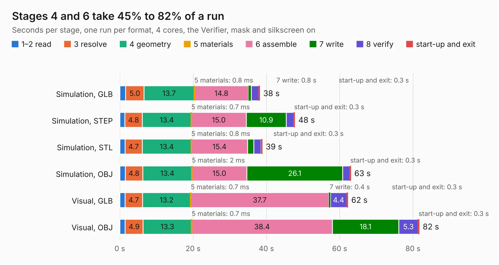

# 2902. pocket-reform-keyboard-kailh-ortho

Board 2,902 of the 3,129 of [Corpus Testing](../Corpus-Testing.md), on [Corpus Page 27](../CorpusTestingPages/Corpus-Testing-27.md#2902-pocket-reform-keyboard-kailh-ortho).

| Mode and format | 1–2 read | 3 resolve | 4 geometry | 5 materials | 6 assemble | 7 write | 8 verify | start-up and exit | Total |
|---|---:|---:|---:|---:|---:|---:|---:|---:|---:|
| Simulation, GLB | 1.6 | 5.0 | 13.7 | 0.8&nbsp;ms | 14.8 | 0.8 | 2.0 | 0.3 | 38.2 |
| Simulation, STEP | 1.4 | 4.8 | 13.4 | 0.7&nbsp;ms | 15.0 | 10.9 | 2.0 | 0.3 | 47.7 |
| Simulation, STL | 1.4 | 4.7 | 13.4 | 0.8&nbsp;ms | 15.4 | 1.7 | 2.0 | 0.3 | 38.9 |
| Simulation, OBJ | 1.5 | 4.8 | 13.4 | 2&nbsp;ms | 15.0 | 26.1 | 2.0 | 0.3 | 63.0 |
| Visual, GLB | 1.4 | 4.7 | 13.2 | 0.7&nbsp;ms | 37.7 | 0.4 | 4.4 | 0.3 | 62.2 |
| Visual, OBJ | 1.5 | 4.9 | 13.3 | 0.7&nbsp;ms | 38.4 | 18.1 | 5.3 | 0.3 | 81.7 |

<table align="center"><tr><td valign="top">

| Board | Repo: [torlye/pocket-reform](https://github.com/torlye/pocket-reform) Board: `pocket-reform-keyboard-kailh-ortho.kicad_pcb` |
|---|---|
| Folder | pocket-reform-keyboard-kailh-ortho |
| Complexity | 360&nbsp;/&nbsp;1000 (size&nbsp;270, features&nbsp;90) |
| KESE&nbsp;features | through vias, rounded, trapezoid or chamfered pads, filled zones, curved board outline, stack-up, dielectric εr and tanδ, mask and silkscreen colours |
| Tested | 9th November 2026 |
| Copper&nbsp;layers | 4 |
| File&nbsp;format | KiCad 9 (20241229) |
| Parts,&nbsp;tracks,&nbsp;vias | 297, 2,155, 530 |
| Triangles,&nbsp;simulation | 4,621,726 in 199 parts |
| Verifier | PASS in all six runs |

</td><td valign="top">

<table>
<tr><th>File type</th><th>File size</th><th>Peak memory used</th></tr>
<tr><th colspan="3" align="left">Simulation</th></tr>
<tr><td>GLB</td><td align="right">155&nbsp;MB</td><td align="right">1.6&nbsp;GB</td></tr>
<tr><td>STEP</td><td align="right">575&nbsp;MB</td><td align="right">1.8&nbsp;GB</td></tr>
<tr><td>STL</td><td align="right">231&nbsp;MB</td><td align="right">1.6&nbsp;GB</td></tr>
<tr><td>OBJ</td><td align="right">489&nbsp;MB</td><td align="right">2.9&nbsp;GB</td></tr>
<tr><th colspan="3" align="left">Visual</th></tr>
<tr><td>GLB</td><td align="right">104&nbsp;MB</td><td align="right">1.7&nbsp;GB</td></tr>
<tr><td>OBJ</td><td align="right">330&nbsp;MB</td><td align="right">2.1&nbsp;GB</td></tr>
</table>

</td></tr></table>

| Previous | Next |
|:---|---:|
| [2901. pocket-reform-headphones](b2901b_pocket-reform_pocket-reform-headphones.md) | [2903. pocket-reform-motherboard](b2903b_pocket-reform_pocket-reform-motherboard.md) |
